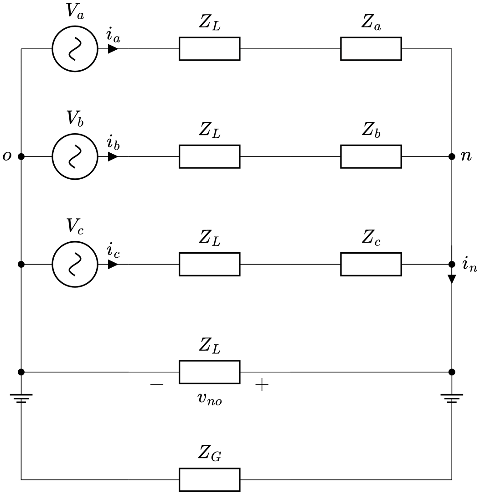
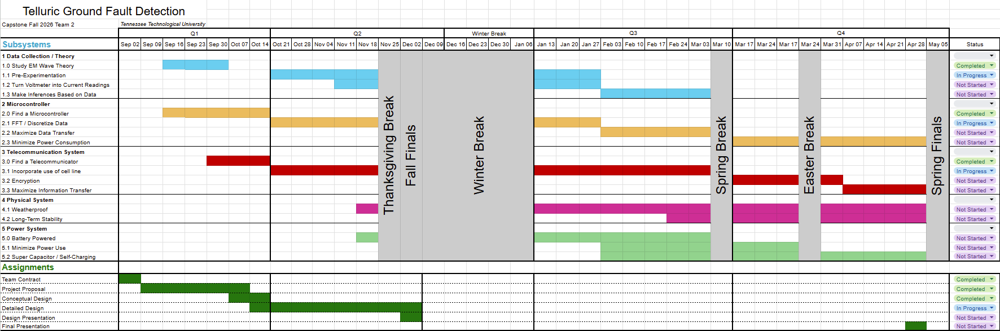
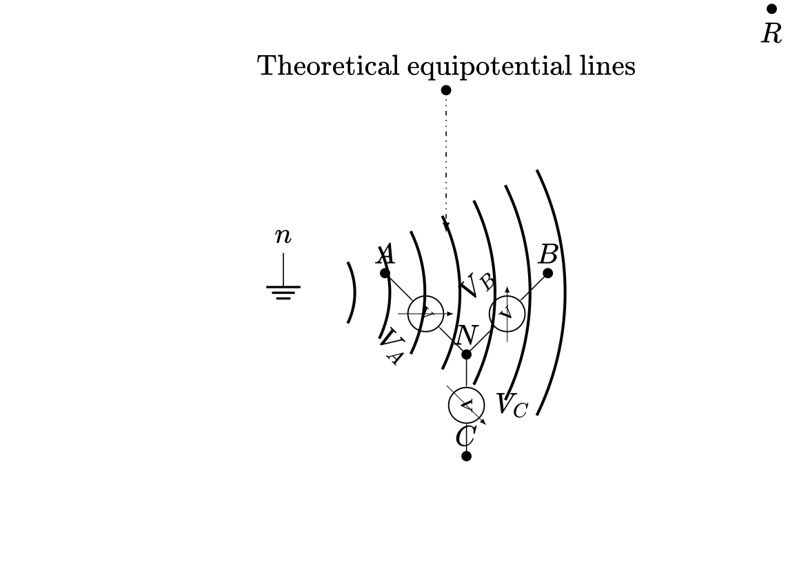
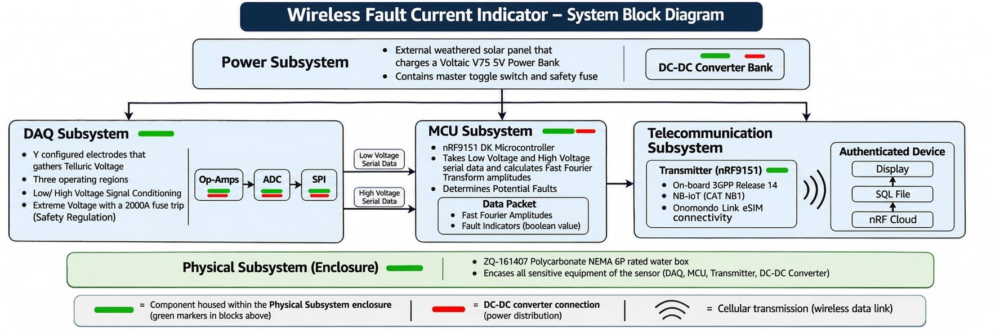

# Seal Team 2 Project Proposal: Telluric Current Ground Fault Indicator (TC-GFI)
## Introduction
Across the globe, electrical power is supplied from source to recipient via power lines. These lines carry single and three phase power while often carrying telecommunication signals below on a separate section. If these power lines fail, it can result in loss of magnitude of power (brownout) or loss of power altogether (blackout). This can happen from a transformer blowing up, power lines grounding through trees, or power lines falling either into other lines or onto the ground. Any instance which results in unprompted behavior is called a fault. Currently, the main method in locating a fault is by mobilizing service workers and garnering information from customer calls \[1\]. This, as one can imagine, is quite costly both monetarily and temporally.

In light of this challenge, **Seal Team 2** shall develop an affordable, replicable Telluric Current Ground Fault Indicator (TC-GFI) prototype which will relay information pertaining to the induced telluric currents. This information shall be transmitted wirelessly to the company supplying and managing the area's power. Such information will be primarily contained to ground fault detection for the scope of this prototype. This sensor will take information on the voltage and telluric current density surrounding the power pole, filter the data so that only select harmonics of standard US power are considered, then process the data and signal a fault if necessary. This prototype will include electrodes, a data acquisition unit (DAQ), a microcontroller unit (MCU), a telecommunication module, and a local power unit. The entire system will be designed to operate effectively outdoors in all outdoor conditions at the site, as per the customers specifications (*See Specifications and Constraints*). 

### Scope

In this proposal, **Seal Team 2** will provide a comprehensive view of the problem and solution strategy for the design of the TC-GFI. The *Formulating the Problem* section shall fence in the design aspects by clarifying who the stakeholders are, providing a background of relevant theory to the design, enumerating the specifications and constraints imposed on the design by the stakeholders and governing bodies, and finally declaring a fully formulated problem statement for the design of the TC-GFI. The document shall then provide a survey of existing solutions for current fault indication techniques. The document will then define and clarify **Seal Team 2's** measures of success by explaining the experiments and methodologies that will be used to meet the systems specifications and constraints. The resources section will propose an estimated budget for the system, provide a division of labor for the members of **Seal Team 2**, and provide a detailed timeline for the design of the TC-GFI. The document will conclude by enumerating the specific and broader implications for the design of the TC-GFI.

## Formulating the Problem
### Background
#### Telluric Current Theory

Almost all current methods in distributing power involve transformers and power lines. The smallest of such power lines will hold two lines (a phase and a neutral) or four lines (3 phases and a neutral). Both examples are subsets of three phase power distribution lines which rely primarily on the balancing of all three phases. If power lines fall either by heavy winds, falling trees, or the pole itself falling, two major faults can occur: line-to-line faults or line-to-ground faults. Line-to-line (LL) faults cause an imbalance in the three phases by shorting two of them together. Line-to-ground (LG) faults cause an imbalance by grounding one of the phases. Other specific kinds of faults can be three line (LLL) faults two lines to ground (LLG) and others, but all of these fall in either category of LL or LG or both and will henceforth be referred to by their respective category.

First, consider the LL fault. This occurs when two or three phases have been faulted together. For ease of thought, a fault of lines A and B will be considered. Suppose a line A is faulted in a way which connects it to line B. This will result in the path: 

Source $\rightarrow$ Transformer Winding A $\rightarrow$ A $\rightarrow$ B $\rightarrow$ Transformer Winding B $\rightarrow$ Source

Where the path through B and B's transformer winding is traveling in the reverse direction. This causes the line voltage $V_{AB}$ to be very small near the fault but remain very large at the transformer. Such a voltage difference, with the low impedance of wire, will result in immense current surges. Say lines A and B are components of a $480\,\text{V}$ 3-phase power system (US Standard) and an LL fault of lines A and B occurs. $V_{AB}$ nearest the transformer will be $\approx480\text{ V}$ while near the fault almost $0$. If the combined impedance of the fault and power lines is $0.05\text{ m}\Omega$, then the resulting current would be $\frac{480}{0.05}=9600\text{ A}$. Such an amperage is far too high to be maintainable by a system which causes arcing, fires, mechanical torque, electromagnetic disruptions, etc.

Next, consider the LG fault. This occurs when one or more wires are faulted to ground. This results in the path: 

Source $\rightarrow$ A $\rightarrow$ Fault $\rightarrow$ Ground $\rightarrow$ Source Neutral $\rightarrow$ Source 

Notice that the path relies on the source's neutral node or other ground return scheme to create the loop. This means that if line A has an LG fault, lines B and C *will* be affected because their voltages are relative to the neutral line. Their phase to ground voltage can fluctuate due to the relevance to a now faulty ground. Current through B and C are not primarily affected, but line A's current takes a most intriguing path: through the earth.

Diverting briefly to discuss standard operation: all power lines that carry current inject a portion of it into the ground called grid-induced telluric currents (as opposed to naturally- or geomagnetic-induced telluric currents) \[1\]. For the remainder of this proposal, such currents will be referred to simply as telluric currents. These telluric currents are measurable and show the standard harmonics at 60, 180, and 540 Hz \[1\]. Because there is injected current which extends radially from the power pole, there is an electric field created with equipotential lines of (theoretically) concentric circles emanating from the pole. $$\vec{J}=\sigma\vec{E}:\vec{E}=-\nabla V$$ Research shows that this voltage can be measured by use of two electrodes and an amplifier \[1\]. Given the above relationship (where $\sigma$ is the conductivity of the medium) it's understood that the voltage gradient is proportional to the current density (point-form of Ohm's Law) which means that any voltage measured is proportional to current carried by the power lines.

To prove this, the following derivation is provided. First consider that the path through the ground may be represented as a wire with impedance $Z_G$. Apply Kirchhoff's current law at the node $n$: 

$i_a+i_b+i_c+i_n=0$

Solve for the neutral-neutral current for an unbalanced system:

$i_n=-\left(\frac{v_a}{Z_a}+\frac{v_b}{Z_b}+\frac{v_c}{Z_c}\right)$

Apply current divider to find current through the soil: 

$i_G=i_n\frac{Z_L}{Z_L+Z_G}$

Recall the voltage distribution in a medium: 

$V(r)=\frac{\rho I}{2\pi r}$ 

In this instance, the current in the ground is what produces the voltage distribution, so: 

$V_G(r)=\frac{\rho I_G}{2\pi r}$

In measuring a step voltage, $r$ is displaced by a distance $s$ and the voltages are subtracted:

$V_{step}(r)=\frac{\rho I_G}{2\pi}\left(\frac{1}{r}-\frac{1}{r+s}\right)$

Thus, given the model, the step potential will decrease non-linearly with radius but linearly with $I_G$ meaning the data will be a linear scale of the current.

Recall now that in both LL and LG faults there is a large surge of current on the order of at least hundreds of amps. This will cause the
telluric currents to spike, *especially in the case of LG faults*. LG faults, as a result, shall be the primary focus of this prototype but there may be possibility of uncovering a method to diagnose LL faults in tandem.

\"Grid-Induced Telluric Currents for Non-Contact Load Monitoring and Fault Detection\", by Abigail Farris \[1\], exhibits a prototype used momentarily to monitor the telluric currents produced by a substation. This document shows the use of two electrodes used to measure voltage (parallel to the radius of the voltage gradient) which was then amplified into a system and transformed to the frequency domain. The result of the Fast Fourier Transform (FFT) showed remarkable amplitudes in the 60, 180, and 540 Hz frequencies. Farris concluded in speculation that such monitoring may reveal evidence of ground faults and general load monitoring non-invasively.

Given that modern techniques are either invasive (through the use of component load monitoring), expensive (for a similar reason), or slow (by use of call-ins and field technicians searching for the fault), this method may provide a way to accurately pinpoint and relay information to whomever is heading the power distribution. For such a purpose, it would prove advantageous for this sensor to be able to transmit over long ranges and be self sufficient in power.

#### Telecommunication Theory
The following information provides a background of relevant telecommunication theory for the process of designing the TC-GFI. 

In general, a communication system can be described by the following general process: Let $x(t)$ be the raw physical signal from which information is being extracted. In the case of **Seal Team 2**'s TC-GFI, this will be the telluric currents from the substations. $x(t)$ is then processed by a tranducer, which will convert the physical signal into a digital signal $x_2(t)$ that contains the information from $x(t)$. The information is then propagated through a medium, typically air, using some modulation technique, along a carrier wave of the form: $Acos(\omega t + \phi)$. As the modulated wave propagates across the medium, noise is introduced which attenuates and distorts the signal. The receiver takes this noise distorted signal and demodulates it to restore the information from the input signal.

##### Modulation

Modulation refers to the action of altering the properties of the carrier wave to efficiently carry the information ($x_2(t)$). Basic forms of modulation include AM (amplitude modulation) which varies the amplitude of the carrier signal according to $x_2(t)$ and FM (frequency modulation) which varies the frequency of the carrier signal due to $x_2(t)$. The type of modulation used in the system can minimize the effects of the noise through the medium. For digital modulation, the following techniques have been optimized for such minimization:

- ASK (Amplitude Shift Keying): Encodes data by changing the amplitude (strength) of a carrier wave while keeping its frequency constant.

- FSK (Frequency Shift Keying): Encodes data by switching between different carrier frequencies.

- PSK (Phase Shift Keying): Encodes data by changing the phase (timing position within a cycle) of a carrier wave.

- QPSK (Quadrature Phase Shift Keying): A type of PSK that uses four distinct phase states to encode 2 bits per symbol.

- QAM (Quadrature Amplitude Modulation): Encodes data by varying both the amplitude and phase of a carrier wave, allowing multiple bits per symbol.

- Chirp-Based Modulation: Encodes data using chirps—signals whose frequency continuously increases or decreases over time. It can offer robust communication in noisy environments and is used by technologies such as LoRa.

##### Relevant Metrics

When determining the communication system architecture to be used for the Telluric Current Sensor, the following parameters are worth considering.

- *Speed Metrics*
The following metrics are related to the speed of data transmission:
   - *Data rate:* is the speed for which data transfers from transmitter to receiver, measured in bits/s. 
   - *Symbol Rate / Baud Rate* is the number of symbols/characters transferred from transmitter to receiver. (Calculated as: $\text{BaudRate} = \frac{\text{BitRate}}{\text{BitsPerSymbol}}$). 
   - *Latency* is the time delay in milliseconds for data to travel from source to destination.

- *Accessibility Metrics*
The following metrics are related to a modems ability to transmit effectively:
   - *Bandwidth*: Frequency range of the transmitted signal. For cellular transmission, and more generally for public networks, data must be transmitted along specified bands. Thus, a modem that can operate over a large bandwidth is preferrable. 
   - *Throughput*: The amount of real output that is succesfully tranferred to the receiver.

**Seal Team 2** shall use the above metrics and modulation techniques to determine the effectiveness of potential telecommunication hardware and connectivity options for the TC-GFI.

## Microcontroller Background

Signal processing is the act of taking a signal from an apparatus and performing whatever work needed on it by the user, whether it be analysis, conversion, filtering, or other applications. Two well-known examples of signal processing would be analog signal processing and digital signal processsing. Analog signal processing involves electronic circuits to perform the necessary functions to the input signal [SGW]. However, analog signal processing has some key disadvantages, such as sensibility to noise, lower precision, and inflexibility. Digital signal processing has higher upfront costs, but taking analog data, sampling it sufficiently, and digitizing the data allows for greater flexibility and precision with the data [SGGFG]. 

To perform digital signal processing, a microcontroller would be an appropriate choice for this project. A microcontroller -also known as an MCU- is a small computer programmed to specialize in completing in specific tasks. The MCU can take the digitized data and perform any calculations needed for the experimenter to analyze. The information relevant to this project will pertain to finding the amplitudes of voltage readings at specific harmonics of the power grid. Due to this, transforming the data that models the amplitude of the waveform over time to a frequency equivalent is the goal. Since the data is sampled to have a discrete equivalent and digitized afterwards, the Fast Fourier Transform algorithm would suit the purpose described.

The Fast Fourier Transform algorithm is an algorithm that performs the function of a Discrete Fourier Transform at a higher efficiency. A Discrete Fourier Transform takes the samples of the waveform at various poitns of time and converts them to frequencies as a means of expressing the presence of a signal at a particular frequency. The FFT performs this by what is known as a divide-and-conquer algorithm. The algorithm splits the data into even and odd indexes to compute smaller FFTs before combining all the data into one large transformed data set. It repeats this process until it can no longer split into even and odd indexes, and then it completes the process by performing FFTs on all of the base data sets and combining the data sets into larger sizes until the original size is achieved with the transformed data [SGIBM].

#### Power Theory
A field-ready TC-GFI needs a highly adaptable power architecture capable of operating in diverse environments ranging from remote, unassisted terrain to high-voltage substations. In either scenario, powering a sensitive micro board requires balancing continuous baseline consumption with high peak bursts, all while maintaining power quality to prevent electrical noise from interfering with the ground measurements. To address these design challenges, the power subsystem explores multiple flexible architectures ranging from off-grid renewable energy to direct power feeds, governed by strict electrical and safety standards [SS-1]-[SS-5].

##### Power Subsytem Relevant Metrics

- **SR-01 — Output Regulation:** The power distribution board shall provide regulated DC outputs of 3.3 V and 5 V with a voltage regulation tolerance of $\pm 2\%$ under all operating load steps.
- **SR-02 — Power Quality and Ripple:** The power conditioning circuitry shall limit high-frequency switching ripple to less than 10 µV peak-to-peak to prevent noise contamination of the analog acquisition front-end [SS-7].
- **SR-03 — Galvanic Isolation:** The power supply architecture shall maintain a reinforced isolation barrier rated for a minimum of 2 kV between external power inputs and internal instrument grounds [SS-3], [SS-21].
- **SR-04 — Autonomous Operation:** The primary power architecture shall sustain continuous, unattended operation for a minimum of 3 months (90 Days) under normal field load profiles.
- **SR-05 — Transient Response:** The regulation and post-regulation stages shall maintain voltage stability and limit transient sags to less than 5% during sudden microcontroller load steps.
- **SR-06 — Regulatory Compliance:** All power subsystem component placement, wiring methods, and energy storage enclosures shall comply with applicable NEC Articles 250, 690, and 725 requirements [SS-1]. Energy storage shall rely on a battery pack with UL 2056 / UL 1642 certification and a hardware BMS [SS-27], [SS-28].

##### Equations

###### 1. Voltage Regulation and Drop Analysis

${VR} = \left(\frac{V_{\text{no-load}} - V_{\text{full-load}}}{V_{\text{full-load}}} \right) \times 100\%$

Where:
- $V_{\text{no-load}}$ is the output voltage at zero load current.
- $V_{\text{full-load}}$ is the output voltage under maximum active load.

###### 2. Battery State of Charge and Autonomous Runtime 

$T_\text{runtime}=\frac{C_\text{batt}\cdot\text{DoD}\cdot\eta_\text{sys}}{I_\text{avg}}$

Where:
- $C_{\text{batt}}$ is battery capacity.
- $\text{DoD}$ is maximum depth of discharge.
- $\eta_{\text{sys}}$ is power conversion efficiency.
- $I_{\text{avg}}$ is average continuous current (A).

###### 3. Switching Regulator Output Ripple Voltage 

$$V_{\text{ripple}} = \frac{V_{\text{out}} \cdot (1-D)}{8 \cdot L \cdot C_{\text{out}} \cdot f_{\text{sw}}^2}$$

Where:
- $V_{\text{out}}$ is regulated output voltage.
- $D$ is duty cycle ($V_{\text{out}}/V_{\text{in}}$).
- $L$ is inductance (H).
- $C_{\text{out}}$ is output capacitance (F).
- $f_{\text{sw}}$ is switching frequency (Hz).

###### 4. LDO Ripple Attenuation and PSRR

An ultra-low-noise LDO, downstream of the isolated switching converter controls switching-frequency ripple before it reaches the analog front-end:

$$V_{\text{ripple,out}} = V_{\text{ripple,in}} \times 10^{-\text{PSRR (dB)}/20}$$

Where:
- $V_{\text{ripple,in}}$ is peak-to-peak ripple voltage entering the LDO from the switching converter or isolated module (mV).
- $\text{PSRR}$ is the LDO's power supply rejection ratio at the switching frequency.
- $V_{\text{ripple,out}}$ is the resulting ripple on the analog power rail.

###### 5. LC Low-Pass Filter Corner Frequency

A passive LC filter between the isolated DC-DC converter and the LDO can pre-condition the power rail. Its corner frequency is:

$f_c = \frac{1}{2\pi\sqrt{L \cdot C}}$

Where:
- $L$ is filter inductance (H).
- $C$ is filter capacitance (F).

###### 6. LDO Power Dissipation and Thermal Limit

Because regulators dissipate excess voltage as heat, calculate the LDO's power dissipation:

$P_D = (V_{\text{in}} - V_{\text{out}}) \cdot I_{\text{load}}$

The resulting semiconductor junction temperature is:

$T_J = T_A + (P_D \cdot \theta_{JA})$

Where:
- $P_D$ is power dissipation (W).
- $V_{\text{in}}$ and $V_{\text{out}}$ are the LDO input and output voltages.
- $I_{\text{load}}$ is continuous current drawn by the analog section.
- $T_A$ is ambient temperature inside the enclosure.
- $\theta_{JA}$ is the IC package's junction-to-ambient thermal resistance.

#### Physical Subsystem

Many environmental issues must be considered when designing any project, but with this sensor, the surrounding conditions must be studied and analyzed even more carefully. Since this system is going to be deployed in Cookeville, Tennessee to start, it will be exposed to rainfall, soil moisture, drastic temperature changes, humidity, and potentially other hazardous weather conditions. Any of these conditions could affect the performance of the system and, in some cases, make it inoperable.

The TC-GFI must maintain electrical contact with the soil while also protecting its electrical connections from the environmental hazards stated above. This creates a difficult design challenge because the sensor must interact directly with the ground even though the soil can contain different levels of moisture. If moisture reaches unintended electrical connections or sensitive components, it could lead to inaccurate readings, corrosion, or equipment failure. One possible solution would be to seal the entire system; however, this would be too aggressive because it would reduce the sensor’s ability to measure the electrical potential of the ground.

Additionally, environmental temperature must also be accounted for because changes in temperature can negatively impact the electrical potential and resistance of an electrode. Therefore, the system must be designed to remain protected from outdoor conditions while still allowing the sensor to properly interact with the surrounding soil.

### Specifications and Constraints
#### Stakeholders

In essence, the potential stakeholders for this project other than our customer, Dr. Charles Van Neste, would be groups that deal with managing fault currents, such as utility companies. In particular, a system that can detect faults in this manner would be beneficial for rural utility companies that have to send out fleets of people to search for a fault when it occurs. Since rural utility companies, also known as utility cooperatives, serve multiple counties, a telluric current sensor with fault monitoring would be beneficial since remote areas bring along greater difficulty to locating faults when they occur. Groups that would be invested in this sensor would want a sensor that can detect a fault current using non-invasive techniques, that can transmit the information of the system to a device owned by the stakeholders, and -if possible- having a triangulation system in place to locate the fault in a power system.

#### Specifications

The following section will enumerate and clarify the specifications provided by the customer, Dr. Van Neste, on behalf of all of the stakeholders (See Stakeholders subsection). All of the following specifications will be binary. they are either achieved or failed with quantitative boundaries so as to dilineate success from failure clearly. The tests which evaluate whether each subsystem has passed or failed the specifications will be identified later in *Measures of Success*.

##### Telecommunications Subsystem Specifications
- **TCS-TS1:** The customer, Dr. Van Neste specifies that the telluric current sensor shall wirelessly transmit measurement data to a designated reciever located up to 1,000 m from the sensor, measured as straight-line distance from transmitter to reciever. 
- **TCS-TS2:** The communication link shall successfully deliver at least 99% of scheduled data transmissions under all deployment conditions (as per **TCS-WS2** and **TCS-WS3**).
- **TCS-TS3:** The gateway shall make received measurement data accessible, within 5 minutes of reception, to all designated project stakeholders through an authenticated interface.
- **TCS-TS4:** The authenticated interface shall store all historical measurement data within a 30 day period.
##### MCU Subsystem Specifications
- **TCS-MS1** The customer, Dr. Charles Van Neste, specifies that the Telluric Current Sensor may use the Particle Boron Microcontroller as the combined MCU and Telecommunication modules.
- **TCS-MS2** The customer, Dr. Charles Van Neste, specifies that the MCU must use a Fast Fourier Transform algorithm to extract the frequency amplitudes of the first twenty 60 Hz harmonics of the measured telluric currents
- **TCS-MS2.1** The sampling rate of the measured data should be at least five times the twentieth harmonic of 60Hz (i.e >6000 Hz) to mitigate aliasing.
- **TCS-MS3** Dr. Charles Van Neste specifies that the MCU shall send the following data per the following procedures to the Telecommunication Subsystem:
- **TCS-MS3.1** During regular operation (i.e. no fault detected), the MCU shall send a transmission packet every hour containing the 20 FFT extracted amplitudes calculated stored separately in five minute increments from 60 minutes prior to transmission until 5 minutes prior to transmission. The MCU shall also send a boolean indicator value of FALSE indicating the lack of a fault.
- **TCS-MS3.2** Within the first 10 minutes of detection of an abnormality in the measurement data*, the MCU shall send a priority transmission packet to the telecommunications unit containing the 20 FFT extracted amplitudes stored separately for - at the largest division of time - every one hundredth of a second between the time of detection and 60 seconds after detection. The MCU shall also send a boolean indicator value of TRUE indicating the presence of a fault.
##### Weatherization Subsystem Specifications
- **TCS-WS1** The customer, Dr. Charles Van Neste, specifies that the entire system must be housed in a waterproof* and weatherproof encasement.
- **TCS-WS2** The customer, Dr. Charles Van Neste, specifies that all components must be capable of operating under all of Cookeville, TN temperature ranges ($-30$ to $41^{\circ}$ C).

   *Waterproof equates that the system’s sensitive electrical equipment will remain operational after the enclosure has
been submerged in water for 60 minutes.

##### DAQ Subsystem Specifications
- **TCS-DS1** The customer, Dr. Charles Van Neste, specifies that the DAQ subsystem must measure the voltage differences between two or more electrodes and input this data into the MCU via an ADC converter. 
    - **TCS-DS1.1** This data must be within 10% of the true RMS voltage of the telluric current waveforms as measured by a commercial multimeter whenever the true RMS voltage is above 1 mV and below 10 V.
    - **TCS-DS1** This data must be within 20% of the true RMS voltage of the telluric current waveforms as measured by a commercial multimeter whenever the true RMS voltage is at or above 10 V and less than 500 V.
- **TCS-DS2** The customer, Charles Van Neste, specifies that the DAQ subsystem must be compatible with and within the input range of the MCU in every operation case aside from ultra-high voltage surges of 500 V or greater.

##### Power Subsystem Specifications
- **TCS-PS1** The customer, Dr. Charles Van Neste, specifies that the system must be powered locally and require power system maintenace to be done as infrequently as possible (4 battery changes a year at maximum).
- **TCS-PS2** The customer, Dr. Charles Van Neste, specifies that the system must incorporate surge protection devices complying with IEEE Std C62.41 to withstand high-voltage transient overvoltages a lightning-induced surges.
- **TCS-PS3** The customer, Dr. Charles Van Neste, specifies that the system may be charged via the telluric currents from the substation through the use of a supercapacitor bank, thereby requiring no charging element.
- **TCS-PS4** The customer, Dr. Charles Van Neste, specifies that the output of the regulators and LDOs meet low-noise requirements, ensuring no measurable power supply leaks into the sensor's bandwidth.

##### Financial Specifications
- **TCS-F1** The entire system shall be implemented within the Capstone Design budget of $1000.00.
- **TCS-F2** The system shall cost at most $100 per year for constant operation.
    - **TCS-F2.1** The total power dissipated by the sensor should be minimized such that the total cost per year for power system maintenance does not exceed $85/year.
    - **TCS-F2.2** The total cost for the connectivity between the transmitter and reciever of the Telecommunications Subsystem should not exceed $15/year
##### PCB Specifications
- **TCS-PCB1** The customer, Dr. Charles Van Neste, specifies that each of the subsystems (excluding any surge protection or distant sensors) must be connected via a printed circuit board.

##### Discussion
Upon negotiation with Dr. Charles Van Neste and extensive review of the TCS-MS1 specification, **Seal Team 2** decided to void TCS-MS1 in lieu of better options for microcontroller units that will be outlined in the Conceptual Design Document. Furthermore, due to the complexity beyond the scope of the capstone course of the implementation of a supercapacitor bank mentioned in **TCS-PS3**, **Seal Team 2** negotiated with the customer to void this requirement. All other specifications will be considered for the design of the Telluric Current Sensor.

#### Constraints
##### Safety Constraints for Testing
Since testing will be performed near high-tension lines, there are important safety considerations to be investigated. For one, there is a chance of perturbing underground utilities. To avoid this, OSHA 29 CFR 1926.651(b) requires that the utility owner is contacted before any excavating occurs, and Tennessee’s Underground Utility Damage Prevention Act (TCA 65-31-101) requires everyone who digs to contact Tennessee 811 at least three (3) working days’ notice before starting a project [SG1], [SG2]. The testing location should also be verified on what is permitted within the right-of-way, as per TVA’s Transmission Right of Way team [SG3]. To also prevent electric shock or similar injuries during installation, it is recommended by OSHA 1910.333(c)(6) to minimize the hazard through implementation of work practice such as handling techniques and insulation [SG4]. Because of this, personal protective equipment and proper insulation should be diligently inspected, with these ratings given by 29 CFR 1926.97 and OSHA 29 CFR 1926.957, respectively [SG5], [SG6].

##### Telecommunication Subsystem Constraints

*Independently designed transmitter constraints:*
All wireless transmitters must adhere to the authorization constraints enumerated in the FCC 47 CFR section 2.911 document. In particular, any independently constructed RF transmitter/Receiver network in need of authorization "shall be submitted in writing to a Telecommunication Certification Body (TCB) in a manner prescribed by the TCB." [4]. Other sections of Part 2 of FCC 47 CFR, notably, 2.1033, 2.1046, and 2.1057 must be considered when designing a transmitter that meets the federal frequency and bandwidth regulations. These legal constraints on transmitter design makes it favorable to choose an already approved (commercial) device for the transmitter.

*Integrated commercial transmitter/modem constraints:*
When integrating a commercial transmitter into a communication module, the design of the communication module should adhere to the *FCC KDB 996369 D01: Transmitter Module Equipment Authorization Guide* [5]. As a consequence, if the design of the transmitter of the TC-GFI incorporates a commercial device, there are still legal requirements that need to be considered.

*Use of Public Mobile Services Constraints*
When designing a transmitter to a cellular network, *FCC CFR 47 Part 22* provides limits for frequencies and effective radiated power. Section 22.352 also goes into interference protection protocols as well [6]. This constraint limits the available bandwidth and power output of the transmitter of the TC-GFI in the case of using a cellular communication architecture.

#### Microcontroller Subsystem Constraints

Since the microcontroller will be directly wired to the DAQ, it would be regulated under Supbpart B of Title 47 of the FCC. Under Title 47 of the FCC, the microcontroller would be considered a Class A digital device, which is a device used for industrial and commercial use. Since it would also emits radio frequencies as a byproduct of the function of its clock mechanism, the microcontroller would be considered an unintentional radiator. Because of this, it is regulated as an unintentional radiator, it requires authorization such as the Supplier's Declaration of Conformity to ensure it abides the FCC before it can be marketed [7].

There are additional regulations pertaining to ensuring cybersecurity of the components being connected to the power grid. The North American Electric Reliability Corporation, also known as NERC, requires that security procedures are implemented for the reliable operation and security of the Bulk Electrical System. Under Section B 1.2.5, it requires that any software used for the MCU is verified to comply with strict cyber security standards to ensure power grid safety [9].

Since the microcontroller is apart of a larger fault detection apparatus, it is required by the IEEE Guide for Testing Faulted Circuit Indicators (495-2025) in Section 4 to having an operating condition of -40&deg;C to 85&deg;C [10].

IEEE 1613 pertains to the testing and environmental requirements of communication devices with electric power apparatus applications. for  this system deals with fault detection, the microcontroller will experience voltage surges. To increase the practicality of the device, meeting Class 1 standards in IEEE 1613 allows the device to experience temporary error as long as the device has a self-recovery system [9].

There is also IEEE 1613.1 that is related to transmission and distribution applications. In this document, it defines Zone B as facility with equipment outside of an enclosed area. For our purposes, the MCU would need to be prepared for Zone B use, meaning that the environmental standards due to being outside of a boundary or fenced are [11].

##### Power System Constraints

*Voltage Regulation:* The power distribution and regulation stages must maintain a tight DC voltage tolerances with minimal ripple to prevent high frequency noise [13].

*Transient and Surge Handling:* The system must absorb rapid load steps and isolate the system from external voltage spikes or lightning surges via proper supercapacitor buffering [14].

*Electrical and Isolation:* The analog and processing unit must maintain galvanic isolation to prevent high Ground Potential Rise and faults from damaging downstream  circuitry or creating ground loops [15], [16].

*Power Budget:* Desinged for remote, unattended deployment the systems power must be minimized to ensure the hybrid storage can sustain operation[3].

*Financial:* The total Bill of Materials needs to remain with limits while using reliable components. 

###### Legal Constraints

**Regulatory and Safety Codes:** All internal wiring, power distribution, and grounding must strictly comply with NEC (NFPA 70) requirements, specifically Article 250 (Grounding and Bonding), Article 690 (Solar PV Systems), Article 706 (Energy Storage Systems), and Article 725 (Low-Voltage Control Circuits) [SS-1].

**Thermal and Chemical Limitations:** Battery charging and discharging parameters must respect chemical limits (preventing lithium or thermal runaway under NFPA 855 guidelines) [SS-2].

 **Geographical and Site Restrictions:** Field deployment requires correct physical orientation and spacing of sensing probes relative to local telluric vectors to help with meaningful data collection.

###### Applicable Standards and Design Implementation

To ensure safe operation, signal integrity, and regulatory compliance across environments ranging from field sites to high-voltage substations, the power subsystem incorporates design criteria from key engineering codes and standards.

| Standard / Code | Title / Focus Area | Applicable Subsystem / Aspect | Design Integration and Incorporation Strategy | Target Verification Metric |
| :--- | :--- | :--- | :--- | :--- |
| **ANSI/CAN/UL 2056 & UL 1642** | Safety Standard for Power Banks & Lithium Batteries | Energy Storage / Voltaic V75 Power Bank | Reliance on commercial manufacturer certifications for internal cell safety, overcharge, and short-circuit protection. | Compliance with manufacturer UL certifications and thermal stability |
| **NEC (NFPA 70) Art. 706** | Energy Storage Systems (Applied as Design Guidance) | Battery Storage Enclosure | Applied as guidance for the 72.36 Wh pack: fused connections, polarity protection, and physical isolation within the enclosure. | Fuse clearing and safe battery disconnect verified |
| **NEC (NFPA 70) Art. 250** | Grounding & Bonding | Power Distribution & Chassis | Single-point reference grounding; metallic chassis bonded to earth reference. | Chassis ground resistance under $0.1\,\Omega$ |
| **NEC (NFPA 70) Art. 690** | Solar PV Systems | Auxiliary Solar / MPPT Stage | Overcurrent protection inline with PV feed; rated wire sizing and terminal isolation. | Fuse and wire sizing matches NEC ampacity limits |
| **NEC (NFPA 70) Art. 725** | Class 1, 2, & 3 Remote-Control / Power-Limited | Low-Voltage Power Rails | Physical segregation of low-voltage DC signals ($3.3\text{V}/5\text{V}$) from high-voltage interfaces. | Minimum $6.3\text{ mm}$ PCB trace clearance |
| **IEEE Std 80** | Safety in AC Substation Grounding | Enclosure & Ground Probes | Galvanic isolation barrier prevents Substation Ground Potential Rise (GPR) from damaging microcontrollers. | Withstands $2\text{ kV}_{\text{RMS}}$ Hi-Pot test for 60 seconds |
| **IEEE Std 4** | High-Voltage Testing Techniques | Input Power Protection | Transient Voltage Suppressor (TVS) diodes and isolation barrier designed for surge withstand. | Withstands $3\text{ kV}$ transient impulse surge |
| **IEEE Std 1100** | Powering & Grounding Sensitive Electronics | Analog Front-End (AFE) Rails | Low-noise LDO filtering and isolated DC-DC converter prevent noise coupling into sensitive telluric band. | Noise floor under $10\,\mu\text{V}_{\text{RMS}}$ ($0.01\text{ Hz} - 100\text{ Hz}$) |
| **IEEE Std C37.91** | Protective Relaying for Transformers | Substation Sensor Placement | Structural shielding and transient clamping to withstand transformer magnetic fields and fault currents. | Uninterrupted function during high EMF exposure |
| **IEC 60664 / CAT IV** | Insulation Coordination for Low-Voltage Equipment | Substation Isolation Barrier | Substation environment involves CAT IV transients, but internal electronics are isolated via a 2 kV barrier (operating at SELV). | Withstands 2 kV RMS isolation test across barrier |
| **USB 2.0 / USB-C PD Spec** | USB Power & Delivery Standard | Primary Field Input (VBUS) | Standardized 5 V DC intake interface using commercial USB power banks and wall adapters. | Voltage stable within $4.75\text{V} - 5.25\text{V}$ under load |
| **IEEE Std C62.41** | Surge Voltages in Low-Voltage AC Power Circuits | Input Power Protection & TVS Clamping | Transient Voltage Suppressor (TVS) diode array designed to withstand high-voltage transient overvoltages and lightning surges per IEEE C62.41 location categories. | Withstands simulated lightning and transient impulse surges per IEEE C62.41 waveforms |

### Fully Formulated Problem Statement

Seal Team 2 shall design a Telluric Current Sensor capable of reliably measuring telluric current density emitted from a substation, processing the measurements to identify potential ground faults, and wirelessly transmitting the resulting data to a gateway accessible to all stakeholders over a distance of up to 1 km. The system shall operate autonomously with minimal maintenance requirements and withstand outdoor environmental conditions while satisfying all TCS-DS, TCS-MS, TCS-TS, TCS-PS, and TCS-WS specifications and subsystem constraints.

## Survey of Existing Solutions
Fault Current Indicators are a vital part of electric power distribution. These devices serve a key role in ensuring that operations of a circuit are not violated so that power delivery and public safety are not compromised. There are numerous examples of these:

1) Schweitzer Engineering Laboratories LINAM AR360 and LINAM AR [18]
    - Designed for overhead distribution lines of up to $34.5$ kV and $69$ kV for the AR360 and AR, respectively.
    - Visual LED Indicators with differentiation between momentary and permanent faults.
    - greater than 1,800 flash-hours and 2,500 flash-hours for the AR360 and AR, respectively.
2) Schweitzer Engineering Laboratories LINAM UGFI [19]
    - Designed for underground distribution lines
    - Meets and exceeds IEEE 495 testing standards for faulted circuit indicators.
    - Sends fault status to supervisory control and data acquisition (SCADA) system.
3) Horstmann Navigator LED Series Fault Indicators [20]
    - Designed for overhead and dsitribution lines of up to ~$161$ kV
    - Holds memory over a 72-hour period of maximum load current sample
    - Battery status indication and 360 degree LED indication

However, these systems do not utilize telluric current readings for fault detection. With our device, the goal is to provide a non-invasive, modular, and portable solution to fault circuit indication. That is, the device shall be a contactless fault detection that utilizes telluric currents to monitor the characteristics of the circuit. 

## Measures of Success

Specifications and constraints are given to **Seal Team 2** which are specific for each subsystem, with a choice few applying to multiple or all subsystems. This section will be separated by subsystem and will outline how **Seal Team 2** will measure the success of each subsystem. As written in *Specifications and Constraints*, success is binary. Each of the following tests will be either passed or failed.

The following general structure will be a restatement of the specification or constraint as aforementioned with a binary test that will show success or failure. The reader should be viligant: the subsections do not list *all* of the specifications that apply to the subsystem rather those which fall primarily into each category. In this way the measures of success will not be repeated for each subsystem; rather, each section will define how those that apply majorly to the subsystem will be measured for the entre system. 

In general, there is a budget for the entire system as imposed by **TCS-F1**, **TCS-F2**, **TCS-F2.1**, and **TCS-F2.2** and a wattage budget imposed by the cost of energy which applies to the aforementioned financial specifications. **TCS-F1** will be succeeded if **Seal Team 2** remains under budget. Specifications **TCS-F2**, **TCS-F2.1**, and **TCS-F2.2** will be succeeded if **Seal Team 2** remains under the wattage budget. Both of these budgets are defined more rigorously in *Budget*.

**TCS-PCB1** is also golablly applicable to each of the systems (aside the physical protection). This specification will be accomplished so long as *all* of the specifications and constrains can be met wihle incorporating a PCB. TO further elaborate on the exclusion of the specification, any sensor that cannot be connected on the PCB in order to perform accurately will be left off. In addition to this, no surge protection nor anything unprotected from surges will be included on the PCB (fuses, TVS, GDT, etc.).

### Data Acquisistion Measures of Success
The specifications majorly relevant to the DAQ are as follows:
- **TCS-DS1** The customer, Dr. Charles Van Neste, specifies that the DAQ subsystem must measure the voltage differences between two or more electrodes and input this data into the MCU via an ADC converter. 
    - **TCS-DS1.1** This data must be within 10% of the true RMS voltage of the telluric current waveforms as measured by a commercial multimeter whenever the true RMS voltage is above 1 mV and below 10 V.
    - **TCS-DS1** This data must be within 20% of the true RMS voltage of the telluric current waveforms as measured by a commercial multimeter whenever the true RMS voltage is at or above 10 V and below 500 V.
- **TCS-DS2** The customer, Charles Van Neste, specifies that the DAQ subsystem must be compatible with and within the input range of the MCU in every operation case aside from ultra-high voltage surges of 500 V or greater.

**TCS-DS1** will be succeded if **TCS-DS1.1** and **TCS-DS1.2** are met while incorporating an ADC and two or more electrodes.

**TCS-DS1.1** will be succeeded if the following two tests pass:

Test 1: Apply a sine wave raging from 1 mV RMS to 10 V RMS to the electrodes of the DAQ system. For each sine wave, the digitally outputted sine wave must be within 10% accuracy of the applied sine wave. Alternatively it may be scaled by a scalar or added with a constant, but this scalar or constant but be constant with respect to the voltage. In this way, the input/output relationship will be confirmed in a controlled environment.

Test 2: Inject a current into the soil (using two electrodes to identify a path). Then, implant the sensor designed to measure the voltage between them. Measure the *same distance* using a multimeter and compare these values. As the last test states, it may be scaled by a scalar or added with a constant, but this scalar or constant but be constant with respect to the voltage. In this way, field accurate testing will be shown to be reliable.

For both of these tests, the RMS will be measured by DMM and compared against the RMS found by the following equation for calculating digital RMS.

$V_{RMS}=\sqrt{\frac{1}{n}\sum_{i=1}^nV_i^2}$

**TCS-DS1.2** will be proven in the same way but with the different range as specified.

**TCS-DS2** cannot be safely proven without sacrificing some equipment. The intent of ths specification is to have a reliable failsafe for the product. If by coincidence, lightning strikes the DAQ and it survives, this metric will be proven, but because we cannot conjure lightning, the success will rely on the datasheets of whatever surge protection devices are selected.

### Telecommunications Measures of Success:

| Specification/Constraint | Success Condition |
| ----- | ----- |
| **TCS-TS1** The customer, Dr. Van Neste specifies that the telluric current sensor shall wirelessly transmit measurement data to a designated reciever located no more than 1,000 m from the sensor, measured as straight-line distance from transmitter to reciever. | Success of **TCS-TS1** is achieved if and only if the Telecommunications Subsystem can meet all of the requirements over a continuous 24 hour period for success of the **TCS-TS2**, **TCS-TS3**, and **TCS-TS4** specifications as shown below. |
| **TCS-TS2:** The communication link shall successfully deliver at least 99% of scheduled data transmissions under all deployment conditions (as per **TCS-WS2** and **TCS-WS3**). | Success of **TCS-TS2** is achieved if and only if the ratio of the total data sent to the transmitter over the total received data is at least 0.99 for all of three 24 hour test under the following conditions: - [24 hour Transmitter Test 1] The distance between transmitter and receiver is at least 1050 m measured as a straight line from transmitter to receiver, and a data packet is sent every hour from transmitter to receiver containing precisely the amount of information that is contained in the packet specified in **TCS-MS3.1**. - [24 hour Transmitter Test 2] The conditions of [24 hour Transmitter Test 1] are applied, but 6 additional priority transmissions are also chosen at random that each contain a packet with the same amount of information as the priority transmission packet specified in **TCS-MS3.2** - [24 hour Transmitter Test 3] The conditions of [24 hour Transmitter Test 2] are applied while the device is under the extreme temperature conditions of Cookeville TN (Specify). |
| **TCS-TS3:** The gateway shall make received measurement data accessible, within 5 minutes of reception, to all designated project stakeholders through an authenticated interface. | Success of the **TCS-TS3** specification will be acheived if and only if, under the same conditions of each of the three tests in **TCS-TS2**, the receiver sends all of the received data to an authenticated device, and the authenticated device generates a file that is accessible within 240 seconds of the reception containing at least 99% of the transmitted data |
| **TCS-TS4:** The authenticated interface shall store all historical measurement data within a 30 day period. | Success of the **TCS-TS4** specification will be acheived if and only if the authenticated data collection device passes the following test: [Authenticated Device Storage Test] A random set of data containing precisely 150 times the amount of bits sent across the transmitter over the [24 hour Transmitter Test 2] is to be sent to the Authenticated Device. The authenticated device passes this test if this data is accessible for no less than a total of 30 consecutive days from the start of the test. |
| *Independently designed transmitter constraints* | Success of *Independently designed transmitter constraints* is acheived if and only if the transmitter is commercially designed or the transmitter/receiver is built independently such that the Part 2 of FCC 47 CFR section 2.1033, 2.1046, and 2.1057 constraints are satisfied, and the transmitter/receiver network adheres to the FFC 47 CFR 2.911 authorization constraints. |
| *Integrated commercial transmitter/modem constraints:* | Success of *Integrated commercial transmitter/modem constraints:* is acheived if and only if the transmitter is independently designed or the device is commercially designed such that the datasheet of the commercial model confirms that the transmitter is authorized according to the *FCC KDB 996369 D01: Transmitter Module Equipment Authorization Guide* |
| *Use of Public Mobile Services Constraints* | Success of *Use of Public Mobile Services Constraints* is achieved if and only if |

# Measures of Success for Microcontroller 

| Specification/Constraint | Success Condition |
| ----- | ----- |
| **TCS-MS1:** The customer, Dr. Charles Van Neste, specifies that the Telluric Current Sensor may use the Particle Boron Microcontroller as the combined MCU and Telecommunication modules. | This specification was nullified due to Particle Boron being end of phase |
| **TCS-MS2:** The customer, Dr. Charles Van Neste, specifies that the MCU must use a Fast Fourier Transform algorithm to extract the frequency amplitudes of the first twenty 60 Hz harmonics of the measured telluric currents | Success of **TCS-MS2** is achieved if and only if the microcontroller passes its three tests ten times. Test (1) requires that a predetermined signal containing a known, precise, and randomized Fourier spectra with a bandwidth of at minimum 10 MHz will be sampled at 50,000 samples per second. Test (2) is that sampled data will be fed into the MCU to be processed by the FFT algorithm. If the FFT outputs the 60 Hz, 120 Hz, ..., 1200 Hz amplitudes, and the sum of the squared errors between the theoretical and calulated FFT amplitudes does not exceed 0.01% of the average theoretical amplitude of the spectra over the 1200 Hz, the FFT passes the accuracy test. Test (3) is that if the FFT processes the amplitudes in 30 seconds, it passes the speed test.
| **TCS-MS3:** Dr. Charles Van Neste specifies that the MCU shall send the following data per the following procedures to the Telecommunication Subsystem... | Success of **TCS-MS3** is achieved if and only if the microcontroller passes the tests for **TCS-MS3.1** **TCS-MS3.2**|
| **TCS-MS3.1:** During regular operation (i.e. no fault detected), the MCU shall send a transmission packet every hour containing the 20 FFT extracted amplitudes calculated stored separately in five minute increments from 60 minutes prior to transmission until 5 minutes prior to transmission. The MCU shall also send a boolean indicator value of FALSE indicating the lack of a fault. | Success of the **TCS-MS3.1** specification will be acheived if and only if during a 24-hour test, the MCU shall successfully send 600 FFT amplitudes (floats) and 1 boolean indicator of false as a transmission packed every hour. Under idealized transmission conditions, success will be achieved if and only if (1) the data is received with 99% accuracy and (2) it is received in less than 5 minutes after process starts |
|  **TCS-MS3.2** Within the first 10 minutes of detection of an abnormality in the measurement data*, the MCU shall send a priority transmission packet to the telecommunications unit containing the 20 FFT extracted amplitudes stored separately for - at the largest division of time - every one hundredth of a second between the time of detection and 60 seconds after detection. The MCU shall also send a boolean indicator value of TRUE indicating the presence of a fault. | Success of the **TCS-MS3.2** specification will be acheived if and only if during a 24-hour test, under idealized transmission conditions, success is achieved if and only if (1) six hypothetical faults are sent, each containing a transient value (100 x the data array) that flags the indicator,(2) upon detection, a priority transmission is received containing 10,000 FFt amplitude graphs and a boolean value of TRUE with 99% accuracy, and (3) the transmission is received in 10 minutes |
| **NERC Section B 1.2.5** | Success of **NERC Section B 1.2.5** is acheived if and only if device will boot arbitrary, modified, or malicious code if an attacker manages to flash it over-the-air (OTA) or via a physical interface. This can be done by taking, a known working compiled binary, modifying a single byte in the code, attemping to apply this binary code to the MCU and testing to see if it flags the update or not.|

### Power Measure of Success:
| Specification/Constraint | Success Condition |
| ----- | ----- |
| **TCS-PS1** The customer, Dr. Charles Van Neste, specifies that the system must be powered locally and require power system maintenance to be done as infrequently as possible (4 battery changes a year at maximum). | Success of **TCS-PS1** will be conducted by an experiment with the chosen source of power by connecting the expected load outcome over a 2-week period of time. Then calculate the daily discharge rate for the 14-day period, once found scale it by the 90 day specifictaion asked by the customer.|
| **TCS-PS2** The customer, Dr. Charles Van Neste, specifies that the system must incorporate surge protection devices complying with IEEE Std C62.41 to withstand high-voltage transient overvoltage's. | Success of **TCS-PS2** will be conducted by an experiment using the chosen surge protection equipment for the TG-FCI. Hook the chosen equipment to a controlled surge generator and measure the secondary side of the power system with an Oscilloscope to prove voltage spikes were stopped from passing through. (Secondary side will show 0.0V on Oscilloscope to prove voltage spikes were negligible on the secondary side.)| 
| **TCS-PS4** The customer, Dr. Charles Van Neste, specifies that the output of the regulators and LDOs meet low-noise requirements, ensuring no measurable power supply leaks into the sensor's bandwidth. | Success of **TCS-PS4** will be conducted by disconnecting all power sources and external connections, set a digital multi-meter (DMM) to its highest resistance range. Place DMM probe on the primary ground and the other probe on the secondary (isolated side) ground. The multimeter must read infinite resistance, confirming that no hardware compromises the high-voltage isolation rating.|
### Power Subsystem Measures of Success
- **Autonomous Uptime:** Demonstrate at least 24 hours of continuous operation under full active load as a baseline, and support unattended field deployment for at least 3 months (90 days) [SR-04].
- **Galvanic Isolation and Transient Protection:** Demonstrate a verified 2kV RMS isolation barrier between external power inputs and internal instrument grounds to effectively eliminate ground loops and protect downstream circuitry.  
- **Power Quality and Noise Suppression:** Verify that the output of the regulators and LDOs meet low-noise requirements, ensuring no measurable power supply leaks into the sensor's bandwidth [SS-7],[SS-22].
## Weatherization Measures of Success
- **Temperature Resistance:** Success shall be achieved if the weatherproofing system maintains its structural integrity and  electrical functionality throughout an operating temperature range of −30°C to 60°C.
- **Waterproofing Verification**- Success shall be accomplished if moisture-indicating test strips placed inside the enclosure show no evidence of water intrusion following a 60- minute water exposure test. 

## Resources
### Budget

According to specifications **TCS-F1**, **TCS-F2**, **TCS-F2.1**, and **TCS-F2.2**, there is a budget imposed on the TC-GFI. In addition to a monetary budget, there is a wattage budget reliant mostly on **TCS_F2** which establishes the relationship of money and power.

The monetary budget, after much team deliberation, will be divided as seen in the table below.

| Budget per subsystem | Amount (%) |
| -------------------- | ---------- |
| DAQ | 10 |
| MCU/Telecommunications | 20 |
| Weatherproofing | 35 |
| Power | 20 |
| PCB | 15 |

A more in depth breakdown of each subsection will follow in each respective subsection.

According to specification **TCS-F2**, there will be a wattage budget imposed as aforementioned. It is important to convert the monetary specification to a wattage specification. This device will be deployed in Cookeville, TN, so any pricing on power consumption will be pulled from the city's documents [AB-8].

The cost per kWh is $0.11076 and $0.10574 for the first 800 kWhs for all subsequent kWhs. This means $100/year is about 907 kWh.

$$100-800(0.11076)-107.736(0.10574)\approx0$$

If the TC-GFI were to run constantly, that would be 8766 hours.

$$\frac{907000}{8766}=103\,\text{W}$$

This means the budget for the wattage is about 100 watts. This wattage will be distributed towards all subsystems (aside from the physical subsystem because it doesnt consume any power). **TCS-F2.1** and **TCS-F2.2** specify that the Telecommunications subsystem must consume at or under 15 W (rewritten in terms of wattage) and the rest will be allotted 85 W.

The wattage budget, is depicted in the table below.

| Power per subsystem | Amount (W) |
| ------------------- | ---------- |
| DAQ | 20 |
| MCU | 40 |
| Telecommunications | 15 |
| Power | 25 |

This ought to be highly attainable, but it is considered still for rigor in ensuring that the specifications defined by the customer are fulfilled.

#### Data Acquisition Budget

The allotted budget for the DAQ is $100 and 20 W. The DAQ can be separated into three phases, electrodes, protection, processing, conversion. The $100 will be separated into each phase. Electrodes will be metal so they can conduct, as such, they will be costly so they will take 35%. The protection will be for a medium-high voltage which is typical for fuses, which are fairly cheap, so protection will take 10%. The processing should be fairly in-depth but not excessive so it will take 15%. The final section, analog to dgital conversion, will be the brunt of the cost because of the necessity of accuracy; as a result, this will take 40%. Below is a summarized budget (in dollars) of the DAQ.

| DAQ Phase | Allowed Cost ($) |
| --------- | ---------------- |
| Electrodes | 35 |
| Protection | 10 |
| Processing | 15 |
| Conversion | 40 |

Next will be to consider the wattage of the DAQ. This will be fairly simple considering of the previous sections, only two consume non-neglibable power: processing and the ADC. As states the processing ought to be fairly indepth but not excessive, so it will take slightly below half of the wattage budget. The protection may include some power so it will be allotted a very small portion.

| DAQ Phase | Allowed Wattage (W) |
| --------- | ---------------- |
| Processing | 12.5 |
| Conversion | 17.5 |

Below is the summarized budget for the DAQ:

| DAQ Phase | Allowed Cost ($) | Allowed Wattage (W) |
| --------- | ---------------- | ------------------- |
| Electrodes | 35 | 0 |
| Protection | 10 | 1 |
| Processing | 15 | 12 |
| Conversion | 40 | 17 |
| **Total** | **100** | **20** |

#### Telecommunications Budget

*LTE/NB-IoT Motem*: Cost: $8 - 150, depending on if the motem is connected to an MCU.

*Antenna*: largely dependent on communication module. $0 for already implemented antennas. $3-1000 for privately designed antenna to gateway systems. **Seal Team 2** shall choose an antenna <$50.

*SIM Provider* Cost: ~$0-$90/mo.

#### Microcontroller Budget

*MCU*: The microcontroller selected will range from $4 to $150 depending on the manufacturer selected from the previously listed options.

*Programming Software*: Any MCU obtained for this project should have free licensing whether through being free for all users or having free seats for student users.

#### Power Subsytem Budget

#### Power Subsystem Bill of Materials (BOM)

* **Primary Energy Storage (Power Bank)**: Cost: $50 – $120 primary power source.

* **Auxiliary Energy Harvesting (Solar Panel)**: Cost: $15 – $60 depending on power output, weatherproofing rating, and frame construction.

* **Galvanic Isolation DC-DC Module**: Cost: $5 – $30. Board-mount isolated DC-DC converter providing an isolation barrier to satisfy substation ground potential rise (GPR) safety standards.

* **Linear Regulator (Ultra-Low-Noise LDO)**: Cost: $3 – $12 per IC. High-PSRR post-regulator stage used to filter upstream switching ripple for sensitive analog front-end (AFE) rails.

* **Passive Components & Filtering (LC Network)**: Cost: $2 – $15 total. Surface-mount power inductors and low-ESR MLCC ceramic decoupling capacitors.

* **Circuit Protection & Interconnects**: Cost: $5 – $25. Inline fast-acting fuses, reverse-polarity protection diodes/MOSFETs, TVS diode arrays for surge suppression, and power terminal block / USB connectors.

* **Cable Glands**: Cost: $5 – $50. PG/M-type liquid-tight cord grips for external probe entry points.

#### Simulation & Modeling Software Budget

* **Circuit Simulation & Layout Tools**: $0. Simulation, schematic capture, and PCB layout software (spice simulators, numerical computing suites, and EDA toolchains) shall utilize free academic seats, student licenses, or open-source tiers provided through university access.

### Personnel

**Alex Bailey**: SolidWorks, C/C++, MATLAB, LTSpice, soldering, Power Electronics, Electromagnetics, Lightning Capture

**Silas Garmon**: AutoCAD, C/C++, VHDL IEEE Std 1076-2019, MATLAB, LTSpice, Power System Analysis, Allen-Bradley PLC, PLS-CADD

**Mark Myers**: SolidWorks, C/C++, MatLAB, LTSpice,  Allen-Bradley PLC,  Induction Specialized, Power Systems

**Seth Strahan**: Power Courses, System Analysis, Small and Large system power distribution through internship work

**Christopher Wolk**: C/C++, MATLAB, LTSpice, Power Systems, Controls Design, Allen-Bradley PLC.

Limitations: None of the Seal Team 2 members have expertise in either Embedded Systems or Telecommuncations. To address these gaps in understanding, we will contact Mohammad Moltafet and Tarek Elfouly.

The supervisor selected for this project is Dr. Charles Van Neste. His research experience is primarily in wireless power transfer and electromagnetic fields. Under him, research student Abigail Farris first researched this science of fault detection through telluric currents. His skills in supplying power through the soil and analyzing telluric currents will prove most beneficial.

Dr. Storm Johnson is the instructor over this project. He earned his doctorate under Dr. Van Neste and is therefore fully equipped to provide insight to the finer aspects of our project akin to communication with and expectation of Dr. Van Neste. He will also serve as quality control and pacing for the duration of this project because of his previous experience as head of senior design.

### Timeline

## Specific Implications
Dr. Charles Van Neste is the customer for this project. The customer requires a system that can provide near real-time measurements of voltage differences in the ground and make those measurements accessible from a cellular device. Dr. Van Neste's research focuses heavily on energy generation and transmission, including wireless and quasi-wireless power transfer, high-frequency inverter design, electronic instrumentation, and electromagnetic interactions.

During this research, unexpected or cross-coupled voltage readings can make it difficult to determine whether a signal is produced by the experimental system or by another source in the surrounding environment. One possible source is naturally occurring or infrastructure-related telluric ground current, including current associated with nearby electrical substations and grounding systems. The purpose of this project is therefore to provide Dr. Van Neste with a dedicated telluric sensing system that can continuously monitor differences in ground potential. By comparing these measurements with experimental data, the customer will be better able to determine whether additional voltage is present in the ground and distinguish background ground-current effects from the signals produced by his wireless power-transfer experiments.

## Broader Implications, Ethics, and Responsibility as Engineers
Broader Implications:
- Power Grid Stability and Transformer Overheating: Geomagnetically Induced Currents (GICs) flow thorugh a neutral to ground connection. This DC offset causes half-cycle saturation, generates high harmonics, reactive power consumption, and local transformer overheating. A telluric sensor can serve as a good early warning for grid operators. 
- Public Safety and Fire Prevention: Ground faults and earth currents occasianlly iginite vegetation or damage electrcial equipment. Earlier detection timing can help to reduce these wildfires and outages.
- Worker Safety: Undetected faluts cause step and touch potential hazards for line crew and electricans. 
- Access and equity: Low cost, self-powered sensors could extend monitoring to rural or low resourced utilites that cannot afford large SCADA upgrades. 
- Economic Impact: The up front cost of the sensor would outweigh the long term cost of outages, equipment damage, and liability. 
- Pipeline Integrity and Enviromental Containment: Long steel oil and gas pipelines, telluric currents disrupt Cathodic Protection (CP) systems. They shift the potential in the soil in around the pipe that accelerates metal loss and pinhole corrosion. Monitoring the telluric noise can help catch pipeline integrity and oil containment due to this. 
- Cybersecurity and critical infrastructure: The sensor reports data over a network, a compromised device could cause false alarms or hide real data faults.

Ethics: 
- Honest Performance claims: Report detection limits, sensitivity, and failure modes accuratley, not just the best case results. Overstating reliablity on a safety device is a ethical issue. 
- Fail-Safes: If the power is lost, the battery degrades, or a component fails. The sensor should indicate its own failure rather than producing flase or weak reading.
- Codes of Ethics: Cite IEEE Code of Ethics, and the NSPE Code of Ethics.
- Data and Privacy: Logs that transmit across shared grid data should state who owns it and how its protected.
- Intellectual Property and Attributions: Give credit to prior work and individuals whom helped fairly. 
- Data Integrity vs. Alarm Fatigue: Sensor data must accurately decouple true earth fault conditions. Misclassifying a telluric wave as noise risks missing genuine dangerous ground fault currents.
- Affordability and Safety: Reducing cost should not come at the expense of essential safety and reliability. Balance affordability with dependable measurments. 

Responsibility as Engineers:
- Testing and Validation: Commit to documented testing under real conditions beofre claiming it works.
- Risk assessments: Identify hazards and how to mitigate them.
- Accountability: Engineering team review of team members individual work and subsytems. 
- Lifecycle and Future Process: Plan for maintenence, battery replacments, firmware updates, and disposal. 
- Knowing system and individual limits: State when the design needs review and know limits of the desgin; do not over-sell the product. 
- Accurate Reporting: Document the sensors detection range, accuracy, and limitations. A prototype is not a finsihed product and should not be adverties as so.
- Following Standards: Identify appicable electrical safety, grounding, and instrumentations standards. Determine additioanl testing and/or certifications would be needed before real-world deployment. 
- Protecting the Public: Prioritze public and worker safety through design. Consider consequences of missed detections, incorret readings, and procedures.

## References
\[1\] A. C. Farris, W. A. Stump, C. S. Johnson, R. Craven, and C. W. Van
Neste, "Grid-induced telluric currents for non-contact load monitoring
and fault detection," in *Proc. 2023 IEEE Energy Conversion Congress and
Exposition (ECCE)*, 2023, pp. 1248--1252, doi:
10.1109/ECCE53617.2023.10362635.

\[2\] “47 C.F.R. § 2.1046, Measurements required: RF power output,” Code of Federal Regulations, Title 47, Part 2. [Online]. Available: 
https://www.ecfr.gov/current/title-47/section-2.1046 . [Accessed: Oct. 9, 2026].

[3] D. Linden and T. B. Reddy, Handbook of Batteries, 3rd ed. New York: McGraw-Hill, 2002.

[4] “47 C.F.R. § 2.911, Application requirements,” Code of Federal Regulations, Title 47, Part 2. [Online]. Available: 
https://www.ecfr.gov/current/title-47/section-2.911 . [Accessed: Oct. 9, 2026].

[5] “47 C.F.R. § 2.1033, Application for certification,” Code of Federal Regulations, Title 47, Part 2. [Online]. Available: 
https://www.ecfr.gov/current/title-47/section-2.1033 . [Accessed: Oct. 9, 2026].

[6] “47 C.F.R. § 2.1057, Frequency spectrum to be investigated,” Code of Federal Regulations, Title 47, Part 2. [Online]. Available: 
https://www.ecfr.gov/current/title-47/section-2.1057 . [Accessed: Oct. 9, 2026].

\[7\] Telecommunication, Code of Federal Regulations, title 47, pt. 15, subpts. A–B, 2026. \[Online\]. Available: https://www.ecfr.gov/current/title-47/chapter-I/subchapter-B/part-15

\[8\] Prohibition on Certain Semiconductor Products and Services, Section 5949 of the James M. Inhofe National Defense Authorization Act for Fiscal Year 2023, Pub. L. 117-263, 136 Stat. 3165.

\[9\] NERC, “Cyber Security — Supply Chain Risk Management,” NERC Standard CIP-013-2, 2022. \[Online\]. Available: https://www.nerc.com/pa/Stand/Reliability%2520Standards/CIP-013-2.pdf

\[10\] "IEEE Standard for Testing Faulted Circuit Indicators," in IEEE Std 495-2025 (Revision of IEEE Std 495-2007) , vol., no., pp.1-26, 27 Feb. 2026, doi: 10.1109/IEEESTD.2026.11415435.
keywords: {IEEE Standards;Cables;Fault diagnosis;Circuit stability;Circuit testing;cable fault locator;fault indicators;faulted circuit indicator;FCI;IEEE 495 (TM)},

\[11\] "IEEE Standard Environmental and Testing Requirements for Communications Networking Devices Installed in Transmission and Distribution Facilities," in IEEE Std 1613.1-2013 , vol., no., pp.1-22, 20 Dec. 2013, doi: 10.1109/IEEESTD.2013.6687184.
keywords: {IEEE standards;Communications services;Telecommunication network management;Oscillators;Magnetic fields;Radiation effects;Hazards;Surge protection;Damping;common-mode disturbances;communications networking device;conducted RF;damped oscillatory magnetic fields;IEEE 1613.1(tm);immunity;power frequency magnetic fields;radiated;RFI hazards;surge},

\[12\] J. VIOX Editorial Team, “Understanding CAT Ratings: Essential Knowledge for Electrical Safety,” VIOX Electric, Dec. 23, 2025. \[Online\]. Available: https://viox.com/cat-ratings-explained-electrical-safety-guide/. \[Accessed: Oct. 8, 2026\].

[13] IEEE, IEEE Recommended Practice and Requirements for Harmonic Control in Electric Power Systems, IEEE Std 519-2022, 2022.

[14] IEEE, IEEE Recommended Practice on Surge Voltages in Low-Voltage AC Power Circuits, IEEE Std C62.41.2-2002, 2002.

[15] IEEE, IEEE Guide for Measuring Earth Resistivity, Ground Impedance, and Earth Surface Potentials of a Grounding System, IEEE Std 81-2012, 2012.

[16] IEEE, IEEE Recommended Practice for Grounding of Industrial and Commercial Power Systems, IEEE Std 142-2007, 2007.

[17] National Fire Protection Association, NFPA 855: Standard for the Installation of Stationary Energy Storage Systems, Quincy, MA: NFPA, 2026.

\[18\] Schweitzer Engineering Laboratories, “SEL-AR Overhead AutoRANGER Fault Indicator,” SEL. [Online]. Available: https://selinc.com/products/ar/. [Accessed: Oct. 9, 2026].

\[19\] Schweitzer Engineering Laboratories, “LINAM UGFI Underground Fault Indicator,” SEL. [Online]. Available: https://selinc.com/products/linam-ugfi/. [Accessed: Oct. 9, 2026].

\[20\] Dipl.-Ing. H. Horstmann GmbH, “Navigator LM | Navigator LM HV,” Horstmann. [Online]. Available: 
https://horstmanngmbh.com/en/products/overhead-faulted-circuit-indicators/without-remote-signal/navigator-lm-navigator-lm-hv/ . [Accessed: Oct. 10, 2026].

[21] IEEE, IEEE Standard for Information Technology—Telecommunications and Information Exchange between Systems—Local and Metropolitan Area Networks—Specific Requirements—Part 11: Wireless LAN Medium Access Control (MAC) and Physical Layer (PHY) Specifications, IEEE Std 802.11-2024, Apr. 2025. [Online]. Available: https://standards.ieee.org/ieee/1531/10548/.

[22] EPB, “How Far Will Your Wi-Fi Signal Reach?” EPB. [Online]. Available: https://epb.com/get-connected/gig-internet/how-far-will-your-wi-fi-signal-reach/. [Accessed: Oct. 9, 2026].

\[23\] PJRC, “Teensy USB Development Board,” PJRC. \[Online\]. Available: https://www.pjrc.com/teensy/ (accessed Oct. 8, 2026).

\[24\] PJRC, “Teensy Language Support,” PJRC. \[Online\]. Available: https://www.pjrc.com/teensy/languages.html (accessed Oct. 8, 2026).

\[25\] Raspberry Pi Ltd., “Buy a Raspberry Pi,” Raspberry Pi. \[Online\]. Available: https://www.raspberrypi.com/products/ (accessed Oct. 8, 2026).

\[26\] Nabto, “Getting Started with Raspberry Pi Pico Programming,” Nabto. \[Online\]. Available: https://www.nabto.com/raspberry-pi-pico-programming/ (accessed Oct. 8, 2026).

\[27\] Particle, “Cellular Data Guide,” Particle Documentation. \[Online\]. Available: https://docs.particle.io/getting-started/billing/cellular-data/. \[Accessed: Oct. 8, 2026\].

\[28\] STMicroelectronics, “STM32 wireless MCUs,” STMicroelectronics. \[Online\]. Available: 
https://www.st.com/en/microcontrollers-microprocessors/stm32-wireless-mcus.html#st-featured-products . \[Accessed: Oct. 9, 2026\]. 

\[29\] STMicroelectronics, “Microcontrollers & microprocessors,” ST Online Store. \[Online\]. Available: 
https://estore.st.com/en/products/microcontrollers-microprocessors.html?cat=22198&core=17024 . \[Accessed: Oct. 9, 2026\].

\[30\] Espressif Systems, “ESP32 Wi-Fi & Bluetooth SoC,” Espressif Systems. \[Online\]. Available: https://www.espressif.com/en/products/socs/esp32. \[Accessed: Oct. 9, 2026\].

\[31\] M. J. Comeau, S. Ueding, and M. Becken, “Long-term stability, noise, and temperature sensitivity of modular porous-pot electrodes designed for geophysical and geotechnical applications, and details of their construction,” Earth and Space Science, vol. 11, Art. no. e2023EA003327, 2024, doi: 10.1029/2023EA003327.

\[32\] EKM Metering Inc., “Large Watertight Enclosure with Hinged and Latching Lid – UL Listed – 6.7 in. × 10.63 in. × 4.33 in.,” EKM Metering. \[Online\]. Available: EKM watertight enclosure product page. \[Accessed: Oct. 2, 2026\].

\[33\] National Electrical Manufacturers Association, “NEMA enclosure types,” NEMA. \[Online\]. Available: https://www.nema.org/docs/default-source/products-document-library/nema-enclosure-types.pdf. \[Accessed: Oct. 5, 2026\].

[SS1] National Fire Protection Association, NFPA 70: National Electrical Code, Quincy, MA: NFPA, 2026.

[SS3] IEEE, IEEE Recommended Practice for Powering and Grounding Sensitive Electronic Equipment, IEEE Std 1100-2005, 2005.

[SS9] R. P. Deshpande, The Relay Protection of High Voltage Networks, 2nd ed. London: Institution of Engineering and Technology, 2020.

[MW.5] CASRAI Editorial Board, “Limit of Detection vs Limit of Quantitation: How to Calculate LOD and LOQ,” CASRAI, Aug. 26, 2026. [Online]. Available: https://casrai.org/guides/limit-of-detection-vs-limit-of-quantitation-calculation. [Accessed: Oct. 9, 2026].

[MW.6] P. L. Dordal, “1.2: Data Rate, Throughput and Bandwidth,” in An Introduction to Computer Networks, Engineering LibreTexts. [Online]. Available: https://eng.libretexts.org/Bookshelves/ComputerScience/Networks/AnIntroductiontoComputerNetworks%28Dordal%29/01%3AAnOverviewofNetworks/1.02%3ADataRateThroughputand_Bandwidth. [Accessed: Oct. 9, 2026].

[SG1] Occupational Safety and Health Administration (OSHA), "Specific Excavation Requirements," 29 C.F.R. § 1926.651. [Online]. Available: https://www.osha.gov/laws-regs/regulations/standardnumber/1926/1926.651

[SG2] Tennessee 811, "Tennessee 811 Home Page." [Online]. Available: https://www.tenn811.com/

[SG3] Tennessee Valley Authority (TVA), "Who to Call for Help," Right-of-Way Maintenance. [Online]. Available: https://www.tva.com/energy/transmission/right-of-way-maintenance/who-to-call-for-help

[SG4] Occupational Safety and Health Administration (OSHA), "Selection and Use of Work Practices," 29 C.F.R. § 1910.333. [Online]. Available: https://www.osha.gov/laws-regs/regulations/standardnumber/1910/1910.333

[SG5] Occupational Safety and Health Administration (OSHA), "Electrical Protective Equipment," 29 C.F.R. § 1926.97. [Online]. Available: https://www.osha.gov/laws-regs/regulations/standardnumber/1926/1926.97

[SG6] Occupational Safety and Health Administration (OSHA), "Live-Line Tools," 29 C.F.R. § 1926.957. [Online]. Available: https://www.osha.gov/laws-regs/regulations/standardnumber/1926/1926.957

[SGW] "Signal processing," *Wikipedia, The Free Encyclopedia*. [Online]. Available: [https://en.wikipedia.org/wiki/Signal_processing](https://en.wikipedia.org/wiki/Signal_processing). [Accessed: Nov. 11, 2026].

[SGGFG] "Difference between Analog and Digital Processing," *GeeksforGeeks*. [Online]. Available: [https://www.geeksforgeeks.org/electronics-engineering/difference-between-analog-and-digital-processing/](https://www.geeksforgeeks.org/electronics-engineering/difference-between-analog-and-digital-processing/). [Accessed: Nov. 11, 2026].

[SGIBM] "The Fast Fourier Transform: How and why it works," IBM Research Blog. [Online]. Available: https://research.ibm.com/blog/the-fast-fourier-transform-how-and-why-it-works. [Accessed: Nov. 11, 2026].

## Statement of Contributions
Alexander Bailey: Introduction, Background, Personnel, References

Silas Garmon: Editing of Introduction, Personnel, Specifications, Constraints, Existing Solutions, References, Measures of Success, Formatting, Budget

Mark Myers: Editing of Introduction, Personnel, Specifications, Constraints, References, Specific Implications

Seth Strahan: Budget, Personnel, Specifications, Constraints, References, Ethics, Broader Implications, Responsibility as Engineers

Christopher Wolk: Budget, Specifications, Constraints, References, Large Scale Editing

# Conceptual Design: Telluric Current Ground Fault Indicator (TC-GFI)
## Introduction

Across the globe, electrical power is supplied from source to recipient via power lines. These lines carry single and three phase power while often carrying telecommunication signals below on a separate section. If these power lines fail, it can result in loss of magnitude of power (brownout) or loss of power altogether (blackout). This can happen from a transformer blowing up, power lines grounding through trees, or power lines falling either into other lines or onto the ground. Any instance which results in unprompted behavior is called a fault. Currently, the main method in locating a fault is by mobilizing service workers and garnering information from customer calls \[1\]. This, as one can imagine, is quite costly both monetarily and temporally.

In light of this challenge, **Seal Team 2** shall develop an affordable, replicable prototype sensor which will relay information pertaining to the induced telluric currents. This information shall be transmitted wirelessly to the company supplying and managing the area's power. Such information will be primarily contained to fault detection for the scope of this prototype. This sensor will take information on the voltage and telluric current density surrounding the power pole, filter the data so that only the $60$, $180$, and $540$ Hz harmonics are considered, then process the data and signal a fault if necessary. This prototype will include electrodes, an MCU unit, a telcommunication module, and a local power unit. The entire system will be designed to operate effectively outdoors in all outdoor conditions at the site, as per the customers specifications

## Restating the Fully Formulated Problem

**Seal Team 2** shall design a Telluric Current Sensor that obtains reliable current density information of the telluric currents emmitted from a substation while adhering to the **TCS-DS** specifications and DAQ subsystem constraints. The Sensor shall contain an MCU that captures the telluric current data digitally, extracts the 60 Hz, 180 Hz, and 540 Hz amplitudes from an FFT algorithm, determines the existence of a ground fault, and sends the data serially to a telecommunications module while adhering to the **TCS-MS** specifications and MCU subsystem constraints. The Sensor shall contain a telecommunications module to transmit the data across a distance of 1 km to a gateway accessible by all stakeholders while adhering to the **TCS-TS** specifications and telecommunication subsystem constraints. The Sensor shall be powered locally with minimal maintenance needs as per the **TCS-PS** specifications and power subsystem constraints. Finally, the sensor shall be housed in a waterproof and weatherproof encasement, and should be capable of operating in all outdoor conditions as per the **TCS-WS** specifications and Weatherization subsystem constraints.

## Comparative Analysis of Potential Solutions

This section is devoted to the discussion of potential solutions to each of the relevant subsyetms. Of course since there are many potential solutions (some more realistic or attainable than others), only the relevant potential solutions will be considered. Relevance will be deemed by the author of the subsystem, but the selection will still remain comprehensive. Once multiple options are considered, it is imperative to find the best option. The method used to quantize the "bestness" of an option will be to use a decision matrix in which different metrics are wieghted based on important and each option is scored relative to its perfomance in that category. Each metric will be dependent on the specifications and constraints aforementioned (see *Specifications and Constrains* and *Measures of Success*).

The general format of the following subsectiosn will be identification of goals, formulation of choice, establishment of weights in the decision process, analysis and scoring of choices, and the result obtained from the weighted decision matrix. The score of each option's specification will be in parethesis after it is established. Ex (fuzziness as a category): Rocks are hard, not fuzzy (1).

### Data Acquisition Unit (DAQ)

This section provides information pertaining to the identification and justification of choices made in designing the DAQ. In general the DAQ includes measurement of data, signal conditioning, and digital conversion. Many of these do not have multiple valid solutions. For example, in the signal conditioning phase, there will be an unbalanced PI attenuator which matches the input and output impedance while attenuating the signal. Such a small and rather trivial step of signal conditioning will not need a decision matrix. As a result, the copraisons will be: the different materials and arrangement of the electrodes, the different possible reference points, and the analog to digital converter. 

According to the specifications (inluding power and monetary budget), the DAQ must have:
- measurements taken by the voltage difference using two or more electrodes **TCS-DS1**
- accuracy within 10% (**TCS-DS1.1**) or 20% (**TCS-DS1.2**) of the true RMS voltage.
- compatibility with the MCU in all events (excluding lightning strikes or UHV transients) **TCS-DS2**, **TCS-PC2**
- a sampling rate greater than 10 kHz **TCS-MS2.1**
- a power consumption less than 20W according to the power budgetting **TCS-PS1**, **TCS-F2.1**
- a price less than (or optimized under) $100 according to the budget **TCS-F1**

*see budget for power and money budgetting specifics past what is defined by the customer*

Each decision made for the DAQ will be supported by these specifications (no constraints directly apply to this but moreso to the other aspects, especially the power supply an distribution).

#### Comparison of Electrode Materials and Shape

The first decision to make is the material of the electrodes. The electrode must help the DAQ have:
- measurements taken by the voltage difference using two or more electrodes **TCS-DS1**
- accuracy within 10% (**TCS-DS1.1**) or 20% (**TCS-DS1.2**) of the true RMS voltage.
- compatibility with the MCU in all events (excluding lightning strikes or UHV transients) **TCS-DS2**, **TCS-PC2**
- a price less than (or optimized under) $100 according to the budget **TCS-F1**

The accuracy of the electrodes will be due to the patina and resistivity of the material. Resistivity will be ranked low because it will be only a scalar change whereas patina is a little more complicated. The compatibility in all conditions (which incluse moist or dry soil) will be largely determined by the patina. As a result of these two factors, patina will be ranked the highest. The cost of the electrodes may be a large portion of the DAQ budget, so it will be weighted decently high but still not higher than the patina.

|Metric | Weight |
|------ | ------ |
| Patina | 50% |
| Cost | 40% |
| Resistivity | 10% |

Now, the material of the electrodes will be considered. Of course, it must be conductive and withstand the environment well (because they cannot be shielded so that they may conduct). Corrosion resistant metals include: aluminum, copper, brass, bronze, stainless steel, galvanized steel and titanium. Each of these develops a patina or surface oxide which changes the conductivity but some corrode faster or to a greater detriment in soil. References: Patina [AB-1], [AB-2], [AB-3], [AB-4], [AB-5]; Cost [AB-6]; Resistivity [AB-7].

| Material | Patina (0.5) | Cost (0.4) | Resistivity (0.1) | **Total** |
| -------- | ------------ | ---------- | ----------------- | ----- |
| Aluminum | 1 | 4 | 4 | **2.5** |
| Copper | 2 | 3 | 5 | **2.7** |
| Brass | 2 | 3 | 4 | **2.6** |
| Bronze | 2 | 2 | 4 | **2.2** |
| Stainless Steel | 3 | 5 | 3 | **3.8** |
| Galvanized Steel | 1 | 5 | 3 | **2.8** |
| Titanium | 0 | 0 | 3 | **0.3** |

Now it is clear that stainless steel is the best option of the materials considered. Next, the decision must be made on how the data will be collected. Any method must measure the potential difference through the soil to find the electric field. Because all of the ways to extract voltage from the earth rely on implanted conductors, the only decision to be reached is the shape and the material. The shape, or burial configuration, is what determines the measurable data points and the options considered were: delta, wye, collinear rods, and parallel plates. The goals of the arrangement of the electodes is to minimize the complexity and cost while maximizing the data. This implies that the metrics must be the complexity of integration (which includes the burying process), data quality, and cost. Data quality is the sublime metric for the shape because poor quality data is useless data, so it is weighted double the others.

The delta configuration is formed by three electrodes in an equilateral triangle; this would give us three voltage differences that form a loop (helpful for Kirchoff's Equations). Overall, the difficulty of integration is determined by wiring three electrodes and burying three electrodes (3). The data quality would be fairly good, although it gives only two linearly independent voltages ($V_{AB}-V_{BC}=-V_{CA}$) (3). The cost is better than the wye variant but not as good as the collinear rods (4).

The wye configuration is the same as the delta, but there is an electrode place in the center of the delta; this would give us three linearly independent voltages that form many closed loops. The complexity of implementation is slightly higher than the delta configuration (3). The data quality is extremely good compared to the other candidates because of the number of independed equations (5). The cost is again slightly more than the delta configuration with the addition of another electrode (3).

The collinear rods would give one voltage reading. This is very simple and cheap but not entirely cost effective. The complexity is spectacular and as simple as it could be (5). THe data quality is poorer than the delta configration (2). THe cost is as good as it could be (5). 

The parallel plates would gives us only one voltage reading as well. The complexity is still very high, and the cost as well (2 and 2 respectively). There was uncertainty whether or not the voltage difference may self-induce an electric field across the plates, but it wasn't worth testing as it results in the same data points as the rods at best (1). 

| Shape | Complexity (0.25) | Data Quality (0.5) | Cost (0.25) | **Total** |
| ----- | ----------------- | ------------------ | ----------- | --------- |
| Delta ($\Delta$) | 4 | 3 | 4 | **3.5** |
| Wye (Y) | 3 | 5 | 3 | **3.75** |
| Collinear Rods ($\cdot \cdot$) | 5 | 2 | 5 | **3.5** |
| Parallel Plates (\| \|) | 2 | 1 | 2 | **1.5** |

Overall, the stainless steel wye configuration was shown to be superior to the other options. Stainless steel is about $2/kg so the steel rods as a whole will cost $10.

#### Comparison of Electrode Reference Point

By Kirchhoff's voltage law, the voltage between A and B is the same voltage as the voltage between A and B through any point. This means that the line voltage readings are entirely independent of whatever reference point is taken to read the phase voltages. Because of this independence, it is preferable not to directly measure the line voltages because this reduces the number of data points, though this option ought to be considered for a simplistic possibility. This reference point could be $N$ the central node, it could be the grounding rod off of the neutral line, $n$, or it could be some point $R$ many meters away that represents close to $0$ voltage with respect to the rest of the earth (called remote-earth). All three possibilities will be considered and weighted in distinct categories. 

These categories must depend firstly on the specifications: the electrode reference point must help the DAQ have:
- measurements taken by the voltage difference using two or more electrodes **TCS-DS1**
- accuracy within 10% (**TCS-DS1.1**) or 20% (**TCS-DS1.2**) of the true RMS voltage.
- a price less than (or optimized under) $100 according to the budget **TCS-F1**

In addition to these specifications, the electroe reference point will provide insight and clarity the what can be analysed, so this will be considered as well. Accuracy entails the elimination of error from the readings whereas precision is the elimination of noise. All reference points are equally accurate, not inhenertly the same noisiness (this will be discussed), depending on the processing later so this category will be of no weight and uncounted since it will not affect the scores. Noise is weighted low because of the general equality that each reference node provides, so the score can be a little more sensitive. The next goal is to produce data which is insightful (hence the reason why the reference ground was abandoned), this will be elaborated on in each respective section because each produce their own insight. This weight for insight will be fairly high considering the impact it could have. The reference points must also be attainable in application. From this they ought to be cost effective, simple to install, non-invasive, and maintainable. Cost effectiveness will be rated at a low medium this is because the solution still ought to be cheap, but the primary cost will come from the electronics, not necessarily the electrode scheme. Ease of install will be rated low not because it's unimportant, but because they are relatively similar in ease. Non-invasive will be weighted medium for similar reasons; all three options are not invasive so they're fairly equal, but node $n$ will propose some stray from this. Maintainability will be ranked medium-high because a large importance of this project is the longevity of it.

The selected weights and categories are provided each will be ranked 1-5 and summed: 
| Metric | Weight |
| ------ | ------ |
| Accuracy | 0% |
| Noise | 10% |
| Insight | 35% |
| Cost | 12% |
| Installation | 8% |
| Non-invasive | 15% |
| Maintainability | 20% |

Now that there is a metric by which to determine the reference node, an in-depth analysis of such will follow. In parenthesis, the number will represent the score in the discussed category.

##### Reference N
This reference is the center of the inlaid electrodes A, B, and C. This forms the neutral equivalent of the pseudo-wye model. The resulting data would be $V_{AN}$, $V_{BN}$, and $V_{CN}$, three vectors which differ greatly in angle ($120^\circ$ apart). The obvious benefits of this measurement scheme is that all the points are condensed; the housing of the electronics could sit just above the neutral embed and reduce the square footage of the device greatly. The model is also easily interpretable thanks in part to the similarities to the standard wye formation. This also allows the opportunity for a voltage ($V_{AN}$ for example) to be parallel to the radius of the current wave propagation from $n$, forcing another ($V_{BC}$) to be perpendicular to it. 

This would give insight into the general shape of the voltage (and therefore current density) spatial distribution. This insight is particularly beneficial for goals that lie at the edge of the scope of this project: analyzing where the fault happened based on spatial current density distribution (5). Maintenance would be very similar to maintenance of the other three electrodes given that it occupies the same space (4). This method is minimally invasive due to the separation from the power line and connecting wires (5). The cost is the same as adding another electrode and is the cheapest of the reference point options again because it is so close to the other electrodes (4). The noise of this method may be higher than the others. Realistically, there is no certainty for lack of data in measuring grid induced telluric currents, but it is clear that since this node will cover less distance, it will have a lower voltage reading. The lower the voltage reading, the closer it could be to the noise RMS (3). Installation would be relatively simple, as simple as the other three electrodes (4).

##### Reference n
This reference is the grounding electrode of the three phase power lines. The resulting data would be $V_{An}$, $V_{Bn}$, and $V_{Cn}$, three vectors which differ slightly in angle and magnitude. The benefit of this measurement scheme is the relation to the neutral line. This could give valuable data on the balance of the three phase power system. Effectively, it sets the neutral line as the center of a voltage distribution map of which three points are selected. This would also help with spatial modeling of the current density in a uniquely different way than node N. 

This insight would be very valuable (5) (notice that even though the reference points are uniquely different, they're both equally insightful, this will be considered later). Maintenance would be slightly more complicated but already considered; the agency which maintains power lines already maintains the neutral line's grounding node (4). This method is slightly more invasive than any other although it is still very much outside of the transformer and not on the power pole so it remains very non-invasive (4). The cost is minimal as the neutral electrode is already there (5). The noise of this system could be very low if the electrodes are buried far away, but the farther away that they are, the closer their data points become making it obsolete to have many. As a result, this system would have to be closer (and therefore noisier) to read unique data across all three electrodes. In likelihood, the noise would be similar the previous option (3). Installation is not a concern because it will already be there (unless the device is in an area where there is no ground connection). This final note is of great concern to \textbf{Seal Team 2} because it restricts where this device can be placed, as a result it will score a 1 in this category so as not to fully condemn the idea but very much discourage it (1). It does leave open an option which will be discussed in the decision section however. 

##### Reference R
This reference is some buried electrode a substantial distance away from the measurement site. The data obtained would be $V_{AR}$, $V_{BR}$, and $V_{CR}$. The benefit of this reference node is that since, in theory since there are no single point voltages, $V_{AR}=V_A-V_R$ and $V_R\approx0$ because of its distance from any voltage distribution. This means the representation obtained is close to the absolute voltage at that point. This drastically reduces the noise introduced into the system and makes calculation for spatial distribution much easier. 

The insight provided would be very valuable to voltage distribution mapping and power line health (5). The maintenance would be more difficult because every meter away that this electrode is, the more area this device takes up (3). This method is minimally invasive (5). The likelihood of the wire needed to be buried is decently high which would greatly increase the cost (3). There would be as low noise as possible with this reference scheme (5). The installation as mentioned may be difficult and costly depending on the accuracy desired (3).

##### Decision
Below is the table showing the results outlining the decision of which reference node to use.

| Reference Node | Insight | Maintenance | Non-invasive | Cost | Noise | Installation | **Total** |
| -------------- | ------- | ----------- | ------------ | ---- | ----- | ------------ | ----- |
| $N$ | 5 | 4 | 5 | 4 | 3 | 4 | **4.4** |
| $n$ | 5 | 4 | 4 | 5 | 3 | 1 | **4.13** |
| $R$ | 5 | 3 | 5 | 3 | 5 | 3 | **4.2** |

As previously alluded to, there is something considerable about these reference ideas: none of them are exclusive. This means it is feasible, though not cost effective, to implement multiple or all of these references. For now, the product will be designed around node N, but an option may come available for multiple references or selecting based on application. Such decisions could be: node N within a city for small square footage, node n in rural areas where spatial distribution would be massively helpful, node R near substations where the noise threshold is very high. Regardless, node N has been selected as the best candidate for general prototyping.

#### Comparison for Surge Protection

This will be a brief section dictating the general surge protection of the electrodes. The surge protection must help the DAQ have:
- compatibility with the MCU in all events (excluding lightning strikes or UHV transients) **TCS-DS2**, **TCS-PC2**

The options discussed for this option are the transient voltage suppressor (TVS), gas discharge tube (GDT), or metal oxide varistor (MOV). lightning strikes and UHV transients happen in the microsecond range and can spike the voltage over 1 kV. As a result, two primary and heavily weighted surge protection options will be the reaction time and the voltage level. The surge protection must also clamp the device so that it is still useable afterwards, otherwise, valuable LG faults may be missed. Another metric will be the ability to recover and not diminish.

| Surge Protector | Weights |
| --------------- | ------- |
| Response Time | 50 |
| Energy Capacity | 40 |
| Degradation | 10 |

| Surge Protector | Response Time | Energy Capacity | Degradation | **Total** |
| --------------- | ------------- | --------------- | ----------- | --------- |
| TVS | 4 | 3 | 5 | **3.7** |
| GDT | 2 | 5 | 4 | **3.4** |
| MOV | 5 | 5 | 3 | **4.8** |

As a result, the MOV will be used for the primary surge protection. There shall be other protections using more accurate components but these need not be addressed for their general simplicity and lack of uniqueness.

#### Comparison of Analog to Digital Converters (ADCs)

There will be additional circuitry used to condition the signal before it reaches the ADC, but much of that is trivial and straightforward, so much so that there is only one effective way of doing those things. As a result they will be discussed later. The next analysis is to compare different ADCs. 

The ADC must help the DAQ have:
- measurements taken by the voltage difference using two or more electrodes **TCS-DS1**
- accuracy within 10% (**TCS-DS1.1**) or 20% (**TCS-DS1.2**) of the true RMS voltage.
- compatibility with the MCU in all events (excluding lightning strikes or UHV transients) **TCS-DS2**, **TCS-PC2**
- a sampling rate greater than 10 kHz **TCS-MS2.1**
- a power consumption less than 20W according to the power budgetting **TCS-PS1**, **TCS-F2.1**
- a price less than (or optimized under) $100 according to the budget **TCS-F1**

Because of specification **TCS-DS2**, additional measures are taken to provide an alternate path for high voltage spikes in the event of a ground fault this will be refered to as the surge path. Because the surge path will have a greater signal to noise ratio naturally because the voltage will increase but the noise threshold will not, the ADC for the surge path can sacrifice a *little* noise for a higher sampling rate and badwidth while preserving power and monetary cost. IN general, **TCS-DS2** and **TCS-PC2** are accomplished through the division of paths into main and surge path and in the protection circuitry in the event of a lightning strike. 

Now from the goals the parameters can be found all of which (unless otherwise stated) will be ranked 1-5 insufficient to profiecient. By **TCS-DS1**, the ADC ought to have high resolution and low noise. The resulting parameters will be resolution, RMS noise, effective number of bits (ENoB), and common-mode rejection ratio (CMRR). These parameters dictate the ADC's ability to remain accurate and precise given a range of values. By **TCS-DS2**, the ADC must be compatible with the MCU so each selected ADC must have SPI capabilities, this will be an unweighted binary metric as any ADC which violated this will violate the specification and thus not be considered. By **TCS-MS2.1**, the sampling rate must be greater than 6 kHz. For accuracy and the opportunity of oversampling and averaging, this will not be a binary metric. By **TCS-PS1**, **TCS-F2.1**, and the *budget* section, the ADCs combines must consume less than 17 W, but any minimizing of this while preserving the other metrics is desirable. By **TCS-F1** the price must be less than $60 for all ADCs combined, this may also be minimized if possible while preserving other metrics. By metric **TCS-DS2**, the bandwidth must be great to include the harmonics of a surge or high voltage transient, applicable only for the surge path. In general, there will be three measurements taken at all times which corresponds to six ADC channels (main and surge ADCs for each signal), so the cost per channel will be considered.

Special attention will be focused on specifications which will be collected for each ADC but will not be factored in to the decision process. This, in general, is because they're all equal (in the case of the binary SPI compatability metric) or because they don't have any effective difference on the system. Such metrics of the latter are the conversion rate (not linearly independent from sample rate), common-mode range, and differential range (both because the signal conditioning will put the sigal within the range that the ADC can handle). 

The metrics are: Resolution, Sample Rate, Cost per channel, Power, RMS Noise, ENoB, CMRR, and bandwidth (only for surge ADC). Now the weight need to be established for each of the metrics. The weights and ranking will change between the main and surge ADCs. For example, the sample rate of 250 kHz would score a 5 for the main branch because that provides 25 averaged samples at 10 kHz if oversmapling is implemented. On the other hand 250 kHz may not capture many harmonics of a fast voltage transient so it would score a 3 for the surge branch.

Resolution is an important metric because it determines how accurately data is gathered, but because the increase of bits results in an exponential growth of the resolution, most ADC choices will revolve around the 10-16 bit range. Still, resolution is very important and will be weighted highly for both paths. Sample rate is important so long as it is above 10 kHz but after 50 kHz all options are fairly similar. Moderate weight will be put to this metric, but the ranking will be very extreme (0 for <6 kHz 1 for <10 kHz and 5 for >50 kHz). Cost per channel is fairly important because with 3 channels per branch, the average price per channel must be <$10. This will be weighted high. Power is also decently important because of the specification applied, but this restriction is not as tight as the cost. This will be weighted medium. Noise as a whole will take a high weigh as well but each individual secion will be lower weighted so their sum is high but not overpowering. RMS Noise, the measurement of how much voltage must be applied to be distinguished from noise, will be the heghest weight of the noise categories because of the precision needed for 1% error. ENoB will be of moderate weight. Bandwidth will be of high weight for the surge ADC. CMRR will be of high weight as well becuase the common-mode drift must be taken into account by our measurement scheme (central node wye).

| Main ADC Metrics | Weights |
| ---------------- | ------- |
| Resoution | 20% |
| Sample Rate | 15% |
| Cost per Channel | 15%  |
| Power | 15% |
| RMS Noise | 20% |
| ENoB | 5% |
| CMRR | 10% |

Overall, the precision of the device is weighted slightly lower because of the voltage amount which will be measured. The voltage will be sufficiently far from the noise threshold and therefore require less precision to separate it from noise. ENoB is not considered fro these wieght because of the minimal affect it would have on the values (<1%)

| Surge ADC Metrics | Weights |
| ----------------- | ------- |
| Resoution | 20% |
| Sample Rate | 15% |
| Cost per Channel | 15% |
| Power | 15% |
| RMS Noise | 10% |
| CMRR | 5% |
| Bandwidth | 20% |

##### Decision
After searching, **Seal Team 2** selected 6 relevant ADCs [datasheet reference]:
- AD7352 [AB-8]
- LTC1408-12 [AB-9]
- MCP3460R [AB-10]
- ADS130B04-Q1 [AB-11]
- MAX1088 DS [AB-12]
- MCP33151X-14X-025 [AB-13]

Below is the condensed table showing all of the relevant values to the decision matrices recall that the omitted metrics are the conversion rate, SPI compatibility, common mode range annd differential input range. 

| ADC | AD7352 | LTC1408-12 | MCP3460R | ADS130B04-Q1 | MAX1088 DS | MCP33151X-14X-025 |
| --- | ------ | ---------- | -------- | ------------ | ---------- | ----------------- |
| Resolution (bits) | 12 | 12 | 16 | 16 | 10 |14 |
| Sample Rate (kS/s) | 3000 | 100 | 153.6 | 32 | 150 | 250 |
| Channels (#) | 2 | 6 | 1 | 4 | 1 | 1 |
| Cost per channel ($) | 9.31 | 3.83 | 1.35 | 2.365 | 12.92 | 1.3 |
| Power (mW) | 26 | 15 | 2.2-6.8 | 6 | 0.5-0.75 |1 |
| Input Referred RMS Noise ($\mu V$ RMS) | 385 | 122 | 36.6 | 36.62 | 1290 | 231 |
| Effective Number of Bits (#) | 11.5 | 11.67 | 16 | 16 | 9.84 | 13 |
| Bandwidth (kHz) | 77000 | 5000 | 150 | 70 | 100 | 200 |
| Common-Mode Rejection Ratio (dB) | 100 | 83 | 122 | 128 | 100 | 84 |

Below are the decision matrices depicting first the ADC optimized for the main path and the surge path respectively.

| ADC (*Main Path*) | AD7352 | LTC1408-12 | MCP3460R | ADS130B04-Q1 | MAX1088 DS | MCP33151X-14X-025 |
| --------------- | ------ | ---------- | -------- | ------------ | ---------- | ----------------- |
| Resolution | 4 | 4 | 5 | 5 | 3 | 5 |
| Sample Rate | 5 | 4 | 5 | 3 | 5 | 5 |
| Cost per Channel | 3 | 4 | 5 | 4 | 2 | 5 |
| Power | 2 | 2 | 3 | 3 | 4 | 3 |
| RMS Noise | 3 | 4 | 5 | 5 | 2 | 4 |
| ENoB | 4 | 4 | 5 | 5 | 4 | 5 |
| CMRR | 4 | 3 | 5 | 5 | 4 | 3 |
| **Total** | **3.5** | **3.6** | **4.7** | **4.25** | **3.25** | **4.3** |

The selected ADC for the main path is the MCP3460R which is $1.35 for one channel and 6.8mW max per channel. The largest impact this could make in the budget is $4.05 and 20.4mW.

| ADC (*Surge Path*) | AD7352 | LTC1408-12 | MCP3460R | ADS130B04-Q1 | MAX1088 DS | MCP33151X-14X-025 |
| ---------------- | ------ | ---------- | -------- | ------------ | ---------- | ----------------- |
| Resolution | 5 | 5 | 5 | 5 | 4 | 5 |
| Sample Rate | 5 | 3 | 3 | 0 | 3 | 3 |
| Cost per Channel | 3 | 4 | 5 | 4 | 2 | 5 |
| Power | 2 | 2 | 3 | 3 | 4 | 3 |
| RMS Noise | 5 | 5 | 5 | 5 | 4 | 5 |
| CMRR | 4 | 3 | 5 | 5 | 4 | 3 |
| Bandwidth  | 5 | 5 | 3 | 1 | 3 | 3 |
| **Total** | **4.2** | **4** | **4** | **0** | **3.35** | **3.9** |

As the reader can see, then inability of the ADS130B04-Q1 to sample high enough to capture a fast transient has disqualified it with a 0. The selected ADC for the surge path will be the AD7352 which is 9.31 per channel (but it comes as a pair of channels so 2 ADCs would be bought resuting in $18.62) and 26mW per ADC. The maximum impact this could have is $18.62 and 52mW.

### Telecommunications Subsystem

The following section provides Seal Team 2's comparative analysis of potential solutions for designing the telecommunication subsystem of the Telluric Current Sensor. This section will begin by determining and justifying the choice of cellular as the medium for which the data will be transmitted. This section will then compare 5 choices for a cellular hardware module as well as 5 choices for a connectivity/SIM module. Then, it will conclude with a section on determining the softwares that will be used to display the sensor data on an authenticated device.

#### Comparison of Communication Media

The choice for the communication medium for the TC-GFI depends on the following parameters: (Relevant specifications will be shown in parenthesis)
- **General Power Consumption:** The communication process must meet the power dissipation constraints imposed by (**TCS-F2.1**)
- **Range** The communcation link must meet the range requirements imposed by (**TCS-TS1, TCS-TS2**).
- **Integrability** The communication gateway must be accessible from the implementation site (Shipley Farm) by the transmitter and all authenticated devices. (**TCS-TS1, TCS-TS2, TCS-TS3**)
- **Cost** The entire subsystem must meet the financial constraints imposed by (**TCS-F1, TCS-F2.1, TCS-F2.2**).

Through preliminary research, **Seal Team 2** determined 4 potential candidates for the communication medium: LoRaWAN, WiFi, Bluetooth, and Cellular (NB-Iot/LTE-M).

-LoRaWan Module: LoRaWAN, or Long Range Wide Area Networking, is a wireless platform and network catered towards the transmission of IoT device data. According to SemTech, the developer of the physical LoRa module Hardware, LoRa is optimized to deliver data over a long range with minimal power consumption [1]. SemTech also boasts a wide range for their devices allowing for data transmission up to ~3km. As for integrability, according to ttnmapper.org, a website that provides a heatmap of all public LoRaWAN Gateways on earth, Cookeville, Tenessee does not have any public LoRaWAN coverage (Refer to Figure MW.1) [2]. This would require Seal Team 2 to implement a private local gateway at the substation, which could be costly and require the use of the companies power supply.

-WiFi Module: A Wi-Fi based build is another potential candidate for the design. Modules such as the ESP32-WROOM-32E house a Wi-Fi module and a microcontroller in one device. This could reduce component count and simplify the firmware development as compared to the other options. However, upon review of the datasheets of existing Wi-FI modules, the average power output during the active mode of Wi-Fi data transmission is much larger in comparison to the LoRaWan module (See Table 16: Current Consumption Depending on RF Modes from the ESP32-WROOM-32E datasheet [3]). Furthermore, locally housed Wi-Fi modules generally are designed to operate locally, and the >1km range specification from the customer exceeds these modules operating range.

-Bluetooth Module: In the typical use case, devices that use Bluetooth do not operate over a wide range. However, upon futher review, Seal Team 2 found Bluetooth Low Energy, which offers low-power communication over a longer range via forward-error-correction coding at the expense of data rate.[4]. Bluetooth does emphasize that the practical range of the transmission still depends heavily on the radio configuration, antenna characteristics, receiver sensitivity, and therefore establishing a >1 km link could require specialized hardware that could be expensive. 

-Cellular Module: Cellular modules, LTE-M and NB-IoT technologies in particular, pose as strong candidates for the wireless communication module. Unlike the other three potential solutions, cellular communication does not ordinarily require the project team to intall and maintain a receiving gateway due to the existing cellular network infrastructure, therefore making a cellular build highly integrable. Choosing a cellular module does, however, introduce the need for a connectivity/SIM service which introduces an additional periodic cost for the product. However, since our project sends minimal data, (20 FFT amplitudes and a fault indicator), this payment can be minimized, *See Connectivity/SIM Analysis Subsection. Furthermore, the power efficiency of a cellular transmission varies heavily on the choice of cellular technologies and generally the power output in the active mode is higher than that of the LoRa Module.

To determine the Wireless Communication media that will be chosen for the Telluric Ground Fault Indicator, the following decision matrix was made, assigning a quality point from 1-5 for each of the parameters: general power consumption, range, integrability, cost to each of the four candidates per the analysis above. The quality points are determined as follows:
    1 - Fails to meet the relevant specifications and constraints.
    2 - Partially meets the specifications and constraints.
    3 - Can meet specifications and constraints under the condition that further hardware is implemented.
    4 - Meets all specifications and constraints in regular conditions.
    5 - Meets all specifications and constraints under all relevant conditions.

| Technology | Power Consumption (0.50) | Range (1) | Integrability (1) | Cost (0.5) | Total |
| ---------- | --------------------- | --------- | ----------------- | -------- | ----- |
| LoRaWAN | 5 | 4 | 2* | 4 | **10.5** |
| Wi-Fi | 2 | 2 | 4 | 4 | **9** |
| Bluetooth LE | 5 | 2 | 3 | 5 | **10** |
| Cellular (LTE-M/NB-IoT) | 3 | 5 | 5 | 3 | **13** |

##### Discussion
Of the four candidates above, LoRaWAN and Cellular stand as the most optimal choices for the telcommunications unit. *In the case of LoRaWAN, upon review of the all of the range, power consumption and cost specs found in the LoRa overview document in [MW.1], LoRa meets the **TCS-TS1**, **TCS-TS2**, **TCS-TS3**, and **TCS-F2** specifications; however, due to the need of a privately implemented gateway, which requires an external power input, the accessibility parameter was placed at a 2. Cellular also meets the same specifications; however its ability to meet the **TCS-F2** requirement largely depends on the connectivity/SIM choice. Due to these competing options, **Seal Team 2** discussed, and made a decision to choose the Cellular option instead of LoRaWAN for the following two reasons:
- 1: The testing and implementation field, Shipley Farms, has cellular NB-IoT, LTE-M coverage.
- 2: The customer, Dr. Van Neste, would prefer to have the project be a single unit, and the inclusion of a separated LoRa Gateway would fail to meet that desire.

By the above analysis, Seal Team 2 shall choose a cellular module (LTE-M/NB-IoT) as the communication media for the Telecommunication Subsystem.

#### Comparison of Cellular Hardware Modules

The following 5 options were picked as potential candidates for the Cellular Hardware Module of the TC-GFI. These options were chosen based on their availability for NB-IoT or LTE-M transmission and will be weighed based on the following 5 parameters: Power consumption (**TCS-F2.1**), Ease of MCU integration (**TCS-MS3**), Cellular capability/Flexibility (**TCS-TS1, TCS-TS2, TCS-TS3**), Cost effectiveness (**TCS-F2.2**), Compactness (to coordinate with weatherized subsystem).

-RAKwireless RAK5860 (LTE-M + NB-IoT): The RAK5860 module is cellular extension module designed by the WisBlock IoT dvelopment platform. The module utilizes a Quectel BG77 and can provide NB-IoT and LTE-M connectivity. When connected to the Wisblock Core, this system can operate as a microcontroller and cellular system, which would eliminate having to manage complicated RF PCB design. This choice of microcontroller, however, is completely restricted as any other microcontroller-to-RAK5860 module design would require an RF PCB design. The power consumption of the system in active mode is approximately 200 mA as per Table 44 in the BG95 Series QuecOpen Hardware Design document [5]. The module costs ~$30.00.

-M5Stack SIM7080G (LTE-M + NB-IoT): The M5Stack Unit CatM is another cellular connectivity module based on the SIMCom SIM7080G modem, which also supports the desired connectivities for low-bandwidth IoT applications. One noteable drawback of this device is its standby power consumption, which is rated at 49.4 mA [6]. This option costs ~$36.90

-Nordic Semiconductor nRF9151 DK (LTE-M + NB-IoT) The Nordic Semiconductor nRF9151 DK is another strong candidate for the Telluric Sensor System, particularly because the board boasts its low power cellular operation specifying a PSM floor current of 2.7$\mu$A. Furthermore, similar to the RAKwireless RAK5860 module + WisBlock Core, this board is a single MCU + modem unit, so there is no need for any complicated RF design. As such, this property also implies the tradeoff that the modem could not be connected to a separate microcontroller, if a better MCU option exists.

-Quectel BG95 Family (LTE-M: Cat M1 + NB-IoT: Cat NB2): Quectel BG95 Family is a collection of multiple different LTE-M/NB-IoT compatible cellular modules. The main advantage of these modules are that they operate with competitively low power consumption ratings, around ~200 mA in the active mode of operation and <1$mu$A in sleep mode [7]. This module, however cannot connect modularly with an MCU, and RF PCB design would be required.

-Quectel BG77 (LTE-M: Cat M1 + NB-IoT: Cat NB2): The Quectel BG77 is the standalone chip in the RAKWireless RAK5860. Similar to the BG95 modules, this module operates with conserably low power consumption. In fact, this module operates consistently at consistently lower power rates than any of the BG95 modules (*See [5]). Furthermore, the BG77 is more compact than the BG95, making it more favorable for the Telluric Current Sensor's size constraints. This module also cannot connect modularly to an MCU, and an RF PCB design would be required.

##### Determination of weights

The 5 modules above will be assigned quality points in each of the 5 categories listed above by the same metrics shown in the Comparison of Communication Media subsection. Due to the varying level of importance for satisfying the 5 parameters, the following weights will be assigned:

-Due to the low power specifications from Dr. Van Neste (**TCS-F2**), power consumption will have a larger weight of 1.5.
-Due to the lack of expertise in RF PCB design and the (**TCS-MS3**) specification, MCU integration will have a larger weight of 2.
-Due to the need for effective cellular transmission and its implications on the following specifications (**TCS-TS1/TCS-TS2/TCS-TS3**), Cellular capability/Flexibility will have a larger weight of 1.5.
-The cost of most of these boards telecommunication modules are well within the budget maximum of $1000 (**TCS-F1**), so cost will be weighed normally.
-The compactness of the subsystem is important to meet the restrictions of the physical housing system; compactness will be weighed as a 1.

| Module | Power × 1.5 | MCU integration × 2 | Cellular × 1.5 | Cost × 1 | Compactness × 1 | Total / 35 |
|---|---:|---:|---:|---:|---:|---:|
| RAKwireless RAK5860 | 6 | 8 | 6 | 4 | 4 | **28** |
| M5Stack SIM7080G Unit CatM | 3 | 10 | 6 | 4 | 3 | **26** |
| Nordic Semiconductor nRF9151 DK | 7.5 | 10 | 6 | 3 | 4 | **30.5** |
| Quectel BG95 Family | 6 | 4 | 7.5 | 5 | 4 | **26.5** |
| Quectel BG77 | 7.5 | 4 | 6 | 5 | 5 | **27.5** |

From the results of this comparative analysis Seal Team 2 shall choose the **Nordic Semiconductor nRF9151 DK** as the Cellular Hardware Module of the Telecommunications subsystem of the Telluric Ground Sensor.

#### Comparison of the Connectivity/SIM Module

According to the nRF9151 DK setup guide, an Onomondo eSIM is preloaded with 10MB. Seal Team 2 shall, by default, choose this connectivity, as this eSIM supports both LTE-M and NB-IoT.

#### Comparison of the Authenticated Device Interface

Now that the transmitter and connectivity option have been chosen, a procedure for receiving the transmitted data must be determined. To capture the recieved data, the Nordic Semiconductor website mentions that the NRF9151 can be registered with an application that they provide called the nRF Cloud. Any other choice for capturing the delivered transmission would require manually establishing a messaging protocol, therefore making nRF Cloud significantly more favorable than any other option. The decision for the solution for the authenticated device interface will therefore be focused on which software will be used to transfer and display the data sent to the nRFCloud.

Four software platforms were considered for displaying and managing data transmitted from the nRF9151 DK through Nordic Semiconductor's nRF Cloud. The selected platform must provide stakeholders with access to sensor measurements, FFT amplitudes, system metrics, and fault notifications through an authenticated interface.

##### Option 1: nRF Cloud Built-In Dashboard

The nRF Cloud dashboard provides a built-in interface for monitoring connected devices and viewing device information without requiring the development of a separate dashboard.

**Advantages:**
- Direct integration with the nRF9151 and nRF Cloud infrastructure.
- Minimal additional software development and configuration.
- Provides device monitoring, connectivity information, and basic metrics.
- Reduces the need for additional hosting and backend infrastructure.

**Disadvantages:**
- Limited flexibility for creating specialized visualizations.
- May not adequately support customized FFT plots and raw sensor waveform displays.
- Limited control over the overall appearance and organization of the stakeholder interface.
- Less suitable for developing a highly customized application specific to the TC-GFI system.

Sources: [MW.8] [MW.9]

##### Option 2: ThingsBoard

ThingsBoard is an IoT platform designed for collecting, processing, and visualizing telemetry from connected devices. Data can be forwarded from nRF Cloud through its Message Routing Service to a backend or integration service, which formats and forwards the data to ThingsBoard.

**Advantages:**
- Provides customizable dashboards with charts, tables, gauges, and status indicators.
- Supports historical data visualization, device monitoring, and alarm notifications.
- Provides user authentication and access-control capabilities.
- Reduces the amount of custom frontend development required.
- Supports integration with external IoT devices and cloud services.

**Disadvantages:**
- Requires configuration of a data-processing or integration service between nRF Cloud and ThingsBoard.
- Requires additional setup and potentially hosting infrastructure.
- Advanced functionality and enterprise features may require a paid edition.
- Some customization may require familiarity with ThingsBoard's dashboard configuration and scripting tools.

Sources: [MW.10] [MW.11]

##### Option 3: Custom Web Application

A custom web application could be developed using a frontend framework such as React, a backend service such as Python FastAPI or Node.js, and a database such as PostgreSQL. The backend would retrieve or receive data from nRF Cloud, process the measurements, and provide them to the stakeholder interface.

**Advantages:**
- Provides complete control over the appearance and functionality of the interface.
- Allows specialized visualizations for raw sensor measurements, FFT amplitudes, and fault events.
- Provides flexibility in implementing stakeholder authentication and access permissions.
- Can be designed specifically around the TC-GFI system's operational requirements.

**Disadvantages:**
- Requires substantially more software development than the other alternatives.
- Requires implementation and maintenance of the frontend, backend, database, and authentication system.
- Introduces additional hosting and security responsibilities.
- May require significant development and debugging time.

Sources: [MW.12] [MW.13] [MW.14]

##### Option 4: Grafana

Grafana is a data visualization platform commonly used for monitoring time-series data. In this architecture, nRF Cloud would forward data to a backend service, which would store the measurements in a database such as PostgreSQL. Grafana would then retrieve the stored data and display it through customizable dashboards.

**Advantages:**
- Excellent support for time-series plots and historical measurement data.
- Provides customizable dashboards, tables, and alerting functionality.
- Integrates with databases such as PostgreSQL.
- Well suited for monitoring electrical measurements and changes in sensor behavior over time.

**Disadvantages:**
- Requires an external database and backend service to receive and store nRF Cloud data.
- Requires additional configuration and infrastructure.
- Less directly oriented toward IoT device management than ThingsBoard.
- More work may be required to implement device-specific status monitoring and telemetry organization.

Sources: [MW.15] [MW.16]

##### Weighted Decision Matrix

The four alternatives were evaluated using five criteria relevant to the TC-GFI project. Each criterion was assigned a weighting based on its importance to the subsystem's implementation and stakeholder requirements. Alternatives were scored from 1 (least favorable) to 5 (most favorable).

| Evaluation Criterion || Weight |
|---|---:|
| Ease of implementation || 25% |
| Data visualization and customization (**TCS-TS4**)|| 25% |
| Integration with nRF Cloud || 20% |
| Authentication and stakeholder access (**TCS-TS4**)|| 15% |
| Cost and maintenance (**TCS-F1, TCS-F2**)|| 15% |
| **Total** || **100%** |

| Alternative || Ease of Implementation || Visualization || nRF Cloud Integration || Authentication || Cost and Maintenance || Weighted Score |
|---|---:|---:|---:|---:|---:|---:|
| nRF Cloud Dashboard || 5 || 2 || 5 || 4 || 5 || 4.10 |
| **ThingsBoard** || **4** || **5** || **4** || **4** || **4** || **4.25** |
| Custom Web Application || 2 || 5 || 3 || 5 || 2 || 3.35 |
| Grafana || 3 || 4 || 3 || 4 || 3 || 3.40 |

*Weighted score = sum of (criterion weight × criterion score).*

##### Selected Alternative: ThingsBoard

Based on the weighted decision matrix, ThingsBoard received the highest overall score of 4.25 out of 5. Although the built-in nRF Cloud dashboard provides the simplest implementation and direct integration with the communication hardware, its visualization capabilities may be insufficient for the specialized measurement displays required by the TC-GFI system.

ThingsBoard provides a favorable balance between implementation complexity, visualization flexibility, and stakeholder accessibility. Its customizable dashboards can display raw sensor measurements, FFT amplitudes, electrical metrics, device connectivity, and fault notifications in a centralized interface. Furthermore, its authentication and access-control capabilities allow designated stakeholders to access system information without requiring direct access to the nRF Cloud device credentials.

Therefore, ThingsBoard was selected as the preferred software platform for the TC-GFI stakeholder interface. The proposed architecture will forward telemetry from nRF Cloud through its Message Routing Service to an integration service, which will process and format the incoming data before transmitting it to ThingsBoard for visualization and storage.

#### Statement of the Telecommunication Subsystem Solution

Based on the analyses presented above, Seal Team 2 has selected the Nordic Semiconductor nRF9151 DK as the system's integrated microcontroller and telecommunications platform. The device will transmit sensor measurements to nRF Cloud using cellular connectivity provided by an Onomondo eSIM. Designated recipients, including the customer and authorized research participants, will access the transmitted data through a customized ThingsBoard dashboard. The dashboard will receive and display data forwarded from nRF Cloud, providing an authenticated interface for viewing sensor measurements, FFT amplitudes, system metrics, and fault notifications.

### Comparative Analysis of Potential Solutions for the Microcontroller

The microcontrollers that are the main options to consider are the STM32U5, the TI MSP430, the Nordic nRF9151, the ESP32-S3, the Particle BSoM B404, the Raspberry Pi Pico 2, and Teensy 4.1. There is also a laptop option included as a control option. These options will be compared using select key parameters.

#### Parameters 

Ease of Cellular Module Communication Configuration Set Up will be defined as the compatibility and relative ease of setting up the microcontroller with cellular communication. While having a separate modem is an option, this option would introduce complex RF PCB design that would significantly increase the difficulty of implementation of this system. This decision was made based upon coordination with the telecommunications subsystem. Because of this, this parameter will be weighed at 35%. An option receiving a score of a 1 would be an option that is incompatible with cellular communication at the start or would have a steep configuration process, while an option receiving a 5 is an option that has the most direct set up process.

Additionally, the microcontroller must be efficient with power consumption. This parameter is tied to the specification **TCS-F2**, in particular **TCS-F2.1**, which restricts total power consumption costs to no more than $85 per year. It is also tied to the power specification **TCS-PS1** which requires a maintenance operation no more than four times in one year. Since sampling data periodically increases the chances of a fault occuring and not being detected, continuous sampling would need to be used. Because of this, power efficiency is paramount, with a need for low current usage and sleep modes as apart of the system. For this reason, the power efficiency is weighed at 25%. An option receiving a score of 1 would be a device that draws current in the upper milliamps during active modes and lacking sleep mode options. On the other end, a system receiving a 5 would be a system with a robust sleep mode and drawing current in the microamp to sub-microamp range.

Longevity and robustness will be defined as ability to meet the IEEE 495-2025 standard of operating temperature of devices used for fault current indication rated at -40&deg;C to 85&deg;C, and also whether the market for the option is intended for industrial use as opposed to educational or commercial use [SG11]. This is category is important because to market this project, it needs to meet industry standards. For this reason, longevity and robustness is weighed at 20%. An option receiving a score of 5 is a product that exceeds the desired ratings and is tailored for industrial applications, while an option receiving a 1 would be intended for personal/commercial use and failing to meet IEEE 495-2025 standards on operating temperatures.

Cost and practicality will be defined as a combination of the practicality of the option as a part of a device used in field testing as well as overall cost of the microcontroller. This parameter is tied to the **TCS-F1** specification. This category is not as important as parameters such as power efficiency or longevity and robustness, so it is weighed at 15%. An option receiving a 5 is one that is low cost, highly portable, and compact in size, while an option receiving a 1 is an option that can either cost significantly more than the other options or has considerable size differences from the other options.

Computational power and memory will be defined as the microcontroller's ability to compute efficiently for the purposes it is designed to complete as defined by **TCS-MS2** and **TCS-MS3** and their respective sub-specifications. Since the MCU's biggest computational task will be an FFT and sending information, this category does not need to be weighed as highly as the others, meaning that it will only be weighed at 10%. An option receiving a 5 is an option that can perform significantly higher than what is expected of it, and an option receiving a 1 is an option that would not be viable for this project.

#### Ease of Cellular Communication Configuration
- The STM32U5 does not come with a cellular module, so the modem would have to be a separate implementation, giving it a 2 rating.
- The TI MCU This MCU does not come with a cellular module, so the modem would have to be a separate implementation, also giving it a 2 rating.
- The Nordic MCU comes with a cellular module, but development is done within the Zephyr RTOS ecosystem, which would require further learning [SG3]. However, Nordic has a cloud option for its products. For these reasons, the Nordic MCU receives a 5.
- The ESP32-S3 does not come with a cellular module, so the modem would have to be a separate implementation, giving this microcontroller a 2 rating. 
- The Particle BSoM comes with a cellular module, and an entire cloud ecosystem, meaning that this option serves as the simplest option for communicating using cellular [SG5]. In addition, specification **TCS-MS1** was given because of this reason. However, the Particle Boron is currently end-of-phase, so the Particle BSoM is the closest option from Particle. Thus, this option receives a 5 in this category.
- The Pico 2 does not have cellular compatibility, giving it a 1 rating.
- This Teensy 4.1 does not have cellular compatibilty, giving it a 1 rating.

#### Power Efficiency
- The STM32U5 is apart of the ST's ultra-low-power line of microcontroller options. This component has a 19.5 μA/MHz Run mode and has options for a low-power background autonomous mode (LPBAM) which allows for peripherals to operate in Stop mode, which means the peripherals can operate without software running. With these capabilities, the STM32U5 serves as a strong contender in terms of power efficiency [SG1]. For this reason, the STM32U5 receives a 5 in this category.
- The TI MSP430 is a device that has a DMA controller that allows for movement of data without the CPU, meaning that data can move around the peripheral without exiting sleep mode. This device draws 0.35 µA when in Real-Time Clock (RTC) mode, and has an even lower current in shutdown mode of 0.02 µA [SG2]. For this reason, the TI MSP430 receives a 5 in this category.
- The Nordic nRF9151 is a device with adequate power efficiency, consuming under 3 mA during active modes and consumes in the microamp range during sleep mode [SG3]. Because of this, the nRF9151 receives a 4.
- The ESP32-S3 has sleep mode capabilities with sufficient power efficiency, but during active operations there is higher current drawing within the tens milliamp of range [SG4]. Therefore, a 3 is alloted in this option.
- The Particle BSoM B404 is similar to the ESP32-S3 in terms of power consumption. It also has low consumption during sleep modes, but higher active mode power consumptions in the tens of milliamps range, primarily because of the cellular module on the device [SG5]. Also similar to the ESP32-S3, this MCU will get a 3 in this category.
- The Raspberry Pi Pico 2 does not perform at the same level as the other MCUs listed, as its base low-power mode consumes more current than the others and draws milliamps during active operations [SG6]. For this reason, The Pico 2 will receive a 3. 
- The Teensy 4.1 draws 100 mA of current at a clock rate of 600 MHz, which indicates that the Teensy 4.1 performs poorly at power efficiency [SG7]. For this reason, the Teensy 4.1 will receive a 1 in this category.

#### Longevity & Robustness
- The STM32U5 also has an exemplary operating rating of -40&deg;C to 85&deg;C, with even some variants operating up to 125&deg;C, proving itself to be a more than sufficient candidate in terms of surviving industrial conditions [SG1]. For this reason, this MCU will receive a 5 in this parameter.
- The TI MSP430 also meets the IEEE 495-2025 standards of environmental ratings, with the ability to operate at temperatures of -40&deg;C to 85&deg;C, making it reliable for this project [SG2]. Thus, the TI MCU will receive a 4.
- Like the TI MCU, the Nordic MCU also meets the IEEE 495-2025 standards of environmental ratings, which indicates this MCU as being sufficient for this category [SG3]. Thus, it is alloted a 4.
- Like the TI and Noric MCUs, the ESP32-S3 meets the temperature ratings of IEEE 495-2025 [SG4]. It will also be scored at a 4 rating. 
- The BSoM B404 has a recommended operating range of -20&deg;C to 65&deg;C. Because of this, it would not perform in more extreme environments and does not meet IEEE 495-2025 standards [SG5]. Therefore, the score it receives is a 2.
- The Raspberry Pi Pico 2 operates from -20&deg;C to 85&deg;C, which indicates that this device also does not meet the requirements of IEEE 495-2025 [SG6]. Therefore, this board will receive a 2. 
-  The Teensy 4.1 does not meet temperature requirements with a range of 0&deg;C to 70&deg;C, and a low end operating temperature right at freezing indicates that this system would not perform well in an outdoors industrial setting, meaning that it should receive a 1. [SG8].

#### Cost & Practicality
- The STM32U5 is priced in the $10 - $20 range and is a compact size, making it a viable option in terms of practicality. Thus, it receives a 4.
- The MSP430 is also priced in the $10 - $20 range and is a compact size, making it a viable option in terms of practicality. This microcontroller also receives a 4.
- The cost for the nRF9151 is around $23* and it relatively larger than options like the STM32U5 and the TI MSP430, but it compensates this price difference by creating a greater simplication of the subsystems with the cellular module. Therefore, ths nRF9151 receives a 4 [SGnew].
- The ESP32-S3 is priced similarly to the STM32U5 and the TI MSP430, making it another low cost option, giving it a 4.
- The Particle BSoM B404 is the most expensive option at approximately $60, but there is the added benefit that this option is the easiest to set This fact alleviates the cost of this device since the higher upfront cost can be counteracted by the Particle Free cellular plan in addition to the MCU coming with a cellular module, simplifying the subsystems of this project [SG9]. Considering all of this information, the Particle microcontroller will still receive a 3 rating.
- The Raspberry Pi Pico 2 is priced similarly to the STM32U5 and the TI MSP430, giving it a 4 rating.
- The Teensy 4.1 has a low price point like the other inexpensive models, but it is also a relatively larger device, making it less practical to implement. Therefore, the Teensy 4.1 earns a 3 rating.

#### Computational Performance
- The STM32U5 has a 32-bit ARM Cortex-M33 core running up to 160 MHz, providing sufficient performance for this design, giving it a 4 rating [SG1].
- The TI MSP430 is built on a 16-bit architecture, making it to be an inferior option to all other options in this list, giving it a 2 rating [SG2].
- The Nordic nRF9151 runs on a 32-bit ARM cores clocked around 64 MHz,giving it a rating of 4 [SG3].
- The ESP32-S3 features dual-core Xtensa LX7 processor up to 250 MHz, also giving it a rating of 4 [SG4].
- Like the Nordic microcontroller, the Particle BSoM B404 is built around 32-bit ARM cores, also giving it a 4 [SG5].
- The Raspberry Pi Pico 2 utilizes dual ARM Cortex-M33 running at 150 MHz, also giving it a 4 [SG6].
- The Teensy 4.1 has the superior architecture out of the microcontrollers with a processor running at 600 MHz, giving it a rating of a 5 [SG10].

#### Decision Matrix

The decision below demonstrates all of the scores each of the options get. Each of the scores are multiplied by their weights, and the overall score is the sum of each of these multiplied scores. A laptop option is also included in this table for the sake of having a control option, but was not discussed in the previous portions of this section. In summary, the laptop would not be robust or power-efficient enough and would be an impractical option to choose.

| Criteria & Weight | Nordic nRF9151 | Particle BSoM | STM32U5 | TI MSP430 | ESP32-S3 | Raspberry Pi Pico 2 | Teensy 4.1 | Laptop (Control) |
| :--- | :---: | :---: | :---: | :---: | :---: | :---: | :---: | :---: |
| Cellular Setup Ease (0.35) | 5 | 5 | 2 | 2 | 2 | 1 | 1 | 1 |
| Power Efficiency (0.25) | 4 | 3 | 5 | 5 | 3 | 3 | 1 | 1 |
| Robustness / Longevity (0.20) | 4 | 2 | 5 | 4 | 4 | 2 | 1 | 1 |
| Cost & Practicality (0.15) | 3 | 3 | 4 | 4 | 4 | 4 | 3 | 1 |
| Compute Performance (0.10) | 4 | 4 | 4 | 2 | 4 | 4 | 5 | 5 |
| **Final Score** | **4.80** | **4.15** | **3.95** | **3.75** | **3.65** | **2.90** | **2.25** | **1.95** |

Therefore, based on the parameters needed for the microcontroller, the Nordic nRF9151 microcontrollers would be the most suitable option for this team.

*This price reflects the price of the System-in-Package as opposed to the development kit. The price of the development kit is increased compared to the the base SiP, but the decision to move forward with the development kit was made with considerations of primarily the telecommunication subsystem and secondarily the power subsystem.

### Power

Eight distinct power system architectures were hypothesized and evaluated against the project constraints:

### 1. Design Considerations and Selection Factors

Designing a power supply system for a field-deployable telluric ground fault sensor requires balancing several engineering constraints. Because telluric sensors measure ultra-low-frequency, microvolt-level earth potential differences, traditional power design priorities must be ordered to protect instrumentation sensitivity:

### 2. Evaluation of Potential Solution Architectures

#### Option 1: Standalone Photovoltaic (PV) Solar with Hybrid Battery/Supercapacitor

- **Architecture:** A monocrystalline solar panel charges a LiFePO₄ battery via an MPPT controller, buffered by a parallel supercapacitor bank.
- **Evaluation:** Offers infinite off-grid autonomy and high isolation, but introduces high hardware complexity, weather dependency, and physical constraints for rapid transportability.

**References:** [SS-9]–[SS-14], [SS-16]

#### Option 2: Dual-Input Hybrid Architecture (Field Battery + Bench DC Jack)

- **Architecture:** A custom power distribution board utilizing an active power multiplexer to auto-switch between a field battery and a bench wall adapter.
- **Evaluation:** Excellent for dual environment use, but increases PCB layout complexity and introduces a conductive path to grid ground during bench testing.

**References:** [SS-3]

#### Option 3: Custom Rechargeable 18650/21700 Li-ion Pack with Discrete BMS

- **Architecture:** A multi-cell raw lithium-ion pack paired with a custom BMS and buck-boost regulation stage.
- **Evaluation:** Highly compact and isolated, but requires significant development time for custom safety circuitry, thermal protection, and spot-welded packaging.

**References:** [SS-2]

#### Option 4: Regulated AC-to-DC Wall Adapter with Isolated SMPS

- **Architecture:** A commercial AC-to-DC wall plug connected directly to linear regulators to provide steady power.
- **Evaluation:** Ideal for baseline noise characterization in the lab, but completely lacks outdoor field portability.

#### Option 5: Primary Industrial Lithium-Thionyl Chloride (LiSOCl₂) Pack

- **Architecture:** A non-rechargeable primary battery pack paired with a Hybrid Layer Capacitor (HLC) for multi-year deployment.
- **Evaluation:** Unmatched operating temperature range (-55 °C to +85 °C) and zero self-discharge, but expensive, non-rechargeable, and not concise for capstone development.

**References:** [SS-15], [SS-17]

#### Option 6: Modified Bauer 20 V Power Tool Battery with Custom Dock

- **Architecture:** A gutted Harbor Freight charger shell serving as a mechanical dock for Bauer 20 V tool packs, feeding a custom step-down buck converter and Under-Voltage Lockout (UVLO) circuit.
- **Evaluation:** Mechanically robust and easy to hot-swap, but requires significant manual wiring, custom UVLO protection, and heavy LC filtering to suppress raw switching noise.

**References:** [SS-7], [SS-18], [SS-19]

#### Option 7: Off-the-Shelf USB Power Bank with Isolated DC-DC and Low-Noise LDO

- **Architecture:** A commercial USB-C power bank providing regulated 5 V DC, feeding a board-mount isolated DC-DC converter module (e.g., RECOM/Murata 2 kV isolation) and an ultra-low-noise post-regulation LDO (e.g., LT3042).
- **Evaluation:** Combines certified safety, prebuilt BMS/charging, complete ground loop isolation, and quiet analog power rails in a compact, portable format.

**References:** [SS-2], [SS-3], [SS-20], [SS-21], [SS-22]

#### Option 8: Off the shelf USB Power Bank with Solar Panel Charging 
- **Architecture:** A commercial USB energy storage setup pairing an external battery pack with a 6W monocrystalline solar panel. Featuring zero low-current auto-shutoff. Downstream, the regulated 5 V USB output feeds an isolated DC-DC converter module (such as a RECOM or Murata 2 kV isolation unit) to break ground loops, followed by an ultra-low-noise linear regulator (LT3042) to deliver a pristine analog rail [SS-3], [SS-20]–[SS-24].
- **Evaluation:** Combines certified Li-ion safety, prebuilt BMS/charging with hardware "Always On" zero-cutoff logic, continuous off-grid solar harvesting via the P106-S panel, complete ground loop isolation (2 kV RMS), and ultra-quiet analog power rails ($<10\ \mu\text{V}_{\text{RMS}}$) in a rugged, portable format.

#### 3. Decision Matrix Analysis

To select the optimal architecture, a weighted decision matrix was constructed. Each criterion was assigned a weight from 1 (lowest) to 5 (highest) based on its impact on overall project success.
### Weight Rationale

* **Signal Quality: Electrical Noise / PSRR (SR-02 / IEEE Std 1100) — Weight 5**
  * **Rationale:** Telluric measurements capture subtle microvolt signals. Switching noise or power supply ripple can easily contaminate data and ruin the Fast Fourier Transform (FFT) harmonic analysis required by the DAQ and MCU.

* **Isolation: Ground Loop Isolation (SR-03 / IEEE Std 80) — Weight 5**
  * **Rationale:** Operating near utility substations and power lines exposes the unit to high Ground Potential Rise (GPR). Strong galvanic isolation (≥2 kV) is mandatory to protect internal electronics and eliminate earth ground loops.

* **Logistics: Field Autonomy and Runtime (SR-04 / TCS-PS3) — Weight 4**
  * **Rationale:** Designed for unattended outdoor deployment around Cookeville, Tennessee, the system must sustain continuous operation over multi-month field periods without frequent manual battery swaps or site visits.

* **Mechanical: Durability and Ruggedness (TCS-WS1 / TCS-WS2) — Weight 4**
  * **Rationale:** Outdoor exposure requires power hardware and enclosures to withstand rain, humidity, soil moisture, wind, and mechanical strain inside the NEMA-rated enclosure.

* **Financial: Initial Cost (TCS-F1 / TCS-F2) — Weight 3**
  * **Rationale:** The complete prototype must fit strictly within the capstone budget, and annual recurring power maintenance costs must stay low to remain viable for rural utility cooperatives.

* **Usability: System Compatibility (TCS-DS1 / TCS-DS2) — Weight 3**
  * **Rationale:** The power subsystem must seamlessly supply clean voltage rails to the Nordic nRF9161 DK, analog front-end, and telemetry modules without voltage mismatching.

* **Lifecycle: Expected Lifespan / Cycle Life (TCS-PS1) — Weight 3**
  * **Rationale:** Multi-month field operation requires energy storage with reliable recharge cycles and shelf-life stability so the power storage does not degrade prematurely during field deployment.

* **Build Effort: Design and Integration Simplicity — Weight 3**
  * **Rationale:** Using pre-certified commercial components (such as pre-built USB power banks and modular isolated DC-DC converters) minimizes custom PCB layout risks and simplifies integration within the capstone timeline.

* **Environment: Cold Weather / Temperature Range (TCS-WS2) — Weight 3**
  * **Rationale:** The system must remain fully operational across local seasonal temperature extremes (-30 °C to 41 °C per IEEE 495-2025), preventing battery chemical drop-off or thermal shutdowns.

### 1. Power Source Decision Matrix

| Power Option | Financial: TCS-F1 & TCS-F2 (Weight 3) | Mechanical & Weatherization: TCS-WS1 & TCS-WS2 (Weight 4) | System Compatibility: TCS-DS1 & TCS-DS2 (Weight 3) | Lifecycle & Maintenance: TCS-PS1 (Weight 3) | Signal Quality & PSRR: SR-02 / IEEE Std 1100 (Weight 5) | Isolation & Ground Loops: SR-03 / IEEE Std 80 (Weight 5) | Field Autonomy & Solar: SR-04 / TCS-PS3 (Weight 4) | Build Effort & Integration (Weight 3) | Environment: Cold Weather / Temp Range (Weight 3) | Total Weighted Score |
| :--- | :---: | :---: | :---: | :---: | :---: | :---: | :---: | :---: | :---: | :---: |
| **Option A: Solar + Supercapacitor** | 2 | 3 | 3 | 5 | 4 | 5 | 5 | 1 | 3 | **119** |
| **Option B: Dual-Input Hybrid** | 3 | 4 | 5 | 4 | 3 | 2 | 2 | 2 | 3 | **100** |
| **Option C: Li-ion Pack + BMS** | 4 | 3 | 4 | 3 | 4 | 5 | 3 | 4 | 2 | **120** |
| **Option D: Wall Adapter** | 5 | 2 | 3 | 5 | 2 | 1 | 1 | 5 | 4 | **93** |
| **Option E: Primary LiSOCl₂** | 2 | 5 | 3 | 1 | 5 | 5 | 5 | 4 | 5 | **135** |
| **Option F: Modified Bauer 20 V** | 4 | 5 | 4 | 3 | 2 | 5 | 3 | 2 | 3 | **115** |
| **Option G: USB Power Bank + Isolation and LDO** | 5 | 4 | 5 | 4 | 5 | 5 | 3 | 4 | 3 | **141** |
| **Option H: "Always-On" Power Bank + Solar Charging + Isolation** | 3 | 5 | 5 | 5 | 5 | 5 | 5 | 4 | 4 | **153** |

*Result:* **Option H ("Always-On" Power Bank + Solar Charging + Isolation)** is selected due to its long-term field autonomy (SR-04, TCS-PS3), certified safety and environmental protection (TCS-WS1, TCS-WS2), and isolation capabilities meeting safety standards (SR-03, IEEE Std. 80). 

### 2. Solar Panel Evaluation

- **Power Output & Recovery (30% Weight):** Weighted highest because to an unattended remote sensor power starvation during extended overcast winter conditions in Tennessee. The system must successfully recover its battery charge under profiles to satisfy **SR-04** (3-month autonomous runtime).
- **Form Factor & Enclosure Mounting (25% Weight):** Assigned a high weight due to physical constraints (**TCS-WS1**). The solar panel must mount flush or cleanly onto the ZQ-161407 NEMA enclosure lid without creating excessive wind issues, mechanical instability, or unmanageable structure in the field.
- **Durability & Weatherproofing (25% Weight):** Tied directly to environmental survivability (**TCS-WS2** / **SR-06**). The panel is exposed to continuous UV radiation, heavy rainfall, and freezing temperatures in Cookeville, requiring rugged tempered glass or heavy urethane construction.
- **BOM Unit Cost (20% Weight):** Weighted lowest among the four criteria because while capstone budget limits (**TCS-F1**) apply, minor cost variances ($15 to $40) are secondary to ensuring the system does not lose power in the field.

| Selection Criteria | Weight | System Requirement / Constraint Link | Option A: Renogy 10W Monocrystalline | Option B: PowerFilm MP3-373 (Thin-Film) | Option C: Eco-Worthy 25W Monocrystalline | Option D: Voltaic P106-S 6W Solar Panel |
| :--- | :---: | :--- | :---: | :---: | :---: | :---: |
| **Power Output & Recovery** | 30% | **SR-04** (Autonomous 3-month field operation and energy recovery) | 4 (1.20) | 3 (0.90) | 5 (1.50) | 4 (1.20) |
| **Form Factor & Mounting** | 25% | **TCS-WS1** (NEMA enclosure lid mounting compatibility) | 5 (1.25) | 4 (1.00) | 2 (0.50) | 5 (1.25) |
| **Durability & Weatherproofing**| 25% | **TCS-WS2** / **SR-06** (Outdoor exposure, NEC Art. 690 compliance) | 5 (1.25) | 4 (1.00) | 4 (1.00) | 5 (1.25) |
| **BOM Unit Cost** | 20% | **TCS-F1** / **TCS-F2.1** (Capstone budget limit of $1000) | 5 (1.00) | 2 (0.40) | 4 (0.80) | 4 (0.80) |
| **Total Weighted Score** | **100%** | **Evaluation Summary** | **4.70** | **3.30** | **3.80** | **4.60** |

*Result:* **Option D (Voltaic P106-S 6W Solar Panel)** is selected for direct "plug-and-play" integration with the V75 battery pack while complying with enclosure mounting and autonomous runtime requirements (**SR-04**, **TCS-WS1**).

### 3. DC-DC Regulators and Power Management ICs (LDO & Post-Regulation) Rationale

- **Power Supply Rejection Ratio / PSRR (35% Weight):** Weighted highest because telluric measurement electrodes detect microvolt-level earth potentials. Upstream switching regulators generate high-frequency harmonics that must be rejected to prevent contamination in the analog band (**SR-02**, **SS-7**).
- **Output Noise Floor (30% Weight):** Directly enforces **SR-02**, keeping high-frequency switching ripple below $10\,\mu\text{V}_{\text{p-p}}$ on sensitive analog front-end (AFE) power rails.
- **Voltage Regulation Precision (20% Weight):** Ensures **SR-01**, requiring DC rails to remain within a strict $\pm 2\%$ tolerance across sudden load steps (from deep sleep to active LTE transmission bursts).
- **Thermal & Drop-Out Voltage (15% Weight):** Important for maintaining safe semiconductor junction temperatures ($T_J$) inside a sealed NEMA enclosure during summer ambient peaks (**TCS-WS2**).

| Selection Criteria | Weight | System Requirement / Constraint Link | Option A: TI TPS63060 (Buck-Boost) | Option B: TI LMZ31704 (Power Module) | Option C: ADI LT3042 Ultra-Low-Noise LDO |
| :--- | :---: | :--- | :---: | :---: | :---: |
| **Power Supply Rejection (PSRR)** | 35% | **SR-02** / **SS-7** (High PSRR $>75\text{ dB}$ to strip switching harmonics) | 2 (0.70) | 3 (1.05) | 5 (1.75) |
| **Output Noise Floor** | 30% | **SR-02** / **TCS-PS4** ($<10\,\mu\text{V}_{\text{p-p}}$ noise floor protecting AFE precision) | 2 (0.60) | 3 (0.90) | 5 (1.50) |
| **Voltage Regulation Precision** | 20% | **SR-01** ($\pm 2\%$ voltage regulation tolerance under load steps) | 4 (0.80) | 4 (0.80) | 5 (1.00) |
| **Thermal & Drop-Out Voltage** | 15% | **TCS-WS2** (Thermal dissipation limits within $50^\circ\text{C}$ enclosure) | 5 (0.75) | 4 (0.60) | 4 (0.60) |
| **Total Weighted Score** | **100%** | **Evaluation Summary** | **2.85** | **3.35** | **4.85** |

*Result:* **Option C (Analog Devices LT3042 Ultra-Low-Noise LDO)** is selected as the downstream post-regulator to satisfy strict analog noise constraints (**SR-02**) and voltage regulation tolerances (**SR-01**).

### 4. Energy Storage & Portable Power Bank Rationale

- **Always-On Low-Power Feature (25% Weight):** Assigned top priority because standard commercial power banks automatically shut off when connected to devices drawing microamps during deep sleep. A native "Always-On" mode is needed for multi-month autonomous operation (**TCS-PS1**, **SR-04**).
- **Safety Certifications (25% Weight):** For regulatory compliance and safe transportable deployment (**SR-06**, **SS-27**, **SS-28**). Factory-certified protection (UN 38.3, UL 2056) eliminates the risk of thermal runaway in unattended field boxes.
- **Integrated Solar MPPT / Pass-Through (20% Weight):** Essential for enabling simultaneous battery charging from the P106-S solar panel while delivering uninterrupted power to the load (**SR-04**).
- **Specific Energy & Weight (15% Weight):** Balanced to provide adequate energy capacity ($\ge 70\text{ Wh}$) without exceeding the weight limits or physical volume of the enclosure (**TCS-WS1**).
- **Thermal Range Compliance (15% Weight):** Required to ensure reliable chemical discharge and charging behavior across seasonal temperature swings from $-30^\circ\text{C}$ to $+41^\circ\text{C}$ (**TCS-WS2**).

| Selection Criteria | Weight | System Requirement / Constraint Link | Option A: Commercial USB Power Bank | Option B: K2 Energy LiFePO₄ Cells | Option C: Saft LiSOCl₂ D-Cell | Option D: Voltaic Systems V75 Always-On Pack |
| :--- | :---: | :--- | :---: | :---: | :---: | :---: |
| **Always-On Low-Power Feature** | 25% | **TCS-PS1** / **SR-04** (Sustained output without auto-shutoff during MCU sleep) | 2 (0.50) | 5 (1.25) | 5 (1.25) | 5 (1.25) |
| **Safety Certifications** | 25% | **SR-06** / **SS-27** / **SS-28** (UN 38.3, UL 2056, UL 1642 compliance) | 4 (1.00) | 3 (0.75) | 4 (1.00) | 5 (1.25) |
| **Integrated Solar MPPT / Pass-Through**| 20% | **SR-04** (Dedicated solar port for 90-day unattended field operation) | 3 (0.60) | 2 (0.40) | 1 (0.20) | 5 (1.00) |
| **Specific Energy & Weight** | 15% | **TCS-WS1** (High energy density in a compact NEMA footprint) | 4 (0.60) | 4 (0.60) | 5 (0.75) | 4 (0.60) |
| **Thermal Range Compliance** | 15% | **TCS-WS2** (Outdoor operation across Cookeville extremes $-30^\circ\text{C}$ to $+41^\circ\text{C}$) | 3 (0.45) | 3 (0.45) | 5 (0.75) | 4 (0.60) |
| **Total Weighted Score** | **100%** | **Evaluation Summary** | **3.15** | **3.45** | **3.95** | **4.70** |

*Result:* **Option D (Voltaic Systems V75 Always-On Power Bank)** is selected as the primary energy storage unit due to its zero low-current auto-shutoff firmware (**TCS-PS1**), certified safety protections (**SR-06**), and integrated solar pass-through charging capabilities (**SR-04**).

#### 5. Final Solution Selection and Justification

Based on the decision matrix analysis (Option H): Always-On Solar USB Power Architecture with Isolated DC-DC and Low-Noise LDO Post-Regulation achieved the highest weighted score (153 / 165) and is selected as the primary power architecture for the transportable telluric ground fault sensor.

**Technical Justification for Option H:**
- **Signal Quality for Microvolt Sensing:** By placing an ultra-high-PSRR LDO ($>75\text{ dB}$ at $100\text{ kHz}$) downstream of the isolated DC-DC converter, high-frequency switching noise is attenuated below $10\ \mu\text{V}_{\text{RMS}}$, ensuring power supply ripple does not contaminate the sensor's high-sensitivity analog front-end [SS-21], [SS-7].
- **Complete Galvanic Isolation:** The integrated RECOM/Murata isolated DC-DC module provides a certified $2\text{ kV}$ DC galvanic barrier between the external intake ground and internal instrument analog ground, preventing GPR damage and eliminating earth ground loops [SS-21], [SS-8], [SS-3].
- **Autonomous Off-Grid Field Operation:** Pairing the Voltaic V75 "Always On" battery pack (featuring zero low-current auto-shutoff) with a 6W P106-S monocrystalline solar panel enables continuous multi-month field autonomy ($90+$ days under a 1% duty-cycled telemetry regime) without unexpected power shutdowns during microcontroller deep sleep [SS-23], [SS-24].
- **Seamless Dual-Environment Operation:** The sensor unit plugs into a standard USB wall adapter or laptop port during indoor bench calibration and testing, and switches seamlessly to portable battery and solar power for remote field deployments without requiring active multiplexing hardware [SS-20].
- Equations to Justify Option H:
###### 1. Battery State of Charge and Autonomous Runtime 

$T_\text{runtime}=\frac{C_\text{batt}\cdot\text{DoD}\cdot\eta_\text{sys}}{I_\text{avg}}$

Where:
- $C_{\text{batt}}$ is battery capacity (20.1 Ah).
- $\text{DoD}$ is maximum depth of discharge (0.85).
- $\eta_{\text{sys}}$ is power conversion efficiency (0.85).
- $I_{\text{avg}}$ is average continuous current (A).
- Note on Origin: Battery capacity (20.1 Ah) is derived directly from the manufacturer specification sheet for the Voltaic V75 internal Li-ion cells. Depth of discharge (DoD = 0.85) and conversion efficiency (eta_sys = 0.85) are standard conservative engineering safety margins for commercial battery management systems and DC-DC conversion stages under field conditions.
- 
**Design Evaluation:**

Using the a battery power bank ($20,100\text{ mAh}$ / $72.36\text{ Wh}$) to eliminate low-current auto-shutoff during MCU sleep cycles:

1. **Continuous Active Load Profile (24-Hour Baseline Target):**
   Under full continuous active load and active cellular transmission ($I_{\text{avg}} = 0.575\text{ A}$):

$T_{\text{runtime, continuous}} = \frac{20.1\text{ Ah} \times 0.85 \times 0.85}{0.575\text{ A}} = 25.25\text{ hours}$

   *(Meets the 24 hour run time requirement).*

2. **Field Operations (3-Month / 90-Day Operational Target):**
   Under a 1% duty-cycled telemetry regime (about 36s of active transmission per hour at $0.575\text{ A}$ , with deep-sleep background monitoring of $0.93\text{ mA}$ for the remaining time), the average current draw is $I_{\text{avg, duty}} = (0.01)(575\text{ mA}) + (0.99)(0.93\text{ mA}) \approx 6.67\text{ mA}$:

$T_{\text{runtime, duty}} = \frac{20.1\text{ Ah} \times 0.85 \times 0.85}{0.00667\text{ A}} = 2177.3\text{ hours } (\approx 90.7\text{ days } / \text{ 3.02 months})$
   *(Fulfills the 3-month operations).*

###### 2. LDO Ripple Attenuation and PSRR

An ultra-low-noise LDO, such as the LT3042, downstream of the isolated switching converter controls switching-frequency ripple before it reaches the analog front-end:

$$V_{\text{ripple,out}} = V_{\text{ripple,in}} \times 10^{-\text{PSRR (dB)}/20}$$

Where:
- $V_{\text{ripple,in}}$ is peak-to-peak ripple voltage entering the LDO from the switching converter or isolated module (mV).
- $\text{PSRR}$ is the LDO's power supply rejection ratio at the switching frequency (e.g., at least 75 dB at 100 kHz).
- $V_{\text{ripple,out}}$ is the resulting ripple on the analog power rail.
- Note on Origin: The incoming ripple voltage (50 mV_p-p) is based on standard empirical benchmark measurements of isolated board-mount switching DC-DC modules. The PSRR value (75 dB at 100 kHz) is taken directly from the Analog Devices LT3042 datasheet typical performance curves.

**Design Evaluation:**
With an incoming switching ripple of $V_{\text{ripple,in}} = 50\text{ mV}_{\text{p-p}}$ and an LT3042 PSRR of $75\text{ dB}$ at $100\text{ kHz}$:

$V_{\text{ripple,out}} = 50\text{ mV} \times 10^{-\frac{75}{20}} = 50\text{ mV}\times 0.0001778 = 8.89\mu\text{V}_{\text{p-p}}$

*(Meets the SR-02 limit on the analog rail).*

###### 3. LDO Power Dissipation and Thermal Limit

Because regulators dissipate excess voltage as heat, calculate the LDO's power dissipation:

$P_D = (V_{\text{in}} - V_{\text{out}}) \cdot I_{\text{load}}$

The resulting semiconductor junction temperature is:

$T_J = T_A + (P_D \cdot \theta_{JA})$

Where:
- $P_D$ is power dissipation (W).
- $V_{\text{in}}$ and $V_{\text{out}}$ are the LDO input and output voltages ($5.0\text{ V}$ and $3.3\text{ V}$).
- $I_{\text{load}}$ is continuous current drawn by the analog section ($0.100\text{ A}$).
- $T_A$ is ambient temperature inside the enclosure ($50^\circ\text{C}$).
- $\theta_{JA}$ is the IC package's junction-to-ambient thermal resistance ($41^\circ\text{C/W}$ for MSOP-10).
- Note on Origin: Input (5.0 V) and output (3.3 V) voltages reflect the system bus architecture. The analog load (100 mA) represents maximum expected continuous instrumentation draw, the enclosure ambient temperature (50 °C) accounts for worst-case summer solar heating inside a sealed NEMA box in Tennessee, and theta_JA (41 °C/W) is specified by the thermal packaging metrics in the LT3042 technical manual.
**Design Evaluation:**

$P_D = (5.0\text{ V} - 3.3\text{ V}) \times 0.100\text{ A} = 0.17\text{W}$

$T_J = 50^\circ\text{C} + (0.17\text{ W} \times 41^\circ\text{C/W}) = 56.97^\circ\text{C}$

*(Safely below the LT3042 maximum operating junction limit).*
### Weatherization

The weatherproofing subsystem is responsible for protecting the internal electrical components of the telluric ground sensing system from environmental exposure during outdoor operation. The subsystem must protect the electronics from rainfall, soil moisture, humidity, dust, standing water, and other environmental hazards that could cause corrosion, electrical shorts, inaccurate measurements, or equipment failure.
The comparative analysis placed the greatest emphasis on water resistance and overall outdoor protection because of the expected operating conditions of the system. Each enclosure was evaluated based on whether it had been tested for water exposure, including submersion where applicable, and whether its design provided secure protection against environmental intrusion and tampering. Size was the next most heavily weighted factor because the enclosure must be large enough to house all required components while still remaining practical for Seal Team 2 to deploy in the field. Cost was also given significant weight because the project budget is limited and ultimately became one of the deciding factors in the final enclosure selection. The final criterion, given the lowest weight, was ease of modification. This included how easily the enclosure could be adapted for the project through the addition of cable glands, mounting hardware, and other required penetrations. Ease of modification was also tied closely to cost and risk, since improper modifications could damage the enclosure or reduce its resistance to water intrusion. Below is the breakdown quantitavely.

| Evaluation Criteria | Weight |
|:-------------------------------|:------:|
| Water Protection | 0.30 |
| Temperature / Outdoor Protection | 0.30 |
| Size | 0.20 |
| Cost | 0.15 |
| Ease / Risk of Modification | 0.05 |
| **Total** | **1.00** |

#### Analysis of Each Option and Scoring Scale Parameters
Scoring Scale: 5 = Excellent, 4 = Good, 3 = Acceptable, 2 = Poor, 1 = Very Poor.

 **ZQ-161407**:The ZQ-161407 is a gray polycarbonate electrical enclosure designed for harsh outdoor environments. The enclosure is rated NEMA 6P and IP68 and has been specifically tested for protection against water intrusion in submersible conditions. It is available with either a standard screw-close cover or a screw-close cover with tamper-resistant screws [MM4]. A rubber gasket outlines the cover and works with a thick, raised rib to help maintain a watertight seal. The enclosure also includes 32 internal mounting bosses, providing flexibility for component installation and placement within the system. Its external dimensions are approximately 16 in. × 14 in. × 8.2 in. DIN rails, cable glands, and other internal mounting hardware would need to be purchased separately.

Due to the ZQ-161407 being rated NEMA 6P, it received full points for water protection because the enclosure is designed for harsh wet environments and submersion conditions[MM1]. Additionally, the enclosure provides strong outdoor environmental protection, which makes it well suited for the expected deployment conditions of the telluric sensing system. The size of the enclosure is slightly smaller than ideal, but it should still provide enough space to house the required components without making field installation unnecessarily difficult.

Cost is what most clearly set the ZQ-161407 apart from the other options. The enclosure is cost-effective enough that, if Seal Team 2 incorrectly modifies the enclosure and compromises its waterproofing capability, the project budget would still allow for the purchase of a replacement unit. In addition, the parts required for modification, such as cable glands and mounting hardware, are relatively inexpensive and readily available. These factors reduce both the financial risk and the overall difficulty associated with modifying the enclosure for the final system.

**H181610HCF-6P-P10**:
The H181610HCF-6P-P10 is part of the Integra Premium Series of enclosures and is typically used for outdoor wall-mounted applications. Its construction is very similar to the ZQ-161407, as it is also made from gray polycarbonate and is designed for harsh outdoor environments.[MM2] The enclosure uses a hinged cover secured by four screws, and it also includes a clear cover that allows Seal Team 2 to visually inspect the internal components without opening the enclosure. The enclosure dimensions are approximately 18 in. × 16 in. × 10 in. DIN rails, mounting panels, and other internal hardware are not included with the base enclosure and would need to be purchased separately.

Like the ZQ-161407, the H181610HCF-6P-P10 is rated NEMA 6P, which gives it a high level of protection against water intrusion and outdoor environmental exposure. Because of this, it received full points for both water protection and weather resistance. The enclosure also offers the option of tamper-resistant hardware, which provides an additional level of protection against unwanted access. Where the H181610HCF-6P-P10 lost points was in size and cost. Although it remains within the project size requirements, its larger dimensions would make installation and deployment more difficult than the ZQ-161407 and would provide more internal space than Seal Team 2 is expected to need.

The most significant disadvantage of the H181610HCF-6P-P10 is its cost. The enclosure itself is approximately $223, and this price does not include additional items such as DIN rails, mounting panels, or water-resistant cable glands. These added costs would place greater strain on Seal Team 2’s project budget. In addition, if the enclosure were incorrectly modified and its waterproofing capabilities were compromised, purchasing a replacement would be significantly more difficult than replacing the lower-cost ZQ-161407. Although the H181610HCF-6P-P10 is easier and safer to modify than the custom PVC housing, its higher enclosure and accessory costs make it less practical for the project.

**Personal PVC Housing**:
The Personal PVC Housing is a concept based on research conducted by Delft University of Technology and the University of Münster. The referenced design used a porous-pot electrode constructed with a thick-walled plastic tube and a custom modular enclosure system. Threaded plastic components were used to house the wiring and other internal electrode components, allowing the research team to disassemble, clean, and maintain the system with relative ease. The researchers also incorporated several rubber O-rings to protect important openings from water intrusion while still allowing the sensing portion of the electrode to maintain electrical contact with the surrounding environment.[MM3]

The Personal PVC Housing is the most unique and customizable option considered; however, it would also introduce the greatest amount of risk for Seal Team 2. Its resistance to water intrusion would depend almost entirely on the quality of the team’s fabrication and installation, with no manufacturer certification verifying the completed enclosure. Unlike the H181610HCF-6P-P10 and ZQ-161407, which carry established NEMA ratings for water and outdoor protection, the Personal PVC Housing would not have a recognized environmental rating or verified performance under submerged conditions. For this reason, it received significantly lower scores in the water and outdoor protection categories.

The Personal PVC Housing did receive full points for size because Seal Team 2 could design the enclosure around the exact dimensions required by the system. It also received one of the highest scores for cost because PVC pipe and fittings are relatively inexpensive, readily available, and could potentially include reusable or recycled materials. However, fabrication and modification would require substantially more effort from the team. Seal Team 2 would be responsible for creating all openings, threaded sections, cable penetrations, and sealing interfaces while ensuring that each modification remained watertight. Because no prefabricated enclosure or manufacturer-tested sealing system would be available, the custom PVC option would require extensive fabrication and water

#### Decision Matrix
| Available Products | Water Protection (0.30) | Temperature / Outdoor Protection (0.30) | Size (0.20) | Cost(0.15) | Ease / Risk of Modification (0.05) | Total Evaluation |
| :--- | :---: | :---: | :---: | :---: | :---: | :---: |
| ZQ-161407 | 5.00 | 5.00 | 3.75 | 3.33 | 5.00 | 22.08 |
| H181610HCF-6P-P10 | 5.00 | 5.00 | 3.33 | 1.67 | 3.00 | 18.00 |
| Personal PVC Housing | 2.50 | 2.50 | 5.00 | 5.00 | 1.00 | 16.00 |

Based on the comparative analysis, the ZQ-161407 was selected as the enclosure that gives Seal Team 2 the strongest overall path toward a successful and protective electrical housing. It provides the best balance between environmental protection, reliability, size, and, most importantly, cost. The H181610HCF-6P-P10 offers many of the same protective qualities as the ZQ-161407 and even includes a clear cover that would allow the team to visually inspect the internal electrical system. However, its significantly higher cost creates too great of a barrier for the project.

The Personal PVC Housing is the most innovative and customizable option considered, but it does not provide enough verified protection against outdoor conditions, making it the weakest overall choice. Its performance would depend heavily on Seal Team 2’s fabrication and sealing methods. Although the Personal PVC Housing may still be useful during the testing and prototyping process, the ZQ-161407 provides the best overall combination of protection, reliability, and cost for Seal Team 2.

## High-Level Solution

For the TC-GFI, a wye-configuration of stainless steel rods is used to collect voltage readings from the electric field in the soil. THis signal is protected by fuses and voltage supressors, attenuated, filtered, then amplified into an isolated ADC which converts the signal to a digital signal. From there, the data is converted into magnitudes and frequencies using a Fast Fourier Transform algorithm using a Nordic nRF9161 microcontroller that will send serial information to the cellular module on the device that will then transmit the information to the desired parties. This sensor will be weatherized using a ZQ-161407 enclosure and will be powered by an off-the-shelf USB power bank with isolated DC-DC and low-noise LDO post-regulation.

### Hardware Block Diagram

### Operational Flow Chart

## Atomic Subsystem Specifications

### Data Acquisition

Now begins the in depth specifications of the DAQ. First will be a general flow of the main stages, then a rigorious exaplanation of ease stage will follow.

In the DAQ, there are four main stages: raw data retrieval, protection (which will involve pathing explained later), signal conditioning, and analog to digital conversion. Raw data retrieval is simply acquiring the voltage in the ground. The protection will include limiting the current, a fuse for UHV surges, and a way to separate high and low voltage paths. The signal conditioning includes the attenuation of the signal so that it can be filtered for the desired range then amplified again to match the range of the ADC. The analog to digital conversion is just the ADC sampling.

#### Raw Data Retrieval

Of all the phases, this one is the most straightforward. The requirement is that the DAQ shall read the grid induced telluric voltages using at least two electrodes. It is necessary that these elctrodes be separated by some distance that provides enough amplitude (voltage drop is proportional to radius, 1m suggested). By the decision made earlier, these electrodes shall be made of stainless steel for its resistivity, cost, and low impedance patina. By another decision made previously, these electrodes shall be configured in a wye formation with three of the electrodes be configured as the three points of an equilateral triangle and the fourth be the very center of such triangle. The voltages measured shall be three: each point of the triangle to the center.

The imbalance of the three phase power in the power lines will produce a current in the soil which implies the presence of a voltage gradient in the soil. The electrodes shall input this voltage (or some scalar shift/scale of it) into the next phase.

#### DAQ Protection and Pathing

The DAQ shall be protected from surges over 500 V and overcurrents which is the primary goal of the protection phase. Each node shall have a resistor on it which sufficiently prevents overcurrents (10k). The first path shall clamp at (or close to) 10 V so that the path is saturated, not opened. Same will be for any voltage above 500 V and the second path. These clamps shall be capable of conducting within $30 \mu\text{s}$, the standard period of a lightning strike surge. The selected device shall be a metal oxide varistor (MOV) that will respond by clamping over 500V within a couple of microseconds (<5uS). The resistors responsible for suppressing the current shall be rated high enough to withstand transients within the response time of the MOV or sustained high voltage (hundreds of volts) without varying greatly in value over time. 

The rest of the circuit shall also be protected if there is leftover voltage after the initial protection stage. Before the amplifier and the ADC there shall be sufficient protection so that any voltage over the range will be clamped. The pathing condition is that there shall be two paths. The first path shall measure the voltage from 1 mV to 10 V. The second path shall measure the voltage from 10 V to 500 V. 

Output from this stage should be exactly the same as the input of this stage except for the pathing and the clipping. The output of this stage shall be the now protected raw voltage which is divided into two paths: main path (1mV-10V) and a surge path (10V-500V). In general, no device shall handle current or voltage above what its range, clipping and incorporation shall be necessary. As a result, each of the following stages shall be protected from overvoltage by grounding diode or some other simple but precise protection scheme.

#### Signal Conditioning

The input signal that is the protected and pathed telluric voltage shall be the input of this phase. The goal of signal conditioning is to filter the signal and attenuate/amplify it so that its range is within the range of the ADC. If the signal is a couple of millivolts and the ADC pins measure 0-3.3 volts, then a lot of resolution is missed out on. This section is the same in concept for both paths but slightly different specifications (voltage range and ADCs). The atomic tructure will first outline the main path then the transient path.

##### Main Path

At first, there shall be a signal attenuation by a factor of $8.\bar{3}$ so that the voltage out of the attenuator is a magnitude of $\pm1.2\text{ V}$. This attenuator shall match the impedance of both sides for minimal loss.

Connected to the attenuator shall be a low pass filter. 10 kHz is the requested sampling rate according to specification **TCS-MS2.1**. The filter shall not noticably impact the 0-10 kHz region but shall filter with a cutoff frequency of 15 kHz.

Connected to the filter shall be an amplifier. This amplifier will fit the now protected, pathed, attenuated, filtered signal to the range that the ADC expects. The ADC selected for the main path is the MCP3460R which has an input differential voltage range of $\pm V_{REF}/G$. The ADC has an intenal reference of 2.4V and a Gain which can be modified. If the gain is 1, then the ADC expects a differential voltage range of $\pm2.4\text{ V}$. This amplifier shall be galvanically isolated as another precaution against voltage surges.

The input to the main path shall be the protected and clamped telluric voltage. The output shall be the signal now attenuated by 8.333 filtered at a cutoff of 15kHz and amplified by a factor of 2 with galvanic isolation.

##### Surge Path

At first, there shall be a signal attenuation by a factor of 500 so that the voltage out of the attenuator is a magnitude of $\pm1\text{ V}$. This attenuator shall match the impedance of both sides for minimal loss.

Connected to the attenuator shall be a low pass filter. This low pass filter is to cut down on the aliasing when sampling. The filter cutoff frequency shall be 550 kHz (see the next section for rationale).

Connected to the filter shall be an amplifier. This amplifier will fit the now protected, pathed, attenuated, filtered signal to the range that the ADC expects. The ADC selected for the main path is the AD7352 which has an input differential voltage range of $\pm V_{REF}$. The ADC has an intenal reference of 2.048V. This amplifier shall have a gain of 2 and be galvanically isolated as another precaution against voltage surges.

The input to the surge path shall be the protected and clamped telluric voltage above. The output shall be the signal now attenuated by 500 filtered at a cutoff of 550 kHz and amplified by a factor of 2 with galvanic isolation.

These amplifiers shall be powered by the power subsystem referred there. Their power source will not be discussed to further extent in this subsection.

#### Analog to Digital Conversion

The final stage, analog to digital conversion, shall also have two paths. These ADCs shall be powered also by the power subsystem. Their power source will not be discussed to further extent in this subsection.

##### Main Path

The ADC selected for the main path is the MCP3460R. This ADC expects a signal within the range of $\pm2.4\text{ V}$ of which the main paths signal is. The ouput of this ADC shall be the digital signal which as per secification **TCS-DS1.1** shall be within 10% of the true RMS of the raw voltage signal.

##### Surge Path

The ADC used for the surge path is AD7352 which has a maximum sampling rate of 3MS/s which is period of 333ns. This is much faster than any expected transient (including lightning). Instead, the signal shall be sampled at 100 MHz. By the Nyquist Criterion, the sample shall include harmonics up to 500 kHz. The harmonics at this frequency must remain accurate so that specification **TCS-DS1.2** is met. The output of the ADC shall be the digital signal which shall be within 20% of the true RMS of the raw voltage signal.

#### Summary

The DAQ subsystem shall have the following architecture.
There shall be the input of the raw telluric voltages to the electrodes. This raw input shall be protected, that is clamped with the current limited. This signal shall be directed towards the main or surge path depending on the magnitude of the voltage. Then the signal shall be attenuated (by a factor of 8.333 and 500 respectively). After the attenuation, the signal shall be filtered by a low pass filter at frequency 15 kHz and 550 kHz respectively. These signals shall then both be amplified by a factor of 2. The output of the amplifiers shall both be galvaically isolated. The ADCs shall both sample the data and output a digital representation of the waveform with an accuracy of 10% or 20%, respectively, to the true RMS. This digital signal will be sent to the MCU. 

### Telecommunications Subsystem Specifications:

Seal Team 2 shall use the Nordic Semiconductor nRF9161 DK as a microcontroller + telecommunications unit to output the sensor data via Cellular LTE-M/NB-IoT connectivity to the customer. 

The telecommunications subsystem shall wirelessly transmit measurement data and fault-event notifications received from the MCU to a designated receiver located no more than 1,000 m from the sensor. During normal operation, the subsystem shall transmit measurement records at least once per hour, with each record containing the 20 FFT-extracted harmonic amplitudes and a Boolean fault indicator, while achieving a minimum scheduled transmission success rate of 99% under the specified deployment conditions. Upon receiving a priority fault-event packet from the MCU, the subsystem shall prioritize its transmission and deliver the received data to the authenticated stakeholder interface, where it shall be accessible within 5 minutes of reception and retained for at least 30 days.

The initial prototype of the system shall use the nRF9161 DK development platform and its LTE-M Capability. The on-board iBasis eSIM shall be used to establish cellular connectivity in the testing process. If testing proves the effectiveness of the subsystem, further conectivity options shall be addressed. LTE-M shall be the primary technology for the initial implementation.

The communication module shall establish network connectivity, determine whether transmission succeeded, and report connection or transmission errors to the processor as per the nRF9160 protocol.

Since the MCU only transmits three amplitudes and 1 boolean indicator during reporting, payload bandwidth is not a primary design constraint. However, energy consumed during network access, transmission and failed transmission attempts is a primary design constraint.

### MCU Specifications 
The microcontroller of our Telluric Current Sensor shall receive an output signal from the data acquisition module (DAQ) as a digitized serial signal from the SPI. From there, the microcontroller shall process the information via a Fast Fourier Transform, which converts the time-domain data to frequency domain data, allowing analysis of the voltage magnitude at the frequencies of various harmonics from the input signal. From there, the information that is prepared shall be sent to the transmitter as a serial output.

The clock of the MCU shall be frequent enough to ensure consistency with the SPI.
Since the harmonics desired are the first 20 harmonics. The specified sampling rate was no less than five times the 20th harmonic. This indicates that the minimum sampling frequency must be 6000 Hz. If the common standard is sampling at a rates given by powers of 2, the lowest power of 2 to obtain sufficient sampling for this frequency would be 8192 Hz. This would indicate that the frequency should be established as 8192 Hz.

Since power consumption should be minimized, the MCU should communicate with the user as little as possible. There are two potential scenarios that the MCU should transmit information: the first is immediately when a fault is detected. To ensure this occurs, there should be continuous sampling of the readings of the DAQ module. Periodic sampling would increase the risk of missing short faults, so continuous sampling is the only realistic option. The other scenario would be to transmit information on a regular basis for the purpose of data collection. To minimize the power consumed, this may be performed at an hourly rate. The MCU shall be able to sample data during a sleep mode using Direct Memory Access (DMA) and peripherals to further the minimization of data usage.

The Fast Fourier Transform shall be used to analyze the harmonics of the power system, covering a range of 0 Hz to 1200 Hz to ensure that the first 20 harmonics are reported and sent to the transmitter.

The following are the shall statements for the subsystem:
- **TCS-MS1** The customer, Dr. Charles Van Neste, specifies that the Telluric Current Sensor may use the Particle Boron Microcontroller as the combined MCU and Telecommunication modules.
- **TCS-MS2** The customer, Dr. Charles Van Neste, specifies that the MCU must use a Fast Fourier Transform algorithm to extract the frequency amplitudes of the first twenty 60 Hz harmonics of the measured telluric currents
- **TCS-MS2.1** The sampling rate of the measured data should be at least five times the twentieth harmonic of 60Hz (i.e >6000 Hz) to mitigate aliasing.
- **TCS-MS3** Dr. Charles Van Neste specifies that the MCU shall send the following data per the following procedures to the Telecommunication Subsystem:
- **TCS-MS3.1** During regular operation (i.e. no fault detected), the MCU shall send a transmission packet every hour containing the 20 FFT extracted amplitudes calculated stored separately in five minute increments from 60 minutes prior to transmission until 5 minutes prior to transmission. The MCU shall also send a boolean indicator value of FALSE indicating the lack of a fault.
- **TCS-MS3.2** Within the first 10 minutes of detection of an abnormality in the measurement data*, the MCU shall send a priority transmission packet to the telecommunications unit containing the 20 FFT extracted amplitudes stored separately for - at the largest division of time - every one hundredth of a second between the time of detection and 60 seconds after detection. The MCU shall also send a boolean indicator value of TRUE indicating the presence of a fault.

### Power Management and Conditioning Subsystem (PMCS)

#### 1. Subsystem Overview and Functions

The Power Management and Conditioning Subsystem (PMCS) provides the foundational energy intake, safety isolation, and low-noise regulation required to power the telluric ground fault sensor.

**Core Functions:**
- **Energy Intake and Mating:** Accepts unconditioned 5 V DC power through a standard USB Type-C or Type-A port from an off-the-shelf portable power bank [SS-20].
- **Galvanic Isolation:** Establishes a reinforced isolation barrier rated to 2 kV to eliminate ground loops and prevent high Ground Potential Rise (GPR) in substation environments from propagating into sensitive digital and analog instrumentation [SS-3],[SS-8],[SS-21].
- **Low-Noise Regulation and Filtering:** Converts the isolated input into independent, regulated digital and ultra-low-noise analog power rails using high-PSRR linear post-regulation to suppress switching ripple [SS-22],[SS-7].
- **System Voltage Monitoring:** Scales and buffers input supply voltages into an analog feedback channel for microcontroller health monitoring.

#### 2. Subsystem Interfaces

| Interface ID | Connected Subsystem | Signal Type | Signal Direction | Protocol / Standard | Data / Power Description |
|---|---|---|---|---|---|
| IF-PMCS-01 | Voltaic V75 USB Battery Pack | Power / Supply | Input | USB 2.0 / USB-C PD Specification | Unregulated 5.0 V DC supply voltage ($V_{\text{BUS}}$) from the battery pack; always-on output with no low-current auto-shutoff. |
| IF-PMCS-02 | Analog Front-End (AFE) | Power | Output | Analog Power Rail | Galvanically isolated +3.3 V analog rail with ultra-low noise (<10 μV RMS ripple). |
| IF-PMCS-03 | Microcontroller & Telemetry Unit | Power | Output | Digital Power Rail | Non-isolated +3.3 V digital power rail supporting peak transient loads up to 500 mA, regulated directly from the 5 V USB output. It is not routed through the 1 W isolated DC-DC module, which is limited to about 200 mA and supplies only the analog rail. |
| IF-PMCS-04 | Microcontroller ADC | Analog Signal | Output | Direct Analog Sensing | Scaled battery voltage monitor signal (0.0 V to 3.3 V), proportional to input charge level. |
| IF-PMCS-05 | Voltaic P106-S Solar Panel (via V75 solar input) | Power / Charging | Input (to battery pack) | USB-C solar input of the V75 pack | 6 V, 6 W maximum solar charging input; supports pass-through charging while the pack supplies the load. Not connected to the PMCS regulation stages. |

**References:** [SS-23], [SS-24]

#### 3. Subsystem Operation and User Interface

##### 3.1 User Interface Expectations

The PMCS provides visual status indicators mounted externally on the primary enclosure:

- **Power Status LED (green):** Indicates normal operation when the regulated +3.3 V output rails are within nominal tolerance.
- **Low Battery Warning LED (amber):** Illuminates when the incoming supply voltage from the power bank drops below 4.5 V DC.
- **Master Power Switch:** An inline toggle switch between the external power bank connection and internal circuitry that completely interrupts power during transport or storage.

##### 3.2 Subsystem Requirements

- **SRS-PMCS-001:** The PMCS shall accept standard 5 V DC power inputs from the Voltaic V75 USB battery pack or a compatible USB supply (wall adapter or laptop port) [SS-24],[SS-3].
- **SRS-PMCS-002:** The PMCS shall incorporate a galvanic isolation barrier between the external power input ground and the internal instrument analog ground to mitigate ground loops and transient coupling.
- **SRS-PMCS-003:** The PMCS shall supply stable DC voltage rails suitable for powering both digital microcontrollers and analog signal conditioning circuitry under standard operating loads [SS-7].
- **SRS-PMCS-004:** The PMCS power conditioning circuitry shall utilize passive or active filtering to reduce switching ripple and high-frequency noise on the analog supply rail [SS-22].
- **SRS-PMCS-005:** The PMCS shall utilize linear post-regulation with a high Power Supply Rejection Ratio (PSRR) to isolate sensitive measurement components from upstream supply fluctuations.
- **SRS-PMCS-006:** The PMCS shall provide a monitoring interface or scaled voltage signal to allow the system microcontroller to track incoming supply health or battery status.
- **SRS-PMCS-007:** All component placement, internal wiring methods, and enclosure designs within the PMCS shall comply with National Electrical Code (NEC) requirements, specifically NFPA 70 Articles 250, 690, and 725 [SS-1].
- **SRS-PMCS-008:** The PMCS shall continue to supply regulated output rails without interruption or reset while the P106-S solar panel recharges the battery pack (pass-through charging) [SS-23], [SS-24].
- **SRS-PMCS-009:** The PMCS shall support the load pulled by the Telecommunication, MCU, Microcontroller, and Data Acquisition systems. 

## Ethical, Professional, and Standards Considerations

### Cultural Impacts 
Cultural impacts would include the rise in understanding through-the-soil electrical engineering applications. This field is one that is explored by researchers including Dr. Charles Van Neste, the customer of this project. If this project proves successful, there is a possibility that more students and researchers will take an interest in this field of study. Another potential impact would be for new interest it DIY-style devices with power system applications to arise. Since this project is composed of undergraduate students, a successful outcome would possibly result in other undergraduate students, potentially high school students, to attempt to design new devices with power system applications based on areas of personal intrigue. A more negative impact that could occur is desecration of lands deemed sacred by indigenous populations. This is a risk due to the easier implementation of the TC-GFI in rural and remote locations. To mitigate this affect, implementations will abide by government guidelines related to historically significant places. Initial implementations will occur in Cookeville, Tennessee, so this will not be a concern at the current moment. If testing will later be conducted within land controlled by a Native American Reversation, discussions with the tribal government will need to be conducted.

### Societal Impacts
Societal changes that this Wireless Fault Current Indicator could bring is that if a device that is a inexpensive solution to fault current detection can bring more use cases to less developed areas of the world. For example, electrical co-operatives serve relatively larger areas of land compared to more urban and developed municipals. Because of this, it requires the deployment of a fleet of work vehicles to locate a fault when it occurs. If the product can have a minimized price, this can increase the number of units to be purchased by the interested parties, meaning that a greater area can be served. If a potential triangulation feature could be implemented, it can be deduced that this device would simplify the process of locating ground faults in a power system. Applications in developing countries with less robust power infrastructure are also available due to the minimally invasive installation process and straight-forward operation in addition to the cost of the device. Urban and developed areas would not receive the main benefits of this device due to greater difficulty of installation due to the installation process requiring soil embedment. For mitigation of this technological disadvantage, further research could be conducted once the concept can be demonstrated to work in remote and rural areas.

### Environmental Impacts
One environmental consideration would be the intrusion of the soil. The electrodes will need to be dug into the ground, perturbing the natural environment during the process. 
Since the amount of digging performed will be regulated by other regulations such as Tennessee 811 [SGB] and OSHA 29 CFR 1926.651(b) [SGA], this environmental impact will be mitigated to a minimum.

### Public Health Impacts
Since this device will be used for power grid applications, it should not have ease of access to the public. In addition, this device will also be designed to be autonomous after configuration, meaning that perpetual proximity of individuals need not be required. Because of this, there is minimal public health concerns with this project. 

### Public Safety Impacts
One important consideration for public safety is clear indication of its use cases. Since testing of this device will be coordinated in the vicinity of a substation, it is a wise decision to clearly mark that it is the property of the university, as having an unmarked electronic device in a box near the electric could be perceived as a potential threat to public safety. In addition, since this device is going to monitor voltages, proper safety measures will be established to ensure injury does not occur during the installation of the electrodes or the testing of equipment. Relevant standards will be OSHA 1910.333(c)(6), OSHA 29 CFR 1926.97 and OSHA 29 CFR 1926.957, which will be discussed further in a later section [SGD], [SDE], [SDF].

### Economic Impacts 
Digging into the soil for the electrodes can also pose economic risks if unverified excavation damages underground utilities. Relevant standards will be OSHA 29 CFR 1926.651(b) and Tennessee’s Underground Utility Damage Prevention Act (TCA 65-31-101), which will be discussed further in the following section [SGA], [SGB]. Since this device is intended to reduce the area for locating a ground fault, this could reduce the manpower needed to locate a sustained ground fault when it occurs, saving time and money. However, battery replacement would be a routine maintenance requirement, meaning that a worker will have to visit the site. The best way to reduce the cost of the battery as well as visiting the site on a routine basis is maximizing battery life to reduce the amount of visits to the installation site per year.

### Ethical considerations:
- **Code of Ethics**: Our group will abide by the codes of ethics given by the IEEE Code of Ethics and NSPE Code of Ethics, ensuring that we will perform our moral and professional responsibilities as future engineers.
- **Testing Responsiblities**: The testing location should also be verified on what is permitted within the right-of-way, as per TVA’s Transmission Right of Way team [SGC]. There will also be safety considerations related to OSHA regulations discussed in later sections.
- **Honest Performance**: Report all performance results regardless if they fail to meet specifications. Report detection limits, sensitivity, and failure modes precisely. Misrepresentating reliability is to be considered a violation of our codes of ethics.
- **Affordability and Safety**: The ideal outcome is to create something that is affordable, safe, and reliable. However, safety and reliability are paramount should not be adulterated to increase affordability. Affordability should be balanced with dependable measurements
- **Data and Privacy**: Logs that transmit across shared grid data should state who owns it and how its protected.
- **Intellectual Property and Attributions**: Proper attribution of curators of prior work and individuals who assisted in the creat90j results of this project.
- **Fail-Safes**: If the power is lost, the battery degrades, or a component fails. The sensor should indicate its own failure rather than producing false or weak reading.
- **Data Integrity vs. Alarm Fatigue**: Sensor data must accurately decouple true earth fault conditions. Misclassifying a telluric wave as noise risks missing genuine dangerous ground fault currents.

### Relevant Standards and Constraints
Given all of these considerations, the following includes relevant standards, regulations, and constraints for our system that will dictate the design and testing of our device:

| Title of Standard/Code | Testing (T) or Design (D) Aspect | Requirements | Implementation |
|---|---|---|---|
FCC 47 CFR Section 2.911 \[4\] | D | Any independently constructed RF transmitter/Receiver network in need of authorization "shall be submitted in writing to a Telecommunication Certification Body (TCB) in a manner prescribed by the TCB | Choose an pre-approved (commercial) device for the transmitter |
IEEE Std 4 | D | Dictate how components and isolation barriers must be engineered to handle transient overvoltages | Transient Voltage Suppressor (TVS) diodes and isolation barrier designed for surge withstand, withstanding $3\text{ kV}$ transient impulse surge |
IEEE Std 80 | D | Defines the level of voltage the MCU must be able to withstand | Galvanic isolation barrier prevents Substation Ground Potential Rise (GPR) from damaging microcontrollers, withstanding $2\text{ kV}_{\text{RMS}}$ Hi-Pot test for 60 seconds |
IEEE 495-2025  \[10\] | D | Operating condition of -40&deg;C to 85&deg;C | Select an MCU that meets the operating ratings required by this standard | 
IEEE Std 1100 | D | Sensitive electronic hardware requires clean, conditioned power rails free from high-frequency switching harmonics and broad-band noise that can mix into analog baseband channels | Low-noise LDO filtering and isolated DC-DC converter prevent noise coupling into sensitive telluric band, with noise floor under $10\,\mu\text{V}_{\text{RMS}}$ ($0.01\text{ Hz} - 100\text{ Hz}$) 
IEEE Std 1613 \[9\] | D | Given the nature of fault detection, the device shall have a self-recovery system as defined by a Class 1 device with communication abillities used in a power system context | Use of watchdog timers and ensuring no corrupted data is transmitted through data rollback
IEEE Std 1613.1 \[11\] | D | Meet stricter environmental standards defined by Zone B due to being outside a boundary or fenced area | Select an MCU that meets strict environmental standards and weatherproof it
IEEE Std C37.91 | D | Details the protection schemes (such as harmonic-restrained differential protection $87\text{T}$ and backup overcurrent $50/51$) required to safeguard power transformers | Structural shielding and transient clamping to withstand transformer magnetic fields and fault currents, with uninterrupted function during high EMF exposure
NEC (NFPA 70) Art. 250 [SS-1] | D | Mandates maximum resistance to ground | Single-point reference grounding; metallic chassis bonded to earth reference, chassis ground resistance under $0.1\,\Omega$ |
NEC (NFPA 70) Art. 690 [SS-1] | D | Dictate design choices for the direct current photovoltaic circuits for safety and sizing requirements | Overcurrent protection inline with PV feed; rated wire sizing and terminal isolation, and fuse and wire sizing matches NEC ampacity limits |
NEC (NFPA 70) Art. 706 [SS-1] | D | Requires a verified safe battery disconnect, overcurrent protection devices, prevention of reverse-voltages, and prevention of accidental contact of the DC terminals and busbars | Fused battery connections, polarity protection, and physical isolation within enclosure, with fuse clearing and safe battery disconnect verified
NEC (NFPA 70) Art. 725 [SS-1] | D | Regulates the spatial relationship between Class 2/3 low-voltage circuits and higher voltage power conductors | Physical segregation of low-voltage DC signals ($3.3\text{V}/5\text{V}$) from high-voltage interfaces, with minimum $6.3\text{ mm}$ PCB trace clearance |
NERC Section B 1.2.5 | D | Any software used for the MCU is verified to comply with strict cyber security standards to ensure power grid safety | Utilize Nordic's nRF Cloud and TLS libraries to secure the data |
OSHA 1910.333(c)(6) [SGD] | T | Required to minimize the hazard of electric shock or similar injuries through implementation of work practice such as handling techniques and insulation | Refer to OSHA 29 CFR 1926.97 [SGE] and OSHA 29 CFR 1926.957 [SGF] for ratings of personal protective equipment and insulation, respectively |
OSHA 29 CFR 1926.651(b) [SGA] | T | Requires that the utility owner is contacted before any excavating occurs | Contact any nearby utilities to unsure that no utility could be damaged |
Tennessee’s Underground Utility Damage Prevention Act (TCA 65-31-101) [SGB] | T | Requires everyone who digs to contact Tennessee 811 at least three (3) working days’ notice before starting a project | Ensure that the group will contact Tennessee 811 before any digging occurs |

## Resources
### Budget

First is a restatement of the budget as defined in the Project Proposal for the TC-GFI, please see the *Budget* section of that document for rationale and wattage derivations.

| Budget per subsystem | Monetary ($) | Wattage (W) |
| -------------------- | ------------ | ----------- |
| DAQ | 10 | 20 |
| MCU | 10 | 40 |
| Telecommunications | 10 | 15 |
| Weatherproofing | 35 | 0 |
| Power | 20 | 15 |
| PCB | 15 | 0 |

Generalized budget inclusive of subsubsystems:

### Bill of Materials

While this isn't the final bill of materials, it's a conceptual BoM considering the aforementioned selected choices. Some are approximated but included for rigor (items like resistors or wires which are at this time uncountable). A "-" represents and unknown metric and the "~" highlights an approxmiated value.

Stainless Steelx4 idk 0 MCP3460Rx3 4.05 20.4m AD7352x2 $18.62 52mW 

DAQ BoM:
| Item | Count (#) | Cost per item ($/#) | Wattage per item (mW/#) | Cost | Wattage |
| ---- | --------- | ------------------- | ---------------------- | ---- | ------- |
| Stainless Steel Rods | 4 | 2 | 0 | 8 | 0 |
| Wires | - | - | 0 | ~7 | 0 |
| Components | - | - | 0 | ~7 | 0 |
| Amplifiers | - | - | - | ~10 | ~10 |
| MCP3460R | 3 | 1.35 | 6.8 | 4.05 | 20.4 |
| AD7352 | 2 | 9.31 | 26 | 18.62 | 52 |
| Total | - | - | - | **54.67** | **82.4** |

SHOULD I INCLUDE MORE DETAILS AND IF SO HOW WOULD WE CLARIFY OUR DESIGN WITHOUT SAYING WE HAVE A SOLUTION ?!?!?!?

- $40 Electrodes and wiring
- $30 ADCs and SPIs
- $10 resistors and capacitors
- $10 2kA fuse and ZVS diode
- $10 Amplifiers

**Weatherization Subsystem Bill of Materials:**

Upon conversing with the rest of **Seal Team 2**, it has been established that weatherproofing will be granted a max of 35% of the budget ($350 of the $1000 budget). This is deemed to be fair due to the fact that the weatherproofing needs external materials to create a safe, functional, and reliable weatherproofing system. 
Breakdown of maximum spending potential:
- $200 of the NEMA rated box
- $100 of Installation Products and Appliances (such as Din Rails, Cable Glands, and Water-testing Strips)
- $50 PVC equipment and miscellaneous spending on modifications (such as bits, drills, and threaded PVC piping)

**Telecommunication/MCU Subsystem Bill of Materials:**
- Nordic Semiconductor nRF9151: $102.43
- Alternative SIM option (TBD) (Potential options: 1NCE: $14/10yrs, Hologram: $1/mo)
- nRF Cloud: $0.10/month
- ThingsBoard-Board: $0.00/month for 100 devices
- VS Code: Free to download
- Zephyr RTOS: Open source

**Power System Bill of Materials:**
- **Voltaic Systems V75 Always On External Battery Pack (20,100 mAh / 72.36 Wh):** Industrial high-temperature Li-ion pack with hardware "Always On" mode and zero low-current cutoff ($89.00).
- **Voltaic Systems P106-S 6W 6V Monocrystalline Solar Panel:** Rugged, waterproof urethane-coated solar panel optimized for continuous off-grid pass-through charging ($40.00).
- **Analog Devices / Linear Technology LT3042 (Ultra-Low-Noise, High-PSRR LDO):** Placed downstream to reduce remaining switching ripple to microvolt levels ($4.00 IC / $12.00 breakout).
- **BOM Total:** $89.00 + $40.00 + $4.00/$12.00 + $8.50 + $3.50 = $145.00/$153.00

### Division of Labor
Provided below is Seal Team 2's division of labor for the 5 subsystems of the Telluric Current Sensor:

**Seth Strahan - Power Subsystem:** Due to Seth Strahan's experience working with power system safety at ORNL and his extensive power system related coursework at Tennessee Technological University, **Seal Team 2** unanimously voted for Seth Strahan to take the specifications for the power subsystem and generate a solution in the Power Subsystem Detailed Design Document.

**Alex Bailey - DAQ Subsystem:** Due to Alex Bailey's extensive research history in Electromagnetic Fields, and, in particular, telluric currents, **Seal Team 2** unanimously voted for Alex Bailey to take the specifications for the DAQ Subsystem and generate a solution in the DAQ Subsystem Detailed Design Document.

**Mark Myers - Weatherization Subsystem:** Due to Mark Myers' experience in manufacturing processes at his previous job, Aladdin Temp-Rite, **Seal Team 2** unanimously voted for Mark Myers to take the specifications for the Weatherization Subsystem and generate a solution in the Weatherization Subsystem Detailed Design Document.

**Silas Garmon - MCU Subsystem:** Due to Silas Garmons' coursework in computer science and microcomputer systems at Tennessee Technological University, **Seal Team 2** unanimously voted for Silas Garmon to take the specifications for the MCU subsystem and generate a solution in the MCU Subsystem Detailed Design Document.

**Christopher Wolk - Telecommunications Subsystem:** Due to Christopher Wolk's proficiency in Signals and Systems and Electromagnetic Fields, **Seal Team 2** unanimously voted for Christopher Wolk to take the specifications for the MCU subsystem and generate a solution in the Telecommunication Subsystem Detailed Design Document.

### Timeline

## References

[MW.1] Semtech Corporation, “LoRa Technology Overview.” [Online]. Available: https://www.semtech.com/lora. [Accessed: Oct. 23, 2026].

[MW.2] “TTN Coverage Heatmap.” [Online]. Available: https://ttnmapper.org/heatmap/. [Accessed: Oct. 23, 2026].

[MW.3] Espressif Systems, “ESP32-WROOM-32E and ESP32-WROOM-32UE Datasheet.” [Online]. Available: https://documentation.espressif.com/
esp32-wroom-32e_esp32-wroom-32ue_datasheet_en.html. [Accessed: Oct. 23, 2026].

[MW.4] M. Woolley, “Bluetooth Low Energy Primer.” Bluetooth SIG. [Online]. Available: https://www.bluetooth.com/bluetooth-le-primer/. [Accessed: Oct. 23, 2026].

[MW.5] Quectel Wireless Solutions Co., Ltd., “BG95 Series QuecOpen Hardware Design,” Ver. 1.3. [Online]. Available: https://images.quectel.com/python/sites/2/2023/05/Quectel_BG95_Series_QuecOpen_Hardware_Design_V1.3.pdf. [Accessed: Oct. 23, 2026].

[MW.6] M5Stack, “Unit CatM.” [Online]. Available: https://docs.m5stack.com/en/unit/Unit_CatM. [Accessed: Oct. 23, 2026].

[MW.7] Quectel Wireless Solutions Co., Ltd., “BG95 Series LPWA Specification,” Ver. 2.0, Nov. 2024. [Online]. Available: https://developer.quectel.com/en/wp-content/uploads/sites/2/2024/11/Quectel_BG95_Series_LPWA_Specification_V2.0.pdf. [Accessed: Oct. 23, 2026].

[MW.8] Nordic Semiconductor, "Dashboards," nRF Cloud Documentation. 
    [Online]. Available: https://docs.nrfcloud.com/docs/platform/dashboards.
    [Accessed: Nov. 11, 2026].

[MW.9] Nordic Semiconductor, "Message Routing Service Quickstart,"
    nRF Cloud Documentation. [Online]. Available:
    https://docs.nrfcloud.com/docs/best-practices/mrs-quickstart.
    [Accessed: Nov. 11, 2026].

[MW.10] ThingsBoard, "Dashboards," ThingsBoard Documentation. 
    [Online]. Available: https://thingsboard.io/docs/user-guide/dashboards/.
    [Accessed: Nov. 11, 2026].

[MW.11] ThingsBoard, "Getting Started with ThingsBoard," 
    ThingsBoard Documentation. [Online]. Available:
    https://thingsboard.io/docs/getting-started/.
    [Accessed: Nov. 11, 2026].

[MW.12] Meta Platforms, "React Documentation." [Online]. Available:
    https://react.dev/. [Accessed: Nov. 11, 2026].

[MW.13] Sebastián Ramírez, "FastAPI Documentation." [Online]. Available:
    https://fastapi.tiangolo.com/. [Accessed: Nov. 11, 2026].

[MW.14] Plotly Technologies Inc., "Plotly JavaScript Open Source Graphing
    Library." [Online]. Available: https://plotly.com/javascript/.
    [Accessed: Nov. 11, 2026].

[MW.15] Grafana Labs, "Dashboards," Grafana Documentation. [Online].
    Available: https://grafana.com/docs/grafana/latest/dashboards/.
    [Accessed: Nov. 11, 2026].

[MW.16] Grafana Labs, "PostgreSQL Data Source," Grafana Documentation.
    [Online]. Available:
    https://grafana.com/docs/grafana/latest/datasources/postgres/.
    [Accessed: Nov. 11, 2026].

[SS-1] National Fire Protection Association, NFPA 70: National Electrical Code, Quincy, MA: NFPA, 2026.

[SS-2] National Fire Protection Association, NFPA 855: Standard for the Installation of Stationary Energy Storage Systems, Quincy, MA: NFPA, 2026.

[SS-3] IEEE Recommended Practice for Powering and Grounding Sensitive Electronic Equipment, IEEE Std 1100-2005, 2005.

[SS-4] IEEE Standard for Interconnection and Interoperability of Distributed Energy Resources with Associated Electric Power Systems Interfaces, IEEE Std 1547-2018, 2018.

[SS-5] IEEE Guide for Protective Relaying Applications to Power Transformers, IEEE Std C37.91-2008, 2008.

[SS-6] D. Linden and T. B. Reddy, Handbook of Batteries, 3rd ed. New York: McGraw-Hill, 2002.

[SS-7] A. Barrado, R. Vázquez, J. Pleite, and E. Olias, "Low-frequency ripple in DC-DC converters: Causes and mitigation in sensitive electronic loads," IEEE Transactions on Power Electronics, vol. 23, no. 4, pp. 1952–1959, Jul. 2008.

[SS-8] R. P. Deshpande, The Relay Protection of High Voltage Networks, 2nd ed. London: Institution of Engineering and Technology, 2020.

[SS-9] Renogy, "Renogy 10W 12V Monocrystalline Solar Panel (RNG-SOL10W) Datasheet and Pricing," Renogy [Online]. Available: https://www.renogy.com/ (accessed Oct. 20, 2026).

[SS-10] PowerFilm, "PowerFilm MP3-373 Foldable Solar Panel Specifications," PowerFilm Solar [Online]. Available: https://www.powerfilmsolar.com/ (accessed Oct. 20, 2026).

[SS-11] Eco-Worthy, "Eco-Worthy 25W 12V Monocrystalline Module Specifications and Pricing," Eco-Worthy [Online]. Available: https://www.eco-worthy.com/ (accessed Oct. 20, 2026).

[SS-12] Analog Devices, LT3652 Monolithic Solar Power Battery Charger Datasheet, Analog Devices, Norwood, MA, Rev. E, 2020.

[SS-13] Texas Instruments, BQ25713 Buck-Boost Charge Controller IC Datasheet, Texas Instruments, Dallas, TX, Rev. C, 2021.

[SS-14] K2 Energy, 3.2V 18650 Cylindrical LiFePO₄ Cell Technical Specifications, K2 Energy, Henderson, NV, 2023.

[SS-15] Saft Batteries, Saft LS 33600 Primary Lithium-Thionyl Chloride D-Cell Datasheet, Saft, Paris, France, 2022.

[SS-16] Eaton, Bussmann Series HV 2.7V 100F Cylindrical Supercapacitor Datasheet, Eaton Corporation, Dublin, Ireland, 2021.

[SS-17] Tadiran Batteries, Tadiran Hybrid Layer Capacitor (HLC-1520) Technical Specifications, Tadiran Batteries, Lake Success, NY, 2022.

[SS-18] Harbor Freight Tools, "Bauer 20V Cordless Battery Charger," Harbor Freight [Online]. Available: https://www.harborfreight.com/20v-cordless-battery-charger-56780.html (accessed Oct. 20, 2026).

[SS-19] Harbor Freight Tools, "Bauer 20V 3.0 Ah Lithium-Ion Slide Battery," Harbor Freight [Online]. Available: https://www.harborfreight.com/ (accessed Oct. 20, 2026).

[SS-20] Anker, "Anker Power Bank (20,000mAh, 22.5W, Built-In USB-C Cable) Product Specifications and Pricing," Anker Innovations [Online]. Available: https://www.anker.com/ (accessed Oct. 20, 2026).

[SS-21] RECOM Power, ROE-0505S 1W SIP4 Isolated DC-DC Converter Datasheet, RECOM Power, Gmunden, Austria, 2022.

[SS-22] Analog Devices, LT3042 20V, 200mA, Ultralow Noise, Ultrahigh PSRR RF Linear Regulator Datasheet, Analog Devices, Norwood, MA, Rev. C, 2023.

[SS-23] Voltaic Systems, "P106-S 6 Watt 6 Volt Urethane Solar Panel Technical Datasheet," Voltaic Systems LLC, Brooklyn, NY, USA, Tech. Rep. P106-S-DS, 2023. [Online]. Available: https://www.voltaicsystems.com

[SS-24] Voltaic Systems, "V75 Always On USB Battery Pack (20,100 mAh / 72 Wh) Product Specification & Technical Datasheet," Voltaic Systems LLC, Brooklyn, NY, USA, Tech. Rep. V75-DS, 2023. [Online]. Available: https://www.voltaicsystems.com

[SS-25] IEEE Guide for Safety in AC Substation Grounding, IEEE Std 80-2013, 2015.

[SS-26] IEEE Standard for High-Voltage Testing Techniques, IEEE Std 4-2013, 2013.

[SS-27] Power Banks, ANSI/CAN/UL 2056:2024, UL Standards & Engagement, Northbrook, IL, USA, 2025.

[SS-28] Standard for Lithium Batteries, UL 1642, 6th ed., UL Standards & Engagement, Northbrook, IL, USA, 2020.

[SS-29] Insulation coordination for equipment within low-voltage supply systems - Part 1: Principles, requirements and tests, IEC 60664-1:2020, Ed. 3.0, International Electrotechnical Commission, Geneva, Switzerland, 2020.

[SS-30] *IEEE Recommended Practice on Surge Voltages in Low-Voltage AC Power Circuits*, IEEE Std C62.41-1991, 1991.

[SG1] STMicroelectronics, “STM32U575xx: Ultra-low-power Arm® Cortex®-M33 32-bit MCU + TrustZone® + FPU, 240 DMIPS, up to 2 MB Flash memory, 786 KB SRAM,” Datasheet DS13737, Rev. 10, 2024. [Online]. Available: https://www.st.com/resource/en/datasheet/stm32u575ai.pdf . [Accessed: Oct. 20, 2026].

[SG2] Texas Instruments, “MSP430FR698x(1), MSP430FR598x(1) Mixed-Signal Microcontrollers,” Datasheet SLAS789D, Jun. 2014, revised Aug. 2018. [Online]. Available: https://www.ti.com/lit/ds/symlink/msp430fr6989.pdf . [Accessed: Oct. 21, 2026].

[SG3] Nordic Semiconductor, “nRF9161 Product Specification,” [Online]. Available: https://docs.nordicsemi.com/r/bundle/ps_nrf9161/page/nrf9161_html5_keyfeatures.html . [Accessed: Oct. 21, 2026].

[SG4] Espressif Systems, “ESP32-S3 Series Datasheet,” ver. 2.2, Mar. 5, 2026. [Online]. Available: https://documentation.espressif.com/esp32_s3_datasheet_en.pdf . [Accessed: Oct. 21, 2026].

[SG5] Particle, “B404X datasheet,” Particle Documentation. [Online]. Available: https://docs.particle.io/reference/datasheets/b-series/b404x-datasheet/. [Accessed: Oct. 21, 2026].

[SG6] Raspberry Pi Ltd., “Raspberry Pi Pico 2 Datasheet,” [Online]. Available: https://pip-assets.raspberrypi.com/categories/1005-raspberry-pi-pico-2/documents/RP-008299-DS-2-pico-2-datasheet.pdf. [Accessed: Oct. 21, 2026].

[SG7] PJRC, “Teensy® 4.1 Development Board,” PJRC. [Online]. Available: https://www.pjrc.com/store/teensy41.html#power. [Accessed: Oct. 21, 2026].

[SG8] NetBurner, “SOMRT1061 and Teensy 4.1 Comparison,” NetBurner. [Online]. Available: https://www.netburner.com/somrt1061-and-teensy-4-1-comparison/. [Accessed: Oct. 22, 2026].

[SG9] Particle, “Cellular Data Guide,” Particle Documentation. [Online]. Available: https://docs.particle.io/getting-started/billing/cellular-data/. [Accessed: Oct. 8, 2026].

[SG10] P. Kumar, “Teensy 4.1: The 600 MHz Microcontroller That Feels Like a Tiny Computer,” PiEV Core, Aug. 17, 2026. [Online]. Available: https://pievcore.com/insights/teensy-41-the-600-mhz-microcontroller-that-feels-like-a-tiny. [Accessed: Oct. 22, 2026].
esp32-wroom-32e_esp32-wroom-32ue_dateasheet_en.html. [Accessed: Oct. 23, 2026].

[SG11] "IEEE Standard for Testing Faulted Circuit Indicators," in IEEE Std 495-2025 (Revision of IEEE Std 495-2007) , vol., no., pp.1-26, 27 Feb. 2026, doi: 10.1109/IEEESTD.2026.11415435. keywords: {IEEE Standards;Cables;Fault diagnosis;Circuit stability;Circuit testing;cable fault locator;fault indicators;faulted circuit indicator;FCI;IEEE 495 (TM)},

[SGA] Occupational Safety and Health Administration (OSHA), "Specific Excavation Requirements," 29 C.F.R. § 1926.651. [Online]. Available: [https://www.osha.gov/laws-regs/regulations/standardnumber/1926/1926.651](https://www.osha.gov/laws-regs/regulations/standardnumber/1926/1926.651)

[SGB] Tennessee 811, "Tennessee 811 Home Page." [Online]. Available: [https://www.tenn811.com/](https://www.tenn811.com/)

[SGC] Tennessee Valley Authority (TVA), "Who to Call for Help," Right-of-Way Maintenance. [Online]. Available: [https://www.tva.com/energy/transmission/right-of-way-maintenance/who-to-call-for-help](https://www.tva.com/energy/transmission/right-of-way-maintenance/who-to-call-for-help)

[SGD] Occupational Safety and Health Administration (OSHA), "Selection and Use of Work Practices," 29 C.F.R. § 1910.333. [Online]. Available: [https://www.osha.gov/laws-regs/regulations/standardnumber/1910/1910.333](https://www.osha.gov/laws-regs/regulations/standardnumber/1910/1910.333)

[SGE] Occupational Safety and Health Administration (OSHA), "Electrical Protective Equipment," 29 C.F.R. § 1926.97. [Online]. Available: [https://www.osha.gov/laws-regs/regulations/standardnumber/1926/1926.97](https://www.osha.gov/laws-regs/regulations/standardnumber/1926/1926.97)

[SGF] Occupational Safety and Health Administration (OSHA), "Live-Line Tools," 29 C.F.R. § 1926.957. [Online]. Available: [https://www.osha.gov/laws-regs/regulations/standardnumber/1926/1926.957](https://www.osha.gov/laws-regs/regulations/standardnumber/1926/1926.957)

[Christopher Wolk:G6] Raspberry Pi Ltd., “Raspberry Pi Pico 2 Datasheet,” [Online]. Available: https://pip-assets.raspberrypi.com/categories/1005-raspberry-pi-pico-2/documents/RP-008299-DS-2-pico-2-datasheet.pdf. [Accessed: Oct. 21, 2026].

[AB-1] T. Tamai, "Growth of oxide films on the surface of Cu contact and its effect on the contact resistance property," *Electronics and Communications in Japan (Part II: Electronics)*, vol. 72, no. 7, pp. 87--93, 1989, doi: [10.1002/ecjb.4420720710](https://doi.org/10.1002/ecjb.4420720710).

[AB-2] "The chemistry of copper patination," *Corrosion Science*, 1998. [Online]. Available: [https://www.sciencedirect.com/science/article/pii/S0010938X98000936] (https://www.sciencedirect.com/science/article/pii/S0010938X98000936).

[AB-3] C.-O. A. Olsson and D. Landolt, "Passive films on stainless steels---Chemistry, structure and growth," *Electrochimica Acta*, vol. 48, no. 9, pp. 1093--1104, 2003, doi: [10.1016/S0013-4686(02)00841-1](https://doi.org/10.1016/S0013-4686(02)00841-1).

[AB-4] "Effect of alloying elements on the contact resistance and the passivation behaviour of stainless steels," *Corrosion Science*, vol.44, no. 4, pp. 635--655, 2002, doi: [10.1016/S0010-938X(01)00107-X](https://doi.org/10.1016/S0010-938X(01)00107-X).

[AB-5] F. H. Constable, "Electrical conductivity of copper oxide films showing interference colours," *Nature*, vol. 136, p. 517, Sep. 1935, doi: [10.1038/136517a0](https://doi.org/10.1038/136517a0).

[AB-6] "Metal Price Chart --- \$/lb Today," *FabCostEstimator*. Accessed: Oct. 20, 2026. \[Online\]. Available: [https://fabcostestimator.com/metal-prices] (https://fabcostestimator.com/metal-prices)

[AB-7] A. Helmenstine, "Table of Electrical Resistivity and Conductivity," *Science Notes*. Accessed: Oct. 20, 2026. \[Online\]. Available: [https://sciencenotes.org/table-of-electrical-resistivity-and-conductivity/] (https://sciencenotes.org/table-of-electrical-resistivity-and-conductivity/)

[AB-8] Analog Devices, "AD7352: Differential Input, Dual, Simultaneous Sampling, 3 MSPS, 12-Bit, SAR ADC," Rev. B, 2015. [Online]. Available: [https://www.analog.com/media/en/technical-documentation/data-sheets/ad7352.pdf]

[AB-9] Analog Devices, "LTC1408-12: 6 Channel, 12-Bit, 600ksps Simultaneous Sampling ADC with Shutdown," 2007. [Online]. Available: [https://www.analog.com/media/en/technical-documentation/data-sheets/140812f.pdf]

[AB-10] Microchip Technology Inc., "MCP3460R: Two-Channel, 153.6 kSPS, Low-Noise, 16-Bit Delta-Sigma ADC with Internal Voltage Reference," DS20006975A, 2025. [Online]. Available: [https://ww1.microchip.com/downloads/aemDocuments/documents/MSLD/ProductDocuments/MCP3460R-Data-Sheet-DS20006975.pdf]

[AB-11] Texas Instruments, "ADS130B04-Q1: Automotive, 4-Channel, 32-kSPS, Simultaneous-Sampling, 16-Bit, Delta-Sigma ADC," SBASAD2, Nov. 2021. [Online]. Available: [https://www.ti.com/lit/ds/symlink/ads130b04-q1.pdf]

[AB-12] Analog Devices, "MAX1086–MAX1089: 150ksps, 10-Bit, 2-Channel Single-Ended, and 1-Channel True-Differential ADCs in SOT23 and TDFN," Rev. 3, Sep. 2010. [Online]. Available: [https://www.analog.com/media/en/technical-documentation/data-sheets/MAX1086-MAX1089.pdf]

[AB-13] Microchip Technology Inc., "MCP33151X-14X-025: 14-Bit, 250 kSPS SAR ADC," DS20007079A, 2025. [Online]. Available: [https://ww1.microchip.com/downloads/aemDocuments/documents/MSLD/ProductDocuments/MCP33151X-14X-025-Data-Sheet-DS20007079.pdf]
1.	[MM1] Polycase, “ZQ Series outdoor NEMA industrial enclosures,” Polycase. [Online]. Available: Polycase ZQ Series product page. [Accessed: Oct. 22, 2026]. Polycase
2.	[MM2] AutomationDirect, “H181610HCF-6P-P10 Integra Premium Series enclosure,” AutomationDirect. [Online]. Available: AutomationDirect product page. [Accessed: Oct. 22, 2026]. AutomationDirect
3.	[MM3] M. J. Comeau, S. Ueding, and M. Becken, “Long-term stability, noise, and temperature sensitivity of modular porous-pot electrodes designed for geophysical and geotechnical applications, and details of their construction,” Earth and Space Science, vol. 11, Art. no. e2023EA003327, 2024, doi: 10.1029/2023EA003327. Long‐Term Stability, Comeau
4.	[MM4] National Electrical Manufacturers Association, NEMA Enclosure Types. Rosslyn, VA, USA: NEMA. [Online]. Available: NEMA enclosure-types publication. [Accessed: Oct. 22, 2026].

[SGReplace] Nordic Semiconductor, "nRF9151 Product Specification: Key features," Nordic Semiconductor, Document version 1.0 or later. [Online]. Available: https://docs.nordicsemi.com/r/bundle/ps_nrf9151/page/nrf9151_html5_keyfeatures.html. [Accessed: Nov. 11, 2026].

[SGnew] DigiKey, "nRF9151 SiP - Nordic Semiconductor," DigiKey Product Highlight, 2024. [Online]. Available: https://www.digikey.com/en/product-highlight/n/nordic-semi/nrf9151-sip. [Accessed: Nov. 11, 2026].

## Contributions

Alexander Bailey: Comparative Analysis of Solutions, Atomic Subsystem Specifications, Budget, Operational Flow Chart, References

Silas Garmon: Comparative Analysis of Solutions, Atomic Subsystem Specifications, High Level Solution, Ethical Considerations, References

Mark Myers: Comparative Analysis of Solutions, Hardware Block Diagram, Atomic Subsystems Specifications, Budget, References

Seth Strahan: Comparative Analysis of Solutions, Hardware Block Diagram, Atomic Subsystem Specifications, Budget, References

Chrisopher Wolk: Fully Formulated Problem, Hardware Block Diagram, Atomic Subsystem Specifications, Comparative Analysis of Solutions, Budget, Division of Labor, References
